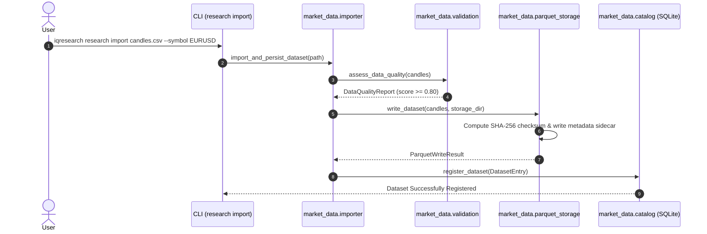
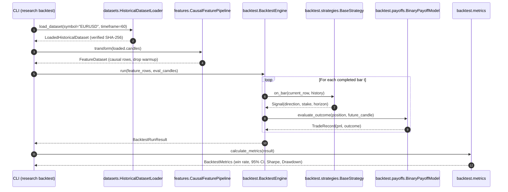
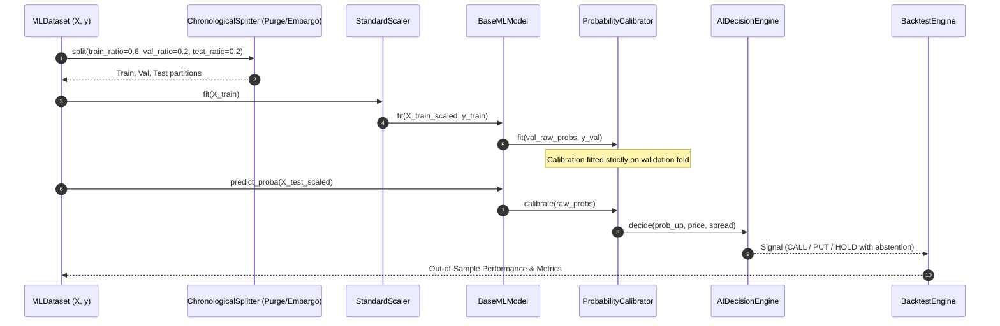

# System Architecture — Phases 1–3 Foundation & Phase 4 Machine Learning

## 1. System Overview

The `iqoption-research` project is a strictly typed, offline-first quantitative market research and machine learning platform. It encompasses:
1. **Phases 1–2**: Secure, read-only connectivity framework for unofficial IQ Option WebSocket feeds, practice account discovery, data validation, and fail-safe security guards.
2. **Phase 3**: Historical market data cataloging (SQLite), partitioned Parquet columnar storage, causal technical feature extraction (zero look-ahead bias), chronological train/val/test splitting (with purging and embargo), and event-driven offline backtesting with binary and Forex payoff models.
3. **Phase 4 (Implemented)**: Directional forecasting ML models, validation-only probability calibration, uncertainty abstention gates, chronological walk-forward evaluation, ensembles, local experiment tracking, tamper-evident artifacts, conservative evidence classification, and provider-neutral research assistance.

```
+─────────────────────────────────────────────────────────────────────────────+
|                         CLI & Applications (Typer)                          |
|   simulate | security-check | validate-data | probe | research | ml            |
+──────────────────────────────────────┬──────────────────────────────────────+
                                       │
        ┌──────────────────────────────┴──────────────────────────────┐
        ▼                                                             ▼
+──────────────────────────────────────+    +─────────────────────────────────+
|   Phase 1-2: Connectivity & Probe    |    |  Phase 3-4: Research & ML Engine|
| - Read-Only Facade (AsyncIQOption)   |    | - DatasetCatalog (SQLite)       |
| - Strict TLS Context & Allowlist     |    | - ParquetStorage (Partitioned)  |
| - ws_client (Frames, Backoff, Ping)  |    | - CausalFeaturePipeline (14+ fts|
| - Credentials & Redaction Logging    |    | - ChronologicalSplitter (Purge) |
| - assert_read_only() Guard           |    | - BacktestEngine & Payoff Models|
+──────────────────────────────────────+    | - BaseMLModel Zoo (P4)          |
                                            | - ProbabilityCalibrator (P4)    |
                                            | - AIDecisionEngine (P4)         |
                                            | - WalkForwardEngine (P4)        |
                                            | - ExperimentTracker (P4)        |
                                            +─────────────────────────────────+
```

---

## 2. Package Architecture

The codebase is organized into modular packages under `src/iqoption_research/`:

### 2.1. Connectivity & Security (Phases 1–2)
- **`connectors/`**:
  - `base.py`: Defines `ReadOnlyBrokerConnector` protocol (contains zero order placement methods).
  - `simulation.py`: Deterministic offline connector (`SimulatedReadOnlyConnector`) for zero-network testing.
  - `iqoption/client.py`: Top-level read-only facade (`AsyncIQOption`) enforcing `assert_read_only()`.
  - `iqoption/http_auth.py`: Asynchronous HTTPS login and logout via `aiohttp` with strict TLS.
  - `iqoption/ws_client.py`: Low-level WebSocket client managing frame dispatch, heartbeat, and bounded retries.
  - `iqoption/protocol.py`: Wire-protocol frame serialization and parsing.
  - `iqoption/exceptions.py`: Typed hierarchy of sanitized, safe connector exceptions.
- **`security/`**:
  - `tls.py`: Strict SSLContext factory requiring `certifi` CA verification, hostname matching, and TLS 1.2+.
  - `endpoints.py`: Allowlisted IQ Option endpoints validation (`auth.iqoption.com`, `wss://iqoption.com/echo/websocket`).
  - `credentials.py`: Secure interactive credential handling (`getpass`), partial email masking, recursive secret redaction.
  - `logging.py`: Structured logging configured with `SecretRedactingFilter` and `SanitizedFormatter`.
- **`models/`**:
  - `account.py`: `Profile`, `Balance`, `AccountType`, `AccountStatus`, and `PracticeVerification`.
  - `market.py`: `Candle`, `CandleSize`, `PriceTick`.
  - `connection.py`: `ConnectionState`, `ConnectionConfig`, `DisconnectReason`, `ConnectionHealth`.
- **`monitoring/`**:
  - `status.py`: Monotonic state transition state machine.
  - `health.py`: Liveness and readiness diagnostic checks.
  - `metrics.py`: Latency tracking with percentile statistics (P95, median, mean).

### 2.2. Historical Data & Storage (Phase 3)
- **`market_data/`**:
  - `catalog.py`: `DatasetCatalog` providing ACID SQLite tracking of datasets, schemas, and SHA-256 checksums in `data/catalog.db`.
  - `parquet_storage.py`: `ParquetStorageEngine` providing partitioned columnar storage under `data/market_data/`, atomic staging, and tamper detection.
  - `importer.py`: `import_and_persist_dataset()` orchestrating CSV/Parquet parsing, quality assessment, and atomic catalog persistence.
  - `candles.py`: Candle models, OHLC bounds validation (`min <= min(open, close) <= max(open, close) <= max`), timestamp normalization to UTC seconds and nanoseconds.
  - `validation.py`: Data-quality assessment assessing gaps, duplicate timestamps, out-of-order events, clock drift, and staleness.
  - `sufficiency.py`: Verifies minimum candle counts and contiguous data thresholds for statistical research.
  - `sessions.py`: Market session detection and OTC quote separation.
  - `symbols.py`: Instrument registry mapping currency pairs (`EURUSD` / `active_id=1`).

### 2.3. Research & Backtesting Subsystems (Phase 3)
- **`research/`**:
  - **`datasets/`**:
    - `loader.py`: `HistoricalDatasetLoader` for cryptographic Parquet verification and loading.
    - `splitter.py`: `ChronologicalSplitter` implementing chronological Train/Val/Test partitioning with configurable label horizon purging and boundary embargo buffers.
    - `integrity.py`: Point-in-time record verification and lookahead bias detection (`validate_point_in_time_record`).
  - **`features/`**:
    - `pipeline.py`: `CausalFeaturePipeline` computing 14+ technical features (returns, log returns, EWMA, volatility, RSI, momentum, Bollinger Bands, spread) using strictly past completed bars ($t' \le t$).
    - `scalers.py`: `StandardScaler` implementing leak-free feature standardization; parameters $(\mu, \sigma)$ fit strictly on training folds and frozen for inference.
  - **`backtest/`**:
    - `engine.py`: Event-driven `BacktestEngine` simulating portfolio capital, position management, and trade execution.
    - `payoffs.py`: `BasePayoffModel`, `BinaryPayoffModel` (fixed payout rate and strike resolution), and `ForexPayoffModel` (pips, spread, slippage, commission).
    - `metrics.py`: `BacktestMetrics` calculation: total trades, win rate with 95% Wilson score confidence intervals, profit factor, Sharpe ratio, max drawdown, and sample size warnings.
    - `reports.py`: `ResearchReport` generation and JSON export.
    - `strategies/`: `BaseStrategy` abstract protocol, `AlwaysCallStrategy`, `AlwaysPutStrategy`, `NoTradeStrategy`, `MomentumStrategy`, `MovingAverageCrossoverStrategy`, `RandomStrategy`.

### 2.4. CLI Architecture & Module Roles
- **`cli/`**:
  - `main.py`: Top-level Typer CLI entrypoint (`iqresearch`).
  - `commands/security_check.py`: **Audit Engine Module** — implements the core security check functions (`run_security_checks()`, `CheckResult`, `check_tls_context`, `check_endpoint_allowlist`, `check_no_insecure_tls_patterns`, `check_read_only_posture`, `check_dependency_pinning`, `check_no_credential_settings`, `check_offline_default`).
  - `commands/security_check_cmd.py`: **CLI Command Binding** — implements `security_check_command()` with Typer options (e.g., `--json`) and delegates execution to `run_security_checks()` in `security_check.py`.
  - `commands/research_cmd.py`: Phase 3 research commands (`iqresearch research import`, `list`, `backtest`, `demo`).
  - `commands/ml_cmd.py`: Phase 4 commands (`iqresearch ml prepare`, `train`, `evaluate`, `walk-forward`, `compare`, `backtest`, `list`, `inspect`, `report`, `demo`).
  - `commands/simulate.py`: Phase 1 offline connection simulation.
  - `commands/validate_data.py`: Phase 1 candle validation tool.
  - `commands/probe.py`: Phase 1 live read-only diagnostic probe (requires `--live`).

### 2.5. Machine Learning Architecture (Phase 4, Implemented)
- **`ml/`** (under `src/iqoption_research/ml/`):
  - `fixtures.py`: Deterministic synthetic candle fixtures with optional planted AR(1) momentum, used only to exercise the pipeline (never as market evidence).
  - `pipeline.py`: End-to-end orchestration — model factory registry, prepared-dataset persistence and fingerprint binding, holdout training, bundle save/load/evaluation, walk-forward and comparison wrappers, and holdout-window payoff backtests.
  - `reporting.py`: Conservative `EdgeVerdict` classification (`SYNTHETIC_ENGINEERING_ONLY`, `INSUFFICIENT_OUT_OF_SAMPLE_DATA`, `NO_RELIABLE_EDGE_DETECTED`, `CANDIDATE_EDGE_REQUIRES_REPLICATION`) and Markdown report rendering.
  - `targets/`: Directional binary targets ($y_t \in \{0, 1\}$), continuous percentage returns, multi-horizon masking, and causality checks.
  - `models/`: `BaseMLModel` common interface; baselines (MajorityClass, SeededRandom, Logistic, Rule); tabular models (RandomForest, HistGradientBoosting); optional dynamic GBDT adapters.
  - `calibration/`: `ProbabilityCalibrator` (Platt/sigmoid, isotonic) fitted strictly on validation folds; calibration metrics and uncertainty-based abstention.
  - `evaluation/`: holdout runner, walk-forward evaluation (expanding/rolling windows, label purging, embargo), and comparative benchmark suite with paired statistical tests.
  - `decision/`: `AIDecisionEngine` translating calibrated probabilities into causal signals (`CALL` / `PUT` / `HOLD`) with payoff-aware abstention; `MLStrategy` adapter for the Phase 3 engine.
  - `ensembles/`: Averaging, weighted (inverse Brier score), and stacking meta-models.
  - `hybrid/`: `BaseLLMProvider`, deterministic offline `MockGPTProvider`, and optional `OpenAIAssistant` (fail-closed, disabled by default, no trading authority).
  - `tracking/`: `ExperimentTracker` (local SQLite) plus `artifacts.py` (SHA-256 manifests, tamper detection, path-traversal resistance, and safe bundle persistence).

---

## 3. Key Architectural Sequences

### 3.1. Phase 3 Historical Ingestion & Cataloging


### 3.2. Phase 3 Causal Feature Engineering & Offline Backtesting


### 3.3. Phase 4 Machine Learning Pipeline


---

## 4. Strict Offline Safety Guarantees & Non-Negotiable Limits

1. **Zero Order Execution Capability**: The repository contains no trading APIs, order execution clients, or broker placement routes. All strategies and decision models interact solely with offline backtesting simulation engines.
2. **Read-Only Facade Guard**: The live client (`AsyncIQOption`) enforces `assert_read_only()`, raising an exception upon instantiation if any forbidden methods (`buy`, `sell`, `open_option`) are detected.
3. **Network Isolation**: All research, feature generation, ML model training, and backtesting operations are strictly prohibited from opening network sockets.
4. **Execution Realism Disclaimers**: Simulated returns and win rates do not reflect actual market execution, liquidity constraints, broker reject rates, slippage spikes, or payout changes. All backtests are research artifacts.
5. **Conservative Evidence Classification**: Synthetic fixtures always yield `SYNTHETIC_ENGINEERING_ONLY`. Authentic results require >= 200 untouched out-of-sample observations, one-sided binomial p < 0.05 vs chance, ROC-AUC >= 0.55, and Brier score no more than 0.02 worse than the base-rate baseline before the highest label, `CANDIDATE_EDGE_REQUIRES_REPLICATION`. No label constitutes a profitability claim.
6. **Tamper-Evident Artifacts & Fingerprint Binding**: Prepared datasets and bundles carry SHA-256 manifests verified before load. Bundles are bound to a dataset fingerprint and refuse evaluation/backtesting against foreign data.
