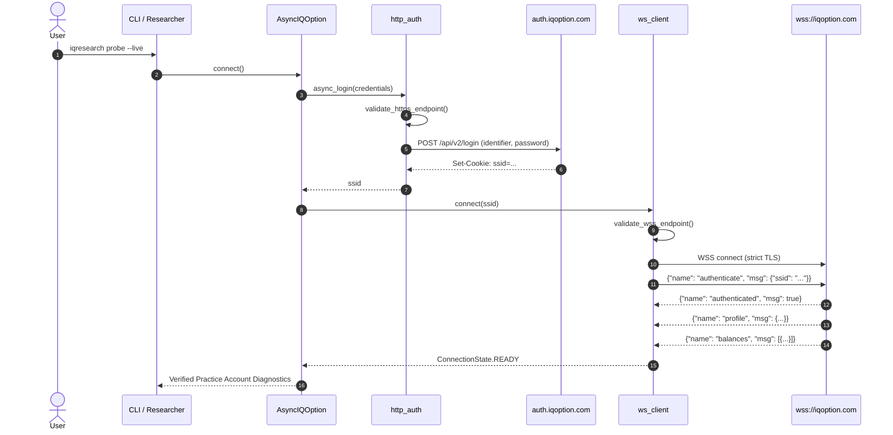
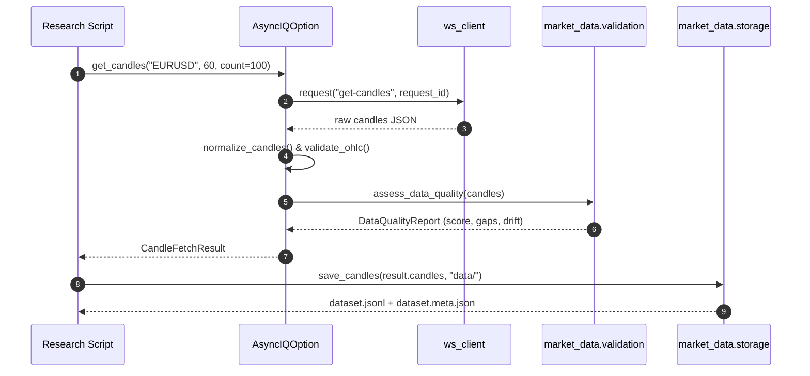

# System Architecture — Phase 1

## 1. System Overview

The `iqoption-research` project is an asynchronous, strictly typed, read-only connectivity framework for quantitative market research. It connects to IQ Option's unofficial WebSocket interface to retrieve historical and real-time candle data, discover practice account balances, and monitor network health without exposing any trading operations.

```
                           +------------------------------------------+
                           |             CLI & Applications          |
                           |  simulate | security-check | validate   |
                           +--------------------+---------------------+
                                                |
                                                v
                           +------------------------------------------+
                           |       AsyncIQOption (Read-Only Facade)  |
                           |   get_account_status() | get_candles()  |
                           |      stream_candles() | assert_read_only|
                           +---------+----------------------+---------+
                                     |                      |
            +------------------------+                      +------------------------+
            v                                                                        v
+-------------------------------+                                        +-------------------------------+
|     Security & Transport      |                                        |    Market Data Engine         |
|  - TLS context (strict)       |                                        |  - OHLC validation            |
|  - Endpoint allowlisting      |                                        |  - UTC normalization          |
|  - getpass Credentials        |                                        |  - Gaps & duplicate detector  |
|  - Sanitized logging filters  |                                        |  - Provenance storage (.jsonl)|
+---------------+---------------+                                        +---------------+---------------+
                |                                                                        |
                v                                                                        v
+-------------------------------+                                        +-------------------------------+
| IQOptionWebSocketClient       |                                        | Models & Monitoring           |
|  - Frame encode/decode        |                                        |  - Account & Balance models   |
|  - Request-response futures   |                                        |  - PracticeVerification       |
|  - Heartbeat & backoff loop   |                                        |  - ConnectionMonitor          |
+-------------------------------+                                        +-------------------------------+
```

---

## 2. Package Architecture

The codebase is organized into modular packages under `src/iqoption_research/`:

- **`connectors/`**:
  - `base.py`: Defines the `ReadOnlyBrokerConnector` abstract protocol. Contains zero order placement methods.
  - `simulation.py`: Deterministic offline connector (`SimulatedReadOnlyConnector`) for zero-network testing and candle generation.
  - `iqoption/client.py`: Top-level read-only facade (`AsyncIQOption`). Enforces the `assert_read_only()` guard.
  - `iqoption/http_auth.py`: Asynchronous HTTPS login and logout via `aiohttp` with strict TLS.
  - `iqoption/ws_client.py`: Low-level WebSocket client managing frame dispatch, heartbeat, and bounded retries.
  - `iqoption/protocol.py`: Pure wire-protocol frame serialization and parsing. Free of any I/O side effects.
  - `iqoption/exceptions.py`: Typed hierarchy of sanitized, safe-to-display connector errors.
- **`security/`**:
  - `tls.py`: Strict SSLContext factory requiring `certifi` CA verification, hostname matching, and TLS 1.2+.
  - `endpoints.py`: Allowlisted IQ Option endpoints validation (`auth.iqoption.com`, `wss://iqoption.com/echo/websocket`).
  - `credentials.py`: Secure interactive credential handling (`getpass`), partial email masking, recursive dictionary secret redaction.
  - `logging.py`: Structured logging configured with `SecretRedactingFilter` and `SanitizedFormatter`.
- **`market_data/`**:
  - `symbols.py`: Instrument registry mapping currency pairs (focus: `EURUSD` / `active_id=1`).
  - `candles.py`: Candle models, OHLC bounds validation (`min <= min(open, close) <= max(open, close) <= max`), timestamp normalization to UTC seconds and nanoseconds.
  - `validation.py`: Data-quality assessment assessing gaps, duplicate timestamps, out-of-order events, clock drift, and staleness.
  - `storage.py`: Sanitized JSONL / CSV persistence with metadata sidecars recording provenance and research disclaimers.
- **`models/`**:
  - `account.py`: `Profile`, `Balance`, `AccountType`, `AccountStatus`, and `PracticeVerification`.
  - `market.py`: `Candle`, `CandleSize`, `PriceTick`.
  - `connection.py`: `ConnectionState`, `ConnectionConfig`, `DisconnectReason`, `ConnectionHealth`.
- **`monitoring/`**:
  - `status.py`: State transition state machine with monotonic timing.
  - `health.py`: Liveness and readiness diagnostic checks.
  - `metrics.py`: Latency tracking with percentile statistics (P95, median, mean).
- **`cli/`**:
  - `main.py`: Typer CLI entrypoint (`iqresearch`).
  - `commands/simulate.py`: Runs full connection simulation completely offline.
  - `commands/security_check.py`: Runs automated checks on TLS, endpoints, credentials, and dependency pinning.
  - `commands/validate_data.py`: Validates candle datasets or generates synthetic candles for research validation.
  - `commands/probe.py`: Real read-only connection diagnostic tool (requires explicit `--live` flag and user confirmation).

---

## 3. Key Architectural Sequences

### 3.1. Authentication & WebSocket Handshake


### 3.2. Market Data Ingestion & Quality Assessment


---

## 4. Design Readiness for Future Execution Adapters

While Phase 1 strictly forbids trading operations, the design accommodates future Phase 2 execution adapters without compromising security:
1. `ReadOnlyBrokerConnector` is a formal Python `Protocol`. Future order routing modules will implement a separate, isolated interface (`OrderExecutionAdapter`).
2. The credential container and connection lifecycle can be shared via dependency injection, but order operations will live in a separate subpackage with independent authorization controls and test suites.
3. The read-only guard (`assert_read_only()`) ensures that any accidental pollution of the research client with order functions will immediately halt execution during initialization.
