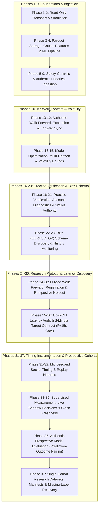

# IQ Option AI Trading Research System (Phases 1–38)

Quantitative market research, authentic historical data cataloging, causal feature engineering, offline backtesting, microsecond timing instrumentation, and offline machine-learning research platform. The system spans Phases 1 through 38, progressing from foundational read-only WebSocket transport and checksum-backed Parquet storage to microsecond application socket timing, multi-session live shadow observation, authentic prospective model evaluation, single-cohort research dataset construction, bounded missing-label recovery planning, and operator-supervised prospective evidence pilot workflows.

> [!WARNING]
> **UNOFFICIAL BROKER INTERFACE**: This research tooling interacts with an unofficial, reverse-engineered WebSocket interface (`wss://iqoption.com/echo/websocket`). Its compatibility, platform authorization, and terms of service compliance have not been established by IQ Option.

> [!IMPORTANT]
> **STRICT OFFLINE RESEARCH & ZERO-ORDER POSTURE**:
> - **Execution Authority**: Strictly **`NONE`**. The system contains **zero trade placement, order execution, or account modification capabilities**.
> - **Scientific Disposition**: Strictly **`NO_DEMONSTRATED_EDGE`**. No real-market predictive edge or statistical profitability has been established.
> - **Offline Default**: All research, feature computation, model training, backtesting, and evaluation operate **100% offline** on local historical data or deterministic synthetic fixtures.
> - **Live Probes Restricted**: Physical broker interaction is restricted to optional, manually authorized read-only connection diagnostics (`--live`), bounded timing measurement sessions, and passive shadow observation trials.

> [!NOTE]
> **PROVENANCE & TAMPER-EVIDENCE BOUNDARIES**:
> - **Provenance Trust Boundary**: The system strictly enforces the Anti-Manufacturing Invariant. No component may manufacture evidence that data was broker-authentic or that outcomes were available at a specific timestamp.
> - **Unkeyed Digest Limitation**: Canonical SHA-256 digests and integrity manifests provide tamper-evidence against accidental corruption and unauthorized modification, but do not provide third-party non-repudiation or cryptographic signatures.

---

## 1. System Baseline & Verification Status

| Dimension | Current Verification Status |
|---|---|
| **Operating System** | Windows (PowerShell tested; cross-platform compatible) |
| **Python Version** | Python `>= 3.12` (verified on Python 3.12.10) |
| **Test Suite** | **2,266 passed tests** (`pytest`, 100% pass rate, 0 failures, 0 skips locally; 1 skipped on clean CI runners lacking authentic Parquet files) |
| **Type Checking** | **Clean MyPy verification across 351 source files** (`mypy src tests`) |
| **Linting & Code Style** | **Clean Ruff compliance** with zero linting errors (`ruff check src tests`) |
| **Security Audit** | **7/7 automated offline security checks passed** (`iqresearch security-check`) |
| **Scientific Disposition** | **`NO_DEMONSTRATED_EDGE`** across all walk-forward and prospective evaluations |
| **Execution Authority** | **`NONE`** (zero real or practice orders authorized or emitted) |
| **Authentic Coverage** | **66,458 unique EURUSD 1m candles** across **65.49 calendar days** (2026-09-15 to 2026-11-19) |
| **Market Integrity** | 9 scheduled market closures; 0 unexpected open-market gaps |
| **Target Instruments** | EUR/USD (`active_id=1`, Forex & OTC); passive schema diagnostics on Blitz (`EURUSD_OP`) |

---

## 2. Quick Start (Windows PowerShell & Cross-Platform)

Open PowerShell or terminal in the repository root directory:

### 2.1. Environment Setup & Dependency Installation
Dependencies are declared in `pyproject.toml` and pinned in `requirements.txt`:
```powershell
# Create and activate virtual environment
python -m venv .venv
.venv\Scripts\Activate.ps1

# Install core runtime and development dependencies
pip install -r requirements.txt
pip install -e .[dev]
```

### 2.2. Static Analysis & Linting
Ensure full compliance with Ruff linting rules and MyPy strict typing:
```powershell
# Run Ruff linting
ruff check src/ tests/

# Run MyPy strict type checker across all source and test modules
mypy src/ tests/
```

### 2.3. Run Automated Offline Test Suite
All 2,266 automated tests execute 100% offline using deterministic mocks, synthetic fixtures, and offline data loaders:
```powershell
# Run the complete test suite
pytest -v

# Run targeted unit tests
pytest tests/unit/ -v

# Run targeted integration tests
pytest tests/integration/ -v
```

### 2.4. Offline Security Audit
Verify TLS policies, endpoint allowlists, read-only guards, credential hygiene, and pinned dependencies:
```powershell
python -m iqoption_research.cli.main security-check
```

### 2.5. Run End-to-End Research Demonstrations
```powershell
# Run Phase 3 end-to-end pipeline demo (CSV import -> audit -> Parquet -> SQLite catalog -> backtest):
python -m iqoption_research.cli.main research demo

# Run Phase 4 ML engineering demo (causal features -> train/val calibration -> holdout -> walk-forward):
python -m iqoption_research.cli.main ml demo
```
> [!NOTE]
> Both demonstrations run on deterministic synthetic fixtures to validate software engineering and causal isolation. They do **not** demonstrate market edge.

---

## 3. Architecture & Evolutionary Roadmap (Phases 1–37)

The project follows a rigorous, phased engineering methodology:



### Phase Summary Breakdown

- **Phases 1–2: Secure Transport & Offline Simulation**
  - Fail-closed read-only guard (`AsyncIQOption.assert_read_only()`) preventing order execution methods.
  - Strict TLS 1.2+ CA bundle enforcement (`certifi`), certificate verification, and hostname checking.
  - Hardcoded endpoint allowlist (`auth.iqoption.com`, `iqoption.com/echo/websocket`).
  - Offline simulated connector for deterministic end-to-end testing without network access.
- **Phases 3–4: Research Storage, Causal Features & Offline ML Pipeline**
  - Partitioned Parquet candle storage and SQLite metadata catalog (`catalog.db`) with SHA-256 sidecars.
  - 13 strictly stationary causal technical features computed without lookahead bias ($t' \le t$).
  - Train-only feature scaling and validation-only Platt calibration; untouched test holdouts.
  - Chronological purged and embargoed walk-forward cross-validation.
  - Tamper-evident SHA-256 model bundle manifests.
- **Phases 5–9: Safety Architecture, Account Isolation & Historical Ingestion**
  - Paper trading engine, risk controllers, and account safety state machines.
  - Live streaming candle parity checks and connection lifecycle recovery.
  - Paginated historical collection with interactive-only `getpass` authentication and request rate budgeting.
- **Phases 10–12: Authentic Walk-Forward, Historical Expansion & Incremental Forward Sync**
  - Checksum-verified authentic walk-forward backtesting with transaction cost simulations.
  - Bounded backward backfilling and durable coverage audits.
  - Manual, checkpointed incremental forward collection from newest authentic candle.
- **Phases 13–15: Research Optimization & Multi-Horizon Volatility Bounds**
  - Research optimization, feature selection, and candidate Random Forest models (`candidate_h1_rf`).
  - Multi-horizon volatility modeling, causal ATR14, and Wilson score confidence intervals.
- **Phases 16–23: Practice Verification, History Monitoring & Blitz Diagnostics**
  - Read-only practice account diagnostics (`practice-watch`), balance routing verification, and order-free safety.
  - Active wallet authority validation ensuring Practice balance isolation.
  - Blitz (`EURUSD_OP`) passive schema exploration reporting `LIVE_SCHEMA_UNVERIFIED`.
- **Phases 24–30: Purged Benchmarks, Target Contracts & Latency Discovery**
  - Reproducible offline authentic-data coverage, strategy benchmarks, and purged walk-forward ML comparisons.
  - Common comparison clock, derived timeframes, and prospective experiment registration.
  - Forensic discovery that cold-CLI invocations impose a ~15-second latency floor.
  - Preregistered target contract: feature close $F \to$ assumed entry $F+120\text{s} \to$ assumed expiry $F+180\text{s}$ with a strict 15-second decision deadline ($F \le t_{\text{decision}} \le F+15\text{s}$).
- **Phases 31–32: Microsecond Timing Instrumentation & Offline Replay**
  - Microsecond application socket timestamping ($t_{\text{app\_socket\_recv}}$ via `time.perf_counter_ns()`).
  - Offline timing replay harness verifying 10 deterministic failure and edge conditions.
  - Bounded operator-supervised measurement protocol specification.
- **Phases 33–35: Live Measurement Baseline, Shadow Decisions & Clock Freshness**
  - Operator-supervised live measurement session confirming sub-second frame receipt ($320\text{--}541\text{ ms}$).
  - Live shadow decision pipeline (features $\to$ inference $\to$ risk $\to$ policy $\to$ append-only SQLite journal commit).
  - Multi-session live acquisition reliability evaluator (`timing reliability`).
  - Broker clock freshness, NTP synchronization, and drift tracking (`Phase 35`).
- **Phases 36–37: Authentic Prospective Model Evaluation & Single-Cohort Research Datasets**
  - Strictly offline causal pairing of shadow predictions with authentic candle outcomes.
  - Enforced Provenance Trust Boundary (Anti-Manufacturing Invariant: no synthetic broker tags).
  - Single-cohort compatibility enforcement, collision-free canonical source tracking, and transactional bundle publication.
  - Offline bounded missing-label recovery planner grouping contiguous unlabelled candle windows.

---

## 4. Comprehensive CLI Command Reference (`iqresearch`)

The CLI interface is accessible via `iqresearch` (or `python -m iqoption_research.cli.main`). All commands default to strictly offline execution.

### 4.1. Core Diagnostic & Transport Commands

#### Offline Security Audit
Inspects TLS policies, endpoint allowlists, absence of insecure patterns (`verify=False`, `CERT_NONE`), read-only posture, and dependency pinning:
```powershell
python -m iqoption_research.cli.main security-check
python -m iqoption_research.cli.main security-check --json
```

#### Offline Connection Simulation
Runs read-only connection, account discovery, and candle retrieval against a synthetic offline connector:
```powershell
python -m iqoption_research.cli.main simulate --count 50
python -m iqoption_research.cli.main simulate --count 100 --save --output-dir data/simulated
```

#### Offline Market-Data Quality Validation
Assesses candle structure, OHLC ordering, timestamps, gaps, duplicates, and clock drift:
```powershell
python -m iqoption_research.cli.main validate-data --simulate --count 100
python -m iqoption_research.cli.main validate-data --file data/simulated/EURUSD_60s_20261106.jsonl
```

#### Explicit Read-Only Live Probe
> [!CAUTION]
> The live probe requires the explicit `--live` flag and an interactive confirmation prompt. It **never** executes automatically or places trades.
```powershell
python -m iqoption_research.cli.main probe --live --symbol EURUSD --size 60 --count 10
```

#### Wallet Diagnostics (Phase 33)
Inspects active balance inventory and validates practice wallet isolation:
```powershell
python -m iqoption_research.cli.main wallet --live
```

---

### 4.2. Practice & Execution Diagnostics (Phases 16–23)

Read-only practice account observation, history reconciliation, and diagnostics. No broker orders are emitted:
```powershell
# Run read-only practice account diagnostics
python -m iqoption_research.cli.main practice-diagnostics --live

# Select practice balance for the current session
python -m iqoption_research.cli.main practice-select --live

# Supervised verification of a single practice order (operator-supervised)
python -m iqoption_research.cli.main practice-test --live

# Passively observe manual practice transactions in official IQ Option UI
python -m iqoption_research.cli.main practice-observe --live --seconds 120

# Read-only classic option history reconciliation
python -m iqoption_research.cli.main practice-history --live --limit 100

# Watch practice activity and reconcile history read-only
python -m iqoption_research.cli.main practice-watch --live --asset EURUSD --seconds 120 --history-limit 100
```

---

### 4.3. Research Subsystem (`iqresearch research`)

Historical dataset import, catalog queries, and offline backtesting:
```powershell
# Import CSV candles into partitioned Parquet storage and index in catalog.db
python -m iqoption_research.cli.main research import path/to/candles.csv --symbol EURUSD --timeframe 60

# List cataloged datasets
python -m iqoption_research.cli.main research list --catalog-db data/datasets/catalog.db

# Offline backtest of Momentum strategy with binary options payoff (85% payout)
python -m iqoption_research.cli.main research backtest --symbol EURUSD --timeframe 60 --strategy momentum --payoff binary --payout-rate 0.85

# Offline backtest of MA Crossover strategy with Forex spread/slippage model
python -m iqoption_research.cli.main research backtest --symbol EURUSD --timeframe 60 --strategy ma_crossover --payoff forex --export-json data/report.json

# Run bundled end-to-end research demo
python -m iqoption_research.cli.main research demo
```

---

### 4.4. Machine Learning Subsystem (`iqresearch ml`)

All ML commands operate 100% offline. Artifacts are cryptographically SHA-256 manifested:
```powershell
# Prepare a causal dataset (synthetic fixture by default)
python -m iqoption_research.cli.main ml prepare --output data/ml/prepared --symbol EURUSD --timeframe 60 --n-bars 1400

# Prepare authentic local data (labels provenance, downloads nothing)
python -m iqoption_research.cli.main ml prepare --csv data/authentic/EURUSD_60s.csv --authentic --symbol EURUSD --timeframe 60

# Train calibrated model bundle (train-only scaling, val-only Platt calibration)
python -m iqoption_research.cli.main ml train --prepared data/ml/prepared --model logistic_regression --calibrator platt

# Evaluate model bundle on untouched holdout split
python -m iqoption_research.cli.main ml evaluate --prepared data/ml/prepared --bundle data/ml/bundle

# Chronological purged/embargoed walk-forward evaluation
python -m iqoption_research.cli.main ml walk-forward --prepared data/ml/prepared --folds 4 --model logistic_regression

# Benchmark multiple models under identical settings
python -m iqoption_research.cli.main ml compare --prepared data/ml/prepared --models majority_class,seeded_random,logistic_regression,random_forest,hist_gradient_boosting

# Simulated binary payoff backtest through Phase 3 engine
python -m iqoption_research.cli.main ml backtest --prepared data/ml/prepared --bundle data/ml/bundle --payoff binary --payout-rate 0.85

# Experiment inspection and markdown report rendering
python -m iqoption_research.cli.main ml list
python -m iqoption_research.cli.main ml inspect --bundle data/ml/bundle
python -m iqoption_research.cli.main ml report --run-id <RUN_ID>

# Phase 10 authentic walk-forward evaluation
python -m iqoption_research.cli.main ml phase10 --storage data/datasets --folds 4 --confidence 0.55 --spread-pips 1.0 --slippage-pips 0.1

# Phase 11 historical expansion development evaluation
python -m iqoption_research.cli.main ml phase11 --storage data/datasets --target-days 90 --confirmation-days 14
```

---

### 4.5. Authentic Historical Data Management (`iqresearch data`)

Durable coverage audits, backward historical backfilling, and incremental forward synchronization:
```powershell
# Audit authentic dataset coverage, calculate gaps and backward expansion targets
python -m iqoption_research.cli.main data coverage-audit --output-dir data/datasets --target-days 90

# Generate bounded backward expansion plan (no broker connection)
python -m iqoption_research.cli.main data backfill-plan --output-dir data/datasets --target-days 90 --max-new-candles 150000

# Check status of historical backfill job
python -m iqoption_research.cli.main data backfill-status --job-id eurusd-history-120d-001 --output-dir data/datasets

# Resume an interrupted backfill job
python -m iqoption_research.cli.main data backfill-resume --job-id eurusd-history-120d-001 --output-dir data/datasets --live --yes-i-understand

# Plan incremental forward synchronization (no broker connection)
python -m iqoption_research.cli.main data forward-plan --symbol EURUSD --size 60 --page-size 500 --max-requests 20 --output-dir data/datasets

# Manually synchronize missing newer completed candles
python -m iqoption_research.cli.main data forward-sync --job-id eurusd-forward-1m --symbol EURUSD --size 60 --page-size 500 --max-requests 20 --output-dir data/datasets --live --yes-i-understand
```

---

### 4.6. Timing Instrumentation & Diagnostics (`iqresearch timing`)

High-resolution timing diagnostics, forensic reconstructions, feasibility audits, and prospective evaluations (Phases 31–37):
```powershell
# Forensic timing reconstruction across historical checkpoints and journals
python -m iqoption_research.cli.main timing audit

# Assess acquisition latency floor and Phase 30 15-second gate feasibility
python -m iqoption_research.cli.main timing feasibility

# Multi-horizon decision window and volatility scaling analysis
python -m iqoption_research.cli.main timing horizons

# Passive Blitz market evidence and option schema audit
python -m iqoption_research.cli.main timing blitz

# Display supervised operator measurement protocol specification
python -m iqoption_research.cli.main timing protocol

# Trace full 10-stage data collection and inference pipeline latency
python -m iqoption_research.cli.main timing pipeline-audit

# Deterministic offline replay harness across 10 failure/edge scenarios
python -m iqoption_research.cli.main timing replay

# Bounded operator-supervised real-time timing measurement session
python -m iqoption_research.cli.main timing measure --live --yes-i-understand --max-candles 5 --max-duration 300

# Cryptographically verify evidence registry SHA-256 integrity
python -m iqoption_research.cli.main timing verify-evidence path/to/timing_evidence_*.json

# Evaluate multi-session authentic acquisition reliability
python -m iqoption_research.cli.main timing reliability data/phase34/sessions/*.json

# Execute a bounded live shadow observation trial
python -m iqoption_research.cli.main timing shadow-trial --live --yes-i-understand --max-cycles 5

# Offline prospective evaluation pairing predictions with authentic candle outcomes (Phase 36)
python -m iqoption_research.cli.main timing evaluate-predictions \
    --evidence data/phase35/timing_evidence_meas_shadow_20261119_163836.json \
    --journal data/phase35/observations.db \
    --storage data/datasets \
    --output data/phase36/evaluation_report.json

# Offline single-cohort research dataset builder and evaluator (Phase 37)
python -m iqoption_research.cli.main timing evaluate-cohort \
    --evidence data/phase35/timing_evidence_meas_shadow_20261119_163836.json \
    --journal data/phase35/observations.db \
    --storage data/datasets \
    --output-dir data/phase37/cohort_run_001

# Plan contiguous missing candle recovery windows (Phase 37)
python -m iqoption_research.cli.main timing plan-missing-labels \
    --evidence data/phase35/timing_evidence_meas_shadow_20261119_163836.json \
    --journal data/phase35/observations.db \
    --storage data/datasets \
    --output data/phase37/missing_labels_plan.json
```

---

### 4.7. Prospective Subsystem (`iqresearch prospective`)

Convenience aliases and runners for frozen prospective research:
```powershell
# Initialize frozen prospective observation run
python -m iqoption_research.cli.main prospective init --run data/phase28/prospective-001

# Record prediction before outcome boundary
python -m iqoption_research.cli.main prospective record --run data/phase28/prospective-001

# Resolve delayed candle outcomes after expiry
python -m iqoption_research.cli.main prospective resolve --run data/phase28/prospective-001

# Export sealed prospective evaluation report
python -m iqoption_research.cli.main prospective report --run data/phase28/prospective-001

# Evaluate prospective predictions (alias for timing evaluate-predictions)
python -m iqoption_research.cli.main prospective evaluate-predictions --evidence data/phase35/evidence.json

# Evaluate cohort research dataset (alias for timing evaluate-cohort)
python -m iqoption_research.cli.main prospective evaluate-cohort --evidence data/phase35/evidence.json --output-dir data/phase37/cohort

# Plan missing candle recovery (alias for timing plan-missing-labels)
python -m iqoption_research.cli.main prospective plan-missing-labels --evidence data/phase35/evidence.json

# Initialize immutable prospective pilot study protocol (Phase 38)
python -m iqoption_research.cli.main prospective pilot-init --output data/phase38/pilot_study_spec.json

# Audit session discovery, deduplication, and label coverage status (Phase 38)
python -m iqoption_research.cli.main prospective pilot-status \
    --study data/phase38/pilot_study_spec.json \
    --evidence data/phase35/evidence.json \
    --storage data/datasets

# Publish immutable prospective research checkpoint bundle (Phase 38)
python -m iqoption_research.cli.main prospective pilot-checkpoint \
    --study data/phase38/pilot_study_spec.json \
    --evidence data/phase35/evidence.json \
    --storage data/datasets \
    --output-dir data/phase38/checkpoint_001

# Verify published pilot checkpoint bundle integrity (Phase 38)
python -m iqoption_research.cli.main prospective pilot-verify \
    --checkpoint-dir data/phase38/checkpoint_001 \
    --study data/phase38/pilot_study_spec.json
```

---

## 5. Core Safety, Security & Methodological Invariants

The platform enforces strict architectural invariants across all modules:

### 5.1. Strict Read-Only Fail-Closed Protection
- The transport layer invokes `AsyncIQOption.assert_read_only()` on startup.
- If any order placement methods (e.g. `buy`, `sell`, `order`, `close_position`) or balance modification attributes are present on client instances, initialization aborts immediately.
- Outbound WebSocket messages are validated against a strict message-type allowlist immediately prior to socket writes.

### 5.2. Strict Offline Default & Local Data Policy
- Network access is disabled by default across all research, ML, backtesting, and evaluation tools.
- Synthetic fixtures are permanently labelled `SYNTHETIC_ENGINEERING_ONLY` and cannot be promoted to edge verdicts.
- Live connectivity is gated behind explicit command-line flags (`--live`), safety disclaimers (`--yes-i-understand`), and interactive terminal confirmations.

### 5.3. Provenance Trust Boundary & Anti-Manufacturing Invariant
- **No Manufactured Provenance**: No function may manufacture evidence that data was broker-authentic or that an outcome was available at a given time.
- **Three-State Provenance Resolver**: Data is classified strictly as `SYNTHETIC`, `UNVERIFIED`, or `LOCAL_BROKER_COLLECTION_VERIFIED`.
- **Zero Raw Mutation**: Data loaders never mutate raw candle records to inject synthetic broker source tags.
- **Availability Timestamp Invariant**: `available_utc_ns` records the actual verified receipt timestamp from collection metadata. It is never synthesized from `to_ts`, `from_ts`, or filenames.

### 5.4. Causal Data Separation & Zero Lookahead Bias
- **Feature Partition**: Features rely exclusively on completed past bars ($t' \le t$).
- **Forward Label Partition**: Prediction targets evaluate strictly forward windows ($t+1$ to $t+H$).
- **Partition Freezing**: Scalers are fitted exclusively on training partitions; calibrators are fitted exclusively on validation partitions; holdouts remain strictly untouched.
- **Gap-Aware Processing**: Features and forward labels are prohibited from spanning data gaps or market closures.

### 5.5. Cryptographic Verification & Tamper-Evident Artifacts
- **Catalog Integrity**: Datasets registered in `catalog.db` store SHA-256 digests and file metadata verified against Parquet sidecars (`.meta.json`).
- **Manifest Verification**: Prepared datasets and trained ML bundles include canonical SHA-256 manifests (`manifest.json`) verified before loading.
- **Append-Only Journals**: Prospective observation events are committed to SQLite journals with canonical event hashes verified against session evidence registries.
- **Canonical Ordering**: All hash digests sort dictionary keys canonically (`sort_keys=True`) to ensure cross-platform determinism.

### 5.6. Strict TLS 1.2+ & Hardcoded Endpoint Allowlist
- HTTPS and WebSocket connections enforce certificate verification via the `certifi` CA bundle and strict hostname validation (`ssl.CERT_REQUIRED`, TLS 1.2 minimum).
- Insecure options (`verify=False`, `CERT_NONE`) are strictly forbidden across the codebase and audited via automated scanners.
- Network connections are restricted to hardcoded official endpoints:
  - `https://auth.iqoption.com/api/v2/login`
  - `https://auth.iqoption.com/api/v1.0/logout`
  - `wss://iqoption.com/echo/websocket`

### 5.7. Ephemeral Credential Hygiene
- Broker passwords are collected interactively via `getpass.getpass()`.
- Credentials are held in memory only for the duration of the authentication handshake and dropped immediately.
- Passwords and security tokens are never stored in settings files, environment variables, disk files, or log streams.

### 5.8. Statistical Rigor & Conservative Evidence Policy
- **No Edge Claim**: Zero profitability or real-world trading edge is claimed. All models operate under `NO_DEMONSTRATED_EDGE`.
- **Wilson Score Intervals**: Prospective hit rates are reported with Wilson score confidence intervals adjusted for effective sample size ($N_{\text{eff}}$) due to lag-1 serial autocorrelation.
- **Probabilistic Scoring**: Forecasts are scored using Brier scores, Brier Skill Scores (BSS relative to base rate), Log Loss, and Expected Calibration Error (ECE).
- **Statistical Gate**: Authentic runs require minimum sample sizes ($N \ge 200$), one-sided binomial $p < 0.05$ versus chance, ROC-AUC $\ge 0.55$, and Brier score beating base rate before qualifying for `CANDIDATE_EDGE_REQUIRES_REPLICATION`.

---

## 6. Documentation Directory & Artifact Index

The repository maintains comprehensive architectural specifications, security audits, runbooks, and phase completion reports:

| Document | Description |
|---|---|
| [docs/ARCHITECTURE.md](docs/ARCHITECTURE.md) | High-level system architecture, module topology, and Mermaid workflow diagrams |
| [docs/SECURITY_AUDIT.md](docs/SECURITY_AUDIT.md) | Threat model, vulnerability review, TLS policies, and security control catalog |
| [docs/LIMITATIONS.md](docs/LIMITATIONS.md) | Operational boundaries, reverse-engineered interface risks, and 2FA constraints |
| [docs/CONNECTION_RESEARCH.md](docs/CONNECTION_RESEARCH.md) | Comparative technical audit of public IQ Option repositories (`victalejo`, `iqair`, etc.) |
| [docs/TEST_RESULTS.md](docs/TEST_RESULTS.md) | Test suite verification methodology and pass criteria across all 46 test modules |
| [docs/PHASE10_AUTHENTIC_EVALUATION.md](docs/PHASE10_AUTHENTIC_EVALUATION.md) | Authentic historical walk-forward evaluation protocol and transaction cost model |
| [docs/PHASE11_HISTORICAL_EXPANSION.md](docs/PHASE11_HISTORICAL_EXPANSION.md) | Bounded backward expansion, durable coverage audits, and confirmation holdout |
| [docs/PHASE12_INCREMENTAL_FORWARD_COLLECTION.md](docs/PHASE12_INCREMENTAL_FORWARD_COLLECTION.md) | Checkpointed incremental forward collection and freeze protocol |
| [docs/PHASE13_AI_RESEARCH_OPTIMIZATION.md](docs/PHASE13_AI_RESEARCH_OPTIMIZATION.md) | AI research optimization, feature selection, and candidate Random Forest models |
| [docs/PHASE16_EXECUTION_CAPABILITY_AUDIT.md](docs/PHASE16_EXECUTION_CAPABILITY_AUDIT.md) | Audit of trading capabilities, emergency stops, and read-only architectural bounds |
| [docs/PHASE17_BROKER_PRACTICE_VERIFICATION.md](docs/PHASE17_BROKER_PRACTICE_VERIFICATION.md) | Practice account protocol verification and balance isolation tests |
| [docs/PHASE18_ACTUAL_IQOPTION_PRACTICE_INTEGRATION.md](docs/PHASE18_ACTUAL_IQOPTION_PRACTICE_INTEGRATION.md) | Practice account integration, balance detection, and order-free verification |
| [docs/PHASE18_MISSED_TRADE_RECOVERY.md](docs/PHASE18_MISSED_TRADE_RECOVERY.md) | Missed trade reconciliation and transaction history recovery |
| [docs/PHASE19_PRACTICE_OBSERVATION.md](docs/PHASE19_PRACTICE_OBSERVATION.md) | Bounded practice observation runbook and gap reconciliation |
| [docs/PHASE21_ACTIVE_WALLET_AUTHORITY.md](docs/PHASE21_ACTIVE_WALLET_AUTHORITY.md) | Active wallet authority rules and practice balance enforcement |
| [docs/PHASE22_BLITZ_OBSERVATION.md](docs/PHASE22_BLITZ_OBSERVATION.md) | Blitz (`EURUSD_OP`) passive observation findings and `LIVE_SCHEMA_UNVERIFIED` verdict |
| [docs/PHASE23_HISTORY_MONITORING.md](docs/PHASE23_HISTORY_MONITORING.md) | Classic option history monitoring, baseline snapshots, and gap tracking |
| [docs/PHASE24_RESEARCH.md](docs/PHASE24_RESEARCH.md) | Offline authentic data coverage, strategy benchmarks, and purged walk-forward ML |
| [docs/PHASE25_RESEARCH.md](docs/PHASE25_RESEARCH.md) | Common comparison clock, derived timeframes, and prospective experiment registration |
| [docs/phase26/README.md](docs/phase26/README.md) | Bounded backward collection pilot, request budgeting, and source evidence |
| [docs/phase27/README.md](docs/phase27/README.md) | Historical boundary diagnostic capped at five read-only candle requests |
| [docs/phase28/README.md](docs/phase28/README.md) | 66,109-candle forward dataset audit and frozen prospective paper observation |
| [docs/phase29/README.md](docs/phase29/README.md) | Acquisition latency audit discovering cold-CLI ~15s execution floor |
| [docs/phase30/README.md](docs/phase30/README.md) | Experimental 3-minute target contract registration ($F \to [F+120, F+180]$) |
| [docs/phase31/README.md](docs/phase31/README.md) | Microsecond timing taxonomy, acquisition feasibility, and supervised protocol spec |
| [docs/phase32/README.md](docs/phase32/README.md) | Microsecond socket timing instrumentation and offline replay harness |
| [docs/phase33_operator_measurement_protocol.md](docs/phase33_operator_measurement_protocol.md) | Operator-supervised live measurement protocol and empirical sub-second baseline |
| [docs/PHASE34_LIVE_SHADOW_AND_RELIABILITY.md](docs/PHASE34_LIVE_SHADOW_AND_RELIABILITY.md) | Live shadow decision pipeline and multi-session acquisition reliability evaluator |
| [docs/PHASE36_AUTHENTIC_PROSPECTIVE_MODEL_EVALUATION.md](docs/PHASE36_AUTHENTIC_PROSPECTIVE_MODEL_EVALUATION.md) | Causal prospective prediction-outcome pairing and Provenance Trust Boundary |
| [docs/MONDAY_OPERATOR_CHECKLIST.md](docs/MONDAY_OPERATOR_CHECKLIST.md) | Step-by-step operator runbook for weekly historical synchronization |
| [docs/wallet_context_and_market_data.md](docs/wallet_context_and_market_data.md) | Architectural analysis of market data independence from account balances |
| [FULL_SYSTEM_AUDIT.md](FULL_SYSTEM_AUDIT.md) | Comprehensive engineering and code audit across all system components |
| [MASTER_REMEDIATION_PLAN.md](MASTER_REMEDIATION_PLAN.md) | Architectural remediation tracker for historical gaps and safety controls |

---

## 7. Repository Layout

```text
IqOptionBot/
├── src/
│   └── iqoption_research/
│       ├── api/              # AsyncIQOption client, TLS context, and authentication
│       ├── bot/              # Bot state machine, session loop, and paper trader
│       ├── cli/              # Typer CLI application and command modules
│       │   └── commands/     # Modular CLI commands (ml, data, timing, prospective, etc.)
│       ├── features/         # Causal technical feature engineering (zero lookahead)
│       ├── market_data/      # Parquet storage, SQLite catalog, backfill & forward sync
│       ├── ml/               # Model training, Platt calibration, walk-forward, ensembles
│       ├── models/           # Pydantic data schemas (Candles, Profiles, Envelopes)
│       ├── research/         # Prospective evaluation, cohort dataset builder, audit tools
│       ├── security/         # Threat scanning, credential hygiene, sanitized logging
│       ├── transport/        # Strict WebSocket transport and frame dispatching
│       └── timing/           # Microsecond timing instrumentation, replay, and reliability
├── tests/
│   ├── integration/          # End-to-end integration tests (offline mocks and fixtures)
│   ├── unit/                 # Unit tests covering all modules, models, and safety rules
│   └── fixtures/             # Deterministic synthetic test fixtures
├── docs/                     # Architectural guides, research papers, and phase runbooks
├── data/                     # Local Parquet datasets, catalogs, models, and logs (untracked)
├── pyproject.toml            # Project metadata, dependencies, Ruff, and MyPy configs
├── requirements.txt          # Pinned dependency manifest
└── README.md                 # System documentation and operational reference
```

---

## 8. License & Attribution

This project is licensed under the [MIT License](LICENSE).

### Upstream Attribution & Acknowledgments
This research platform is an independent clean-room engineering effort that builds upon insights from reverse-engineered open-source broker wrappers (`victalejo/iqoptionapi`, `iqair`, `Lu-Yi-Hsun/iqoptionapi`). Upstream attribution notices are preserved in the [LICENSE](LICENSE) and documented in [docs/CONNECTION_RESEARCH.md](docs/CONNECTION_RESEARCH.md).

### Research Ethics Notice
This software is intended strictly for quantitative research, financial time-series analysis, machine learning research, and educational study. It does not provide financial advice, automated trading services, or guarantees of profitability.
