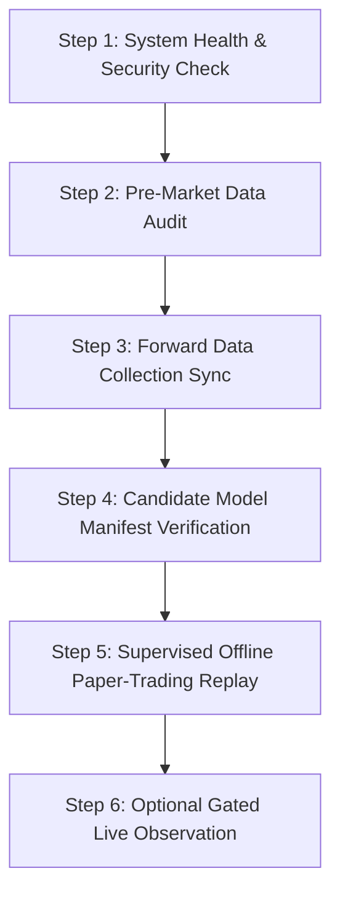

# Monday Morning Operator Runbook & Checklist

**Target Date:** Monday, November 16, 2026 (Forex Market Reopen)  
**System:** IQ Option AI Trading Research System  
**Repository:** https://github.com/elmochilyas/IqOptionBot  
**Current Milestone:** Phase 13 (Offline AI Research, Optimization & Monday Readiness)  
**Security Posture:** Read-Only Market Data Access & Offline Paper Trading Only. **NO REAL FUNDS OR BROKER TRADING.**

---

## 1. Safety & Operational Guardrails

Before executing any commands on Monday morning, operators must review and adhere to these mandatory restrictions:

> [!CAUTION]
> 1. **Zero Order Execution:** The system is explicitly configured with trade execution disabled. Do not bypass or remove simulated paper-trading adapters.
> 2. **Credential Hygiene:** Never commit `.env` files, broker passwords, or SSID session tokens to git. Never echo credentials in terminal commands.
> 3. **Supervised Operations:** Run commands sequentially in interactive PowerShell windows. Do not set up unattended cron jobs or automated daemon scripts.
> 4. **Emergency Stop:** Press `Ctrl+C` in any active terminal session to trigger immediate graceful shutdown.

---

## 2. Step-by-Step Operator Checklist

Follow these steps chronologically upon arriving Monday morning:



---

### Step 1: System Health & Security Audit

Verify that the local environment is clean, tests pass, and security checks succeed.

```powershell
# 1.1 Verify git branch is clean
git status

# 1.2 Run repository security checks (verifies zero leaked secrets or network bypasses)
python -m iqoption_research.cli.main security-check

# 1.3 Run offline regression test suite
pytest -v -m "not network"
```
- **Expected Outcome:** 7/7 security checks pass, and all unit/integration tests pass.

---

### Step 2: Pre-Market Authentic Dataset Audit

Inspect the stored authentic dataset (`data/datasets`) before attempting forward collection.

```powershell
# 2.1 Audit authentic Parquet datasets and SQLite catalog
python -m iqoption_research.cli.main data audit --storage data/datasets

# 2.2 Verify current forward status (confirms weekend boundary)
python -m iqoption_research.cli.main data forward-status --storage data/datasets
```
- **Expected Outcome:**
  - Unique authentic candles: `62,871`
  - Earliest candle: `2026-09-15T05:01:00Z`
  - Latest candle: `2026-11-13T22:00:00Z`
  - Unexpected open-market gaps: `0`
  - Status: `"No forward collection has been required yet"` (or completed sync from prior runs).

---

### Step 3: Incremental Forward Collection Sync

Once the Forex market opens on Sunday evening / Monday morning, query for completed open-market candles.

```powershell
# 3.1 Plan forward collection (verifies how many completed candles are missing)
python -m iqoption_research.cli.main data forward-plan --storage data/datasets

# 3.2 If new completed open-market candles are expected, sync incrementally
# Note: Requires IQOPTION_EMAIL and IQOPTION_PASSWORD in environment or .env
python -m iqoption_research.cli.main data forward-sync --storage data/datasets --max-requests 20

# 3.3 Verify forward status after collection
python -m iqoption_research.cli.main data forward-status --storage data/datasets
```
- **Expected Outcome:**
  - If market has just opened, newly completed 60s bars are fetched without duplicates.
  - Zero conflicts, zero open-market gaps.
  - SHA-256 partition checksums are computed and recorded in SQLite catalog.

---

### Step 4: Experimental Candidate Model Integrity Verification

Verify the Phase 13 candidate model bundle before any paper-trading replay.

```powershell
# 4.1 Inspect candidate model bundle manifest and metadata
python -m iqoption_research.cli.main ml inspect data/phase13/candidate_models/candidate_h1_rf
```
- **Expected Outcome:**
  - Manifest version: `1.0`
  - Lifecycle stage: `DEVELOPMENT_ONLY`
  - Model provenance: `authentic_trained`
  - Checksum verification: `All files verified against SHA-256 manifest`
  - Features: 13 stationary features (`return_1`, `intrabar_return`, `sma_ratio_5`, etc.)

---

### Step 5: Supervised Offline Paper-Trading Replay

Simulate real-time streaming paper trading over the newest authentic market candles.

```powershell
# 5.1 Run 100-bar replay using authentic dataset and candidate model bundle
python -m iqoption_research.cli.main bot replay --storage data/datasets --model-bundle data/phase13/candidate_models/candidate_h1_rf --bars 100 --stake 100.0
```
- **Expected Outcome:**
  - `Model Provenance: authentic_trained`
  - `Operational Mode: offline_replay`
  - Ingests 100 streaming candles through `RollingFeatureBuffer`.
  - Directional predictions evaluated and calibrated via Platt scaling.
  - Circuit breakers and daily loss limits enforced.
  - Snapshot table rendered with session PnL, win rate, and drawdown.

---

### Step 6: (Optional & Supervised) Live Market Observation

To test live WebSocket candle streaming in strictly read-only mode during active market hours:

```powershell
# 6.1 Generate gated observation token (read-only posture)
$token = python -c "from iqoption_research.observation.adapter import ObservationAuthorizationToken; print(ObservationAuthorizationToken.generate(scope='market_observation_only').token)"

# 6.2 Run live observation (observe-only, NO trade placement)
python -m iqoption_research.cli.main bot run --mode OBSERVE_ONLY --token $token --max-runtime 300
```
- **Expected Outcome:**
  - Live 60s completed candles arrive from IQ Option.
  - Read-only guard actively forbids order placement.
  - Runs for 300 seconds (5 minutes) and shuts down cleanly.

---

## 3. Incident Response & Troubleshooting

| Symptom | Cause | Solution |
|---|---|---|
| `forward-sync` returns 0 candles | Market is closed or no completed candles | Check UTC time. Forex reopens Sunday 22:00 UTC. Completed bars required. |
| `Checksum mismatch` in catalog | File was modified or corrupted | Do not edit Parquet files manually. Run `data audit` to isolate corrupted partition. |
| `Circuit breaker tripped` in replay | 3 consecutive losses occurred | Normal risk-management behavior. Engine safely halts simulated orders. |
| Broker login fails (`2FA required`) | Broker challenged login with SMS/email code | Enter verification code in prompt or use saved authenticated session token. |
