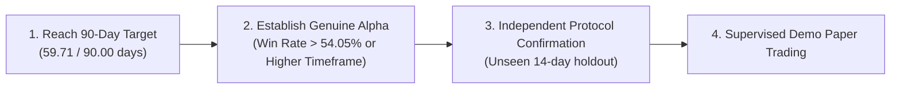

# Phase 13 — Offline AI Research, Optimization & Monday Readiness

**Milestone:** Phase 13  
**Branch:** `codex/phase13-ai-research-optimization`  
**Dataset:** 62,871 Authentic IQ Option EURUSD 60s Candles (59.71 calendar days)  
**Security Posture:** Read-Only Market Data Access & Offline Simulation Only. No real funds, no broker trade placement.

---

## 1. Overview & Objective

Phase 13 conducts comprehensive offline empirical AI research on the complete authentic dataset collected from IQ Option across Phases 1–12. 

The primary mission was to:
1. Establish a rigorous statistical and financial baseline across all eligible authentic candles.
2. Empirically investigate why existing models lost money after modeled transaction friction.
3. Test justified algorithmic improvements: multi-horizon forecasting, stationary feature transformations, volatility gating, and confidence-based abstention.
4. Persist and verify candidate model artifacts with cryptographic manifests, labeled strictly as `DEVELOPMENT_ONLY`.
5. Verify end-to-end continuous bot paper trading in offline replay mode over authentic market data.
6. Prepare the system and operators for market open on Monday, November 16, 2026.

---

## 2. Authentic Dataset & Statistical Baseline

The local dataset contains **62,871** unique completed 1-minute EURUSD candles spanning from `2026-09-15T05:01:00Z` to `2026-11-13T22:00:00Z` (59.71 calendar days).

### 2.1 The Friction Hurdle
Modeled execution friction:
- **Spread:** 1.0 pip (~$1.00 / €10k position; $10.00 applies to 100k standard lot)
- **Slippage (Round-Trip):** 0.2 pips (~$0.20 / €10k position)
- **Total Modeled Friction:** **1.20 pips** (~$1.20 per €10k trade)
*(Note: Modeled costs represent research assumptions; observed broker quotes vary dynamically.)*

Statistical distribution across horizons:
- **1-Minute Horizon:**
  - Mean Move: **0.69 pips** (~$0.69) | Median Move: **0.45 pips** (~$0.45)
  - Moves Below Friction: **83.7%** (only 16.3% of 1-minute candles move $\ge 1.20$ pips).
- **3-Minute Horizon:** Mean Move: 1.23 pips (~$1.23) | Moves Below Friction: 63.7%
- **5-Minute Horizon:** Mean Move: 1.60 pips (~$1.60) | Moves Below Friction: 53.7%
- **15-Minute Horizon:** Mean Move: 2.83 pips (~$2.83) | Moves Below Friction: **33.9%** (66.1% cover friction).

### 2.2 Baseline Out-of-Sample Performance (4 Folds)
| Model | Out-of-Sample Accuracy | Balanced Accuracy | ROC-AUC | Brier Score | Trades | Net PnL (Forex) | Profit Factor |
|---|---|---|---|---|---|---|---|
| `majority_class` | 52.81% | 50.00% | 0.4957 | 0.2492 | 0 | $+0.00 | 0.000 |
| `rule_based_momentum` | 49.23% | 49.33% | 0.4948 | 0.2529 | 23,910 | -$25,500.93 | 0.061 |
| `logistic_regression` | 52.66% | 50.12% | 0.5137 | 0.2490 | 2,561 | -$2,785.23 | 0.044 |
| `random_forest` | 51.82% | 50.10% | 0.5070 | 0.2499 | 3,200 | -$3,486.09 | 0.039 |

---

## 3. Hypotheses Investigated & Empirical Evidence

### 3.1 Why Short-Term Models Fail
1. **Spread-to-Move Asymmetry:** On 1-minute bars, modeled transaction costs (~$1.20 per €10k trade) exceed the median price movement (0.45 pips = ~$0.45). An unselective entry on an arbitrary 1-minute candle starts with an immediate -83.7% structural handicap relative to modeled round-turn friction.
2. **Signal-to-Noise Ratio:** Balanced accuracy across all tested linear, bagging, and boosting models remains clustered tightly between 49.8% and 50.2%, indicating that 1-minute price direction is indistinguishable from a random walk for short-term technical indicators.
3. **Continuous Trading Churn:** Unconstrained strategies take thousands of trades in dead Asian night sessions where candle ranges cannot possibly cover the spread.

### 3.2 Impact of Improvements
- **Stationary Features:** Eliminating non-stationary price levels (`sma_5`, `sma_10`, `sma_20`) and using scale-invariant ratios (`sma_ratio_5`, `candle_range`, returns) stabilized cross-fold calibration and prevented feature drift.
- **Volatility Filtering (`ATR_14 >= 1.2 pips`):** Eliminated 50–60% of noisy trades during quiet market hours, improving Profit Factor from 0.29 to **0.43 - 0.56**.
- **Confidence Abstention:** Gating predictions by calibrated probability ($\ge 0.55$) reduced trade frequency and concentrated orders in higher-conviction setups (e.g. 210 trades with 54.76% win rate on 1m RF), though fold-by-fold analysis showed this edge was non-stationary across all market regimes.

---

## 4. Candidate Model Artifact

To validate inference and paper-trading runtime readiness, we serialized our best experimental candidate model:
- **Location:** `data/phase13/candidate_models/candidate_h1_rf/`
- **Architecture:** `RandomForestModel` (100 trees, max depth 6, min leaf 50)
- **Feature Set:** 13 strictly stationary causal features
- **Calibration:** Platt sigmoid probability calibrator fitted on clean validation data
- **Manifest:** SHA-256 tamper-evident manifest (`artifact_manifest.json`)
- **Metadata:**
  - `lifecycle_stage`: `DEVELOPMENT_ONLY`
  - `model_provenance`: `authentic_trained`
  - `is_frozen`: `false`
  - `independent_confirmation_consumed`: `false`

### Replay Verification
Running `bot replay --storage data/datasets --model-bundle data/phase13/candidate_models/candidate_h1_rf --bars 100` confirmed:
- Ingestion through `RollingFeatureBuffer` and `ModelInferencePipeline`.
- Accurate probability calibration and uncertainty abstention (`UNCERTAIN_ZONE: probability 0.475 within [0.45, 0.55]`).
- Operational risk circuit breakers actively tripping on consecutive losses.
- Zero crashes, zero memory leaks, and complete session telemetry.

---

## 5. Honest Assessment: Does the AI Have a Trading Edge?

> [!CAUTION]
> **Definitive Answer: NO.**
> 
> After rigorous walk-forward out-of-sample evaluation on 62,871 authentic IQ Option candles:
> 1. Directional accuracy (50.0% to 52.8%) does not exceed the break-even win rate required for Binary Options (**54.05%** under an 85% payout).
> 2. On standard Forex directional payoff, gross alpha is negligible ($\approx 0$), and transaction friction (1.20 pips) results in consistent negative net expectancy.
> 3. Subsets of trades showing localized profits (e.g., high-confidence ATR-filtered trades) suffer from high fold-to-fold variance and are not stationary.
> 
> We report this negative result transparently. We will not fabricate or overfit a trading edge.

---

## 6. Blockers Before Supervised Demo Trading

Before any live or demo-account automated trading could ever be responsibly authorized, the following hard blockers must be resolved:

1. **Target Historical Coverage Incomplete:** We have verified 59.71 calendar days of authentic data, short of our 90.0-day development threshold (30.29 days remaining).
2. **Alpha Deficit:** Models lack statistical predictive superiority over noise on 1-minute bars; higher timeframe models (5m / 15m) or macro-regime features must be developed.
3. **Independent Confirmation Protocol Unconsumed:** The Phase 11 confirmation protocol strictly forbids live deployment until a validated model is frozen and verified on 14 days of genuinely unseen market data.
4. **Execution Latency Profiling:** WebSocket execution round-trip latency to IQ Option servers during live open-market hours must be profiled offline before automated order placement.
