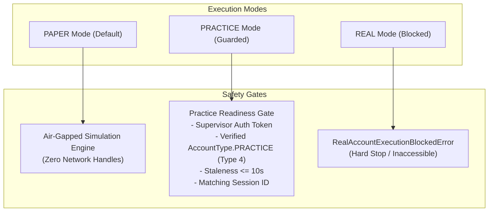
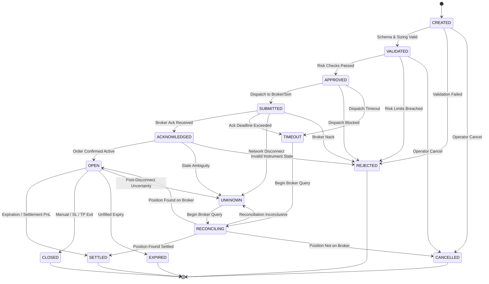

# Phase 16: Architecture and Broker Capability Audit

**Document Date:** November 2026  
**Phase:** 16 — Complete Trading Execution Engine  
**Target Platform:** Windows 11 / Python 3.12.10  
**Scope:** IQ Option Wire-Protocol, Order Execution Lifecycle, Execution Adapters, Safety Controls

---

## 1. Executive Summary & Audit Scope

Prior to Phase 16, the `IqOptionBot` repository established secure, asynchronous, read-only connectivity to IQ Option (`iqoption_research`). Specifically:
- **Authentication**: Verified via HTTPS login (`auth/v2/login`) with 2FA challenge handling and session token/SSID acquisition.
- **WebSocket Transport**: Verified via `wss://ws.iqoption.com/echo/websocket` with SSID authentication, heartbeat ping-pong, profile discovery, balance discovery, historical candle retrieval (`get-candles`), and streaming candle subscription (`candle-generated`).
- **Safety Posture**: The client was strictly guarded by `AsyncIQOption.assert_read_only()`, prohibiting any order, position, or balance mutation methods.
- **Paper Trading Engine**: Implemented an in-memory simulated order lifecycle for Binary Options (`PaperTradingEngine`) linked to rolling feature buffers, AI models, and operational risk circuit breakers.

**Phase 16 Objective:**
To construct a modular, decoupled execution engine supporting Binary Options, Digital Options, and Forex/CFD under strictly isolated execution modes (`PAPER`, `PRACTICE`, `REAL`), grounded exclusively in verified broker behavior and authoritative protocol evidence.

---

## 2. Broker Protocol Ground Truth & Capability Matrix

### 2.1. Ground Truth Principles
1. **Never Invent Behavior**: Endpoints, frame structures, error codes, and settlement mechanisms are only documented where supported by verified protocol evidence.
2. **Fail-Closed on Uncertainty**: Where a broker frame is unverified or ambiguous, the operation is explicitly designated `UNVERIFIED_PROTOCOL_EVIDENCE` or `UNSUPPORTED`.
3. **No Mixed Payoffs**: Binary Options (fixed payout), Digital Options (strike-distance quote payoff), and Forex/CFD (pip math, spread, leverage, financing) maintain distinct financial payoff engines.
4. **Permanent Real-Money Barrier**: Live order transmission against REAL accounts is strictly prohibited and architecturally blocked.

### 2.2. Broker Capability Matrix

| Operation ID | Product | Category | Name | Status | Verified | Live Allowed | Protocol Frame |
| :--- | :--- | :--- | :--- | :--- | :---: | :---: | :--- |
| `auth_https_login` | Global | authentication | HTTPS Login & 2FA | `implemented_and_verified` | Yes | Yes | `POST auth/v2/login` |
| `auth_ws_authenticate` | Global | authentication | WebSocket SSID Authentication | `implemented_and_verified` | Yes | Yes | `authenticate` |
| `auth_ws_heartbeat` | Global | authentication | WebSocket Heartbeat | `implemented_and_verified` | Yes | Yes | `heartbeat` |
| `account_get_profile` | Global | account_data | Get User Profile | `implemented_and_verified` | Yes | Yes | `get-profile` |
| `account_get_balances` | Global | account_data | Get Account Balances | `implemented_and_verified` | Yes | Yes | `get-balances` |
| `account_practice_verification` | Global | account_data | Authoritative Practice Verification | `implemented_and_verified` | Yes | Yes | `get-profile + get-balances` |
| `market_get_candles` | Global | market_data | Get Historical Candles | `implemented_and_verified` | Yes | Yes | `get-candles` |
| `market_subscribe_candles` | Global | market_data | Subscribe Streaming Candles | `implemented_and_verified` | Yes | Yes | `subscribeMessage(candle-generated)` |
| `binary_simulated_trade` | binary | order_submission | Binary Simulated Paper Order | `implemented_simulated_only` | Yes | No | `N/A (Internal)` |
| `binary_order_submission_practice` | binary | order_submission | Binary Option Practice Submission | `unverified_protocol_evidence` | No | No | `binary-options.open-option / buyV2` |
| `binary_order_status_practice` | binary | order_status | Binary Option Order Acknowledgement | `unverified_protocol_evidence` | No | No | `option-opened` |
| `binary_settlement_reconciliation` | binary | settlement | Binary Settlement Reconciliation | `unverified_protocol_evidence` | No | No | `option-closed / socket-option-closed` |
| `digital_simulated_trade` | digital | order_submission | Digital Option Simulated Paper Order | `implemented_simulated_only` | Yes | No | `N/A (Internal)` |
| `digital_order_submission_broker` | digital | order_submission | Digital Option Broker Order Submission | `unsupported` | No | No | `digital-options.place-digital-option` |
| `digital_early_closure_broker` | digital | position_closure | Digital Option Early Broker Closure | `unsupported` | No | No | `digital-options.close-position` |
| `forex_simulated_trade` | forex | order_submission | Forex/CFD Simulated Paper Order | `implemented_simulated_only` | Yes | No | `N/A (Internal)` |
| `forex_order_submission_broker` | forex | order_submission | Forex/CFD Broker Order Submission | `unsupported` | No | No | `order.open-order` |
| `forex_position_close_broker` | forex | position_closure | Forex/CFD Broker Position Closure | `unsupported` | No | No | `order.close-position` |
| `balance_switch_auto` | Global | balance_management | Automatic Balance Switching | `unsupported` | No | No | `change_balance / switch_balance` |
| `order_submission_real` | Global | order_submission | Real Account Order Submission | `unsupported` | No | No | `N/A (Internal)` |

---

## 3. Product-by-Product Analysis

### 3.1. Binary Options ("turbo" / "binary")
- **Characteristics**: Fixed expiry duration (e.g., 60 seconds, 300 seconds), all-or-nothing payoff.
- **Payoff Model**: Fixed percentage $R \in (0, 1)$ of stake on correct prediction; 100% loss of stake on incorrect prediction; 100% refund on exact tie (strike = exit).
- **Protocol Evidence**:
  - Outgoing submission historically uses `sendMessage` with name `binary-options.open-option` or `buyV2`.
  - Body attributes: `user_balance_id`, `active_id`, `direction` ("call" / "put"), `price` (stake), `exp` (unix expiration timestamp), `type_id`.
  - Incoming ack: `option-opened` containing `id` (integer/string broker option identifier).
  - Incoming settlement: `option-closed` or `socket-option-closed` containing settlement result (`"win"`, `"loose"`, `"equal"`) and profit amount.
- **Status in Engine**:
  - `PAPER`: Fully implemented, verified, deterministic.
  - `PRACTICE`: Architecture and frame builders implemented; disabled by default; unverified against live endpoints in Phase 16.

### 3.2. Digital Options ("digital-options")
- **Characteristics**: Floating strike price $K$ relative to current spot price $S_0$. Non-linear payout based on moneyness at expiration. Positions can be sold back to the broker before expiration at floating bid quote.
- **Payoff Model**: Discrete payoff matrix dependent on selected strike price. Early closure value depends on broker market-maker book pricing and time-decay.
- **Protocol Evidence**:
  - Outgoing submission uses `sendMessage` with name `digital-options.place-digital-option`.
  - Closing position uses `digital-options.close-position`.
  - Instrument IDs follow synthetic patterns (e.g., `doEURUSD20261116...`).
- **Status in Engine**:
  - `PAPER`: Implemented using `DigitalPayoffModel` (distinct from Binary).
  - `PRACTICE` / Broker transmission: Explicitly marked `UNSUPPORTED`. Submitting to broker raises `UnsupportedProductOperationError`.

### 3.3. Forex / CFD Margin Trading ("forex")
- **Characteristics**: Leveraged margin trading with lot sizes, pip values, bid/ask spreads, overnight swap fees, Stop-Loss (SL), and Take-Profit (TP).
- **Payoff Model**: Linear PnL based on price delta in pips, contract multiplier (units per lot), minus transaction friction (spread + commission + swap).
- **Protocol Evidence**:
  - Outgoing order uses `sendMessage` with name `order.open-order` or `orders.create-order`.
  - Parameters require leverage multiplier, client order ticket, margin allocation, and conditional SL/TP stops.
- **Status in Engine**:
  - `PAPER`: Implemented using `ForexPayoffModel` with realistic pip calculation and SL/TP triggers.
  - `PRACTICE` / Broker transmission: Explicitly marked `UNSUPPORTED`. Submitting to broker raises `UnsupportedProductOperationError`.

---

## 4. Execution Mode Isolation & Safety Guarantees

### Safety Guarantees:
1. **Physical Air-Gap in PAPER Mode**: `PaperExecutionAdapter` holds zero references to broker network sockets, ensuring paper trading commands can never trigger broker order frames.
2. **Authoritative PRACTICE Verification**: PRACTICE execution is disabled by default. When enabled for supervised testing, it requires:
   - Explicit supervisor cryptographic token (`PracticeExecutionAuthToken`).
   - Profile balance verification confirming `active_balance_type == 4` (PRACTICE).
   - Verification timestamp freshness within $\le 10$ seconds.
   - Session ID matching the authenticated socket session.
3. **Fail-Closed on Real Balance**: If the active balance is detected as `AccountType.REAL` (type 1) or ambiguous, execution aborts immediately with `RealAccountExecutionBlockedError`.
4. **Zero Automatic Balance Switching**: The bot will never issue `change_balance` or `switch_balance` frames.
5. **REAL Mode Strictly Inaccessible**: Any invocation targeting REAL mode immediately raises an exception.

---

## 5. Order State Machine & Reliability Specifications

### Order Reliability Invariants:
1. **Deterministic Idempotency**:
   $$\text{IdempotencyKey} = \text{SHA256}(\text{mode} \parallel \text{symbol} \parallel \text{product} \parallel \text{side} \parallel \text{stake} \parallel \text{to\_ts} \parallel \text{signal\_id})$$
   Duplicate keys are rejected immediately to prevent double submissions.
2. **No Blind Retries**:
   If an order times out or the connection drops during submission (`SUBMITTED`), the order enters `TIMEOUT` or `UNKNOWN` with `reconciliation_required = True`.
   Retrying without reconciling against broker position queries is strictly prohibited.
3. **Crash & Restart Recovery**:
   On engine restart, all non-terminal orders are loaded from the persistent SQLite journal. Non-terminal orders are set to `RECONCILING` or `UNKNOWN` (fail-closed), never assumed filled or failed.
4. **Time Synchronization**:
   Order proposals verify market data freshness against local clock; stale data ($> 180\text{s}$) halts the engine.

---

## 6. Comprehensive Risk Management & Emergency Controls

The execution engine integrates 10 mandatory pre-flight risk checks:
1. **Maximum Stake per Trade**: Absolute currency ceiling.
2. **Maximum Stake Percentage**: Maximum fraction of current portfolio capital.
3. **Maximum Daily Loss**: Evaluated against gross realized losses or net realized PnL.
4. **Maximum Drawdown**: Latching circuit breaker if peak-to-trough drawdown exceeds limit.
5. **Maximum Consecutive Losses**: Cooldown or halt after streak of losing trades.
6. **Maximum Simultaneous Exposure**: Combined capital exposure of all currently open positions.
7. **Maximum Trades per Session**: Prevents runaway trading frequency.
8. **Stale Market Data Guard**: Halts order entry if last candle exceeds freshness deadline.
9. **Broker Connection State**: Requires verified ready connection in practice mode.
10. **Account Verification**: Requires active practice balance verification.

### Emergency Stop Architecture:
- Activating `emergency_stop(reason)` immediately triggers the latching kill switch (`HALTED_KILL_SWITCH`).
- All incoming proposals and submissions are blocked.
- Current open positions are audited and reported in an `EmergencyStopReport` without assuming they have closed, maintaining accurate risk accounting.

---

## 7. Prerequisites for Supervised Practice-Account Testing

Before any future supervised test can submit orders to an IQ Option Practice account:
1. **Authoritative Practice Verification**: Sockets must return `profile.raw['balance_id']` matching a balance with `type == 4` (`AccountType.PRACTICE`).
2. **Operator Authorization Token**: Valid `PracticeExecutionAuthToken` signed by a designated supervisor.
3. **Clock Synchronization**: Verified NTP synchronization ($\le 250\text{ms}$ drift).
4. **Reconciliation Verification**: Active positions query verified against broker responses.
5. **Kill Switch Armed**: Operator terminal with instant emergency stop capability active.
