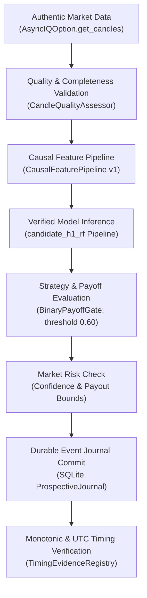

# Phase 34: Live Reliability, Shadow Decisions & Complete Timing Validation

## 1. Executive Summary & Objective

Phase 34 advances the IQ Option research system toward automated bot operation by integrating authentic market-data acquisition with the existing feature engineering, model inference, risk controls, policy decisions, and durable append-only journaling systems.

> [!IMPORTANT]
> **STRICT ZERO-ORDERS POSTURE**: This phase is entirely order-free. No REAL or PRACTICE broker orders are authorized, implemented, or emitted. The outbound WebSocket protocol is restricted at the transport layer by a strict allowlist immediately before socket writes.

### Scientific Disposition
The research disposition remains strictly:
$$\mathbf{NO\_DEMONSTRATED\_EDGE}$$

Executing a complete, timing-compliant shadow decision (including analytical CALL or PUT directions) demonstrates software engineering feasibility within the 15-second latency contract, but provides **zero evidence of predictive profitability or trading edge**.

---

## 2. Phase 33 Baseline & Presentation Corrections

### Baseline Evidence
The operator-supervised live measurement session `meas_705e2ab066f0_1795077245` established the empirical timing baseline:
- Two genuine completed EURUSD 1-minute candle observations ($F = 1795077300$ and $F = 1795077360$).
- Client frame receipt within 15 seconds: **2/2** (offsets: $320.5\text{ ms}$ and $541.3\text{ ms}$).
- Completed candle validation within 15 seconds: **2/2** ($322.4\text{ ms}$ and $541.7\text{ ms}$).
- Prediction stages: intentionally **NOT_MEASURED** in Phase 33 (acquisition-only observation).
- SHA-256 integrity hash: `77202b02e9c140b9c5a006c34832d6255d0ba8e41e39a0dd182b75deb54b3700` (PASSED).

### Presentation Fix
In Phase 33, because `phase30_gate_satisfied` was `False` for acquisition-only observations, the CLI summary displayed a red `FAIL` under the "15s Gate?" column.

In Phase 34, the CLI display has been corrected without altering historical evidence or changing field definitions:
1. **Receipt $\le$ 15s**: Displays `PASS` and delivery offset in milliseconds (or `NO` if late).
2. **Validation $\le$ 15s**: Displays `PASS` if structural OHLC and completeness checks passed within 15 seconds.
3. **Acquisition Verdict**: Displays `PASS` when receipt and validation succeed without rejection.
4. **Full Prediction Contract**: Displays `NOT_MEASURED` when prediction stages were not part of the run (instead of `FAIL`), or `PASS`/`FAIL` with total close-to-commit latency when full shadow stages were measured.

Verification via `verify-evidence` now reports:
```text
Full Phase 30 Gate: NOT_MEASURED (for acquisition-only) or X/Y measured
```

---

## 3. Authentic Acquisition Reliability Evaluator

Phase 34 introduces an offline multi-session evaluator (`iqoption timing reliability <paths>`) in `src/iqoption_research/timing/reliability.py`.

### Capabilities & Guarantees
1. **Integrity Pre-check**: Every registry file is verified for SHA-256 integrity and internal timestamp consistency before ingestion. Tampered registries are reported under `invalid_registries`.
2. **Provenance Separation**: Only registries with `operational_mode == "OPERATOR_SUPERVISED_LIVE"` are included in live reliability estimates. Simulated observations are segregated.
3. **Boundary Deduplication**: When overlapping sessions or duplicate registries observe the same nominal candle boundary $(symbol, size, F)$, the earliest valid receipt attempt is retained. Duplicate boundary attempts are tracked.
4. **Gap Detection**: Chronological gaps between observed candle boundaries within each session are recorded.
5. **Distribution & Percentile Reporting**:
   - Computes count, median, maximum, and tail percentiles:
     - p90: requires $N \ge 10$
     - p95: requires $N \ge 20$
     - p99: requires $N \ge 100$
   - Percentiles remain `null` when sample sizes are statistically insufficient.
6. **15-Second Compliance Rates & Wilson Score Intervals**:
   - Calculates receipt and validation compliance rates.
   - Provides asymmetric 95% Wilson score confidence intervals:
     $$w = \frac{p + \frac{z^2}{2n} \pm z\sqrt{\frac{p(1-p)}{n} + \frac{z^2}{4n^2}}}{1 + \frac{z^2}{n}}$$
   - For $N=2$ (Phase 33 baseline), the 100% compliance rate has a 95% confidence interval of $[0.342, 1.000]$, illustrating the broad uncertainty of small samples.
7. **Sample Size Interpretation**: Explicitly reports `"INSUFFICIENT_SAMPLE_FOR_TAIL_RELIABILITY"` when $N < 100$, preventing premature claims of production reliability.
8. **Receipt & Journal Verification**: For `PHASE_34_SHADOW_V1` registries, the evaluator verifies that every recorded durable commit matches an immutable event in the session's SQLite hash chain.

---

## 4. Repeated Supervised Session Protocol

To accumulate authentic observation data safely without unattended broker access, operator sessions adhere to the following protocol:

1. **Session Bounds**:
   - Hard ceiling of **5 candle cycles** per session.
   - Hard timeout of **300 seconds** (5 minutes) total observation time.
2. **Interactive Operator Presence**:
   - Interactive credentials prompt via standard terminal `getpass`.
   - Explicit confirmation flag `--yes-i-understand`.
   - Requires interactive TTY (`sys.stdin.isatty()`).
   - No background daemons, scheduled tasks, or unattended reconnect loops.
3. **Fail-Closed Teardown**:
   - Reconnect attempts set to 0 (`max_reconnect_attempts=0`).
   - Socket drops or network errors trigger immediate clean disconnect and registry persistence.
   - Operator cancellation (`Ctrl+C`) cleanly closes the WebSocket and saves partial observations.
4. **Data Aggregation**:
   - Multiple completed sessions are aggregated offline via `iqoption timing reliability data/phase33 data/phase34/operator_supervised_live`.

---

## 5. End-to-End Real-Data Shadow Decision Pipeline

Phase 34 implements the complete end-to-end shadow pipeline in `src/iqoption_research/timing/shadow.py`:



### Component Details
1. **Authentic Candle Collector**: Reuses `AsyncIQOption.get_candles("EURUSD", 60, 22, endtime=F)` over the existing WebSocket client.
2. **Candle Quality & Window Validation**:
   - Checks research-grade quality, absence of errors, 60-second duration, and contiguous timestamps ($t_{i,\text{to}} == t_{i+1,\text{from}}$).
   - Rejects partial, unclosed, or corrupted candles with `INVALID_OR_INCOMPLETE_WINDOW`.
3. **Causal Feature Pipeline**:
   - Reuses `CausalFeaturePipeline(drop_warmup=True)`.
   - Guarantees `available_at_ts == F`: features use only completed historical candles with zero lookahead.
4. **Model Bundle Verification**:
   - Pinned candidate model: `data/phase13/candidate_models/candidate_h1_rf`.
   - SHA-256 manifest digest verified against `8dc27f329148af54a5c44234268c4b4e31233b6b3b4e7ed79bd13e5cd98de872`.
   - Validates feature schema, provenance (`authentic_trained`), horizon ($H=1$), and bundle timestamp.
   - If model is unavailable or manifest mismatch occurs, sets `skip_reason="MODEL_UNAVAILABLE"` and defaults to `SKIP`.
5. **Strategy & Policy Decision**:
   - Reuses `BinaryPayoffGate(assumed_payout=0.85, margin=0.059)` with frozen decision threshold $0.60$.
   - Gated calibrated probability determines direction (`CALL`, `PUT`, or `SKIP` with `BELOW_FROZEN_THRESHOLD`).
6. **Market Risk Controls**:
   - Evaluates confidence bounds ($\ge 0.55$) and payout bounds ($\ge 0.70$) via `market_risk_rejection`.
   - Spot market data does not carry contract payout rates; records `eligibility_block="missing_payout_data"`.
7. **Durable SQLite Journal**:
   - Appends to `observations.db` with `PRAGMA synchronous=FULL`, `BEGIN IMMEDIATE`, and SHA-256 hash chaining (`previous_hash` $\to$ `event_hash`).
   - SQLite table constraints and triggers prevent duplicate boundary decisions and enforce immutability.

---

## 6. The Full 15-Second Decision Contract

Phase 34 instruments all 9 real stages conforming to the Phase 30 frozen contract:

$$F \le t_{\text{observed}} \le t_{\text{decision}} \le t_{\text{durable\_commit}} \le F + 15\text{ seconds}$$

### Instrumented Stages
| Stage ID | Stage Name | Monotonic & Disciplined UTC Recording |
|---|---|---|
| `STAGE_1` | `STAGE_1_REQUEST_INIT` | Request dispatch time and request ID |
| `STAGE_2` | `STAGE_2_NETWORK_RECV` | Local socket frame read |
| `STAGE_3` | `STAGE_3_PARSE_VALIDATE` | JSON decode and frame correlation |
| `STAGE_4` | `STAGE_4_CANDLE_VALIDATE` | Candle sequence validation and normalization |
| `STAGE_5` | `STAGE_5_COMPLETED_RECOG` | Nominal boundary $F$ recognition |
| `STAGE_7` | `STAGE_7_FEATURE_AVAIL` | Causal feature matrix computation |
| `STAGE_8` | `STAGE_8_INFERENCE` | Calibrated probability inference |
| `STAGE_DECISION` | `STAGE_POLICY_DECISION` | Payoff gate and risk decision |
| `STAGE_9` | `STAGE_9_JOURNAL_COMMIT` | Synchronous SQLite commit with SHA-256 payload receipt |

### Contract Rules
- If any stage is missing (e.g. model unavailable), the contract is marked `NOT_MEASURED` or `FAIL`, **never `PASS`**.
- If clock step is detected or clock uncertainty $> 5000\text{ ms}$, decision defaults to `SKIP` with `TIMING_RISK`.
- If commit latency exceeds $15000\text{ ms}$, verdict is `FAIL_GATE_OVERRUN`.

---

## 7. Transport Layer Zero-Orders Enforcement

To prevent accidental order emission, the system enforces multi-layered controls:

1. **Connector Attribute Invariants**: `AsyncIQOption.assert_read_only()` verifies that no order-routing methods (`buy`, `sell`, `open_option`, `change_balance`) exist on the client.
2. **Connection Configuration**: Configured with `timing_market_data_only=True` and `max_reconnect_attempts=0`.
3. **Outbound Protocol Allowlist (`validate_timing_frame`)**:
   Enforced inside `_send_lock` immediately prior to WebSocket transmission:
   - Only `authenticate` and `heartbeat` permitted pre-auth.
   - Once authenticated, only `sendMessage` with:
     - `get-profile` (version 1.0)
     - `get-balances` (version 1.0)
     - `get-candles` (version 2.0; active_id, size, count, to)
   - Any order frame (`binary-options.open-option`, `digital-options.open-option`, `buyV2`), account mutation frame (`change-balance`), or funds operation (`deposit`, `withdraw`) immediately raises `TradingNotAllowedError`.

---

## 8. Verification & Test Coverage

The test suite contains **2,036 passing tests** across 49 test modules:

1. `tests/unit/test_phase34_reliability.py`:
   - Multi-session aggregation across live and simulated registries.
   - Duplicate session and registry deduplication.
   - Corrupted/tampered registry rejection.
   - Gap detection and tail percentile minimum-sample gates.
   - Wilson score confidence interval computation.
2. `tests/integration/test_phase34_shadow.py`:
   - 12 comprehensive scenario simulations:
     - `normal`: Genuine model inference, gate evaluation, and SQLite commit.
     - `missing_wallet`: Operates even with unverified wallet selection.
     - `unavailable`: Model unavailable defaults cleanly to SKIP.
     - `features`: Missing feature variance defaults cleanly to SKIP.
     - `invalid`: Malformed candle rejected.
     - `partial`: Unclosed candle rejected.
     - `disconnect`: Fail-closed on network drop.
     - `journal_failure`: SQLite error handled, zero orders.
     - `clock_step`: Clock jump triggers `TIMING_RISK` SKIP.
     - `late`: Arrival $>15\text{s}$ fails 15s gate.
     - `commit_overrun`: Commit $>15\text{s}$ fails gate.
     - `restart`: Process crash before export reloads without duplicate commit.
   - `test_untrusted_and_stale_bundle`: Rejects manipulated weights or stale bundles.
   - `test_offline_and_confirmation`: Enforces interactive TTY and `--yes-i-understand`.
   - `test_shadow_runner_forbids_trading_and_account_mutations`: Verifies that order and balance-switch payloads are strictly blocked before socket transmission.
3. Static Analysis:
   - `ruff check src tests`: Clean (0 errors).
   - `ruff format --check src tests`: Clean (all files formatted).
   - `mypy src`: Clean (0 issues across 212 source files).
   - `security-check`: 7/7 automated security checks passed.

---

## 9. Operator Validation Commands

### Offline Validation Commands
```powershell
# 1. Run offline security audit
python -m iqoption_research.cli.main security-check

# 2. Verify Phase 33 baseline evidence
python -m iqoption_research.cli.main timing verify-evidence `
  --path data/phase33/supervised_timing_evidence_meas_705e2ab066f0_1795077245.json

# 3. Evaluate Phase 33 baseline reliability
python -m iqoption_research.cli.main timing reliability `
  data/phase33/supervised_timing_evidence_meas_705e2ab066f0_1795077245.json

# 4. Run shadow trial preflight check (offline)
python -m iqoption_research.cli.main timing shadow-trial

# 5. Run targeted Phase 34 test suite
pytest tests/unit/test_phase34_reliability.py tests/integration/test_phase34_shadow.py -v
```

### Pre-Authorized Bounded Live Shadow Trial Command
*(To be executed only by an authorized operator in an interactive PowerShell terminal)*:
```powershell
python -m iqoption_research.cli.main timing shadow-trial `
  --live `
  --yes-i-understand `
  --max-candles 2 `
  --duration 180
```

---

## 10. GO / NO-GO Assessment

| Criterion | Evaluation | Status |
|---|---|---|
| **Zero-Orders Guard** | Outbound protocol allowlist enforces read-only operations before socket write; zero order attributes | **GO** |
| **Pipeline Integration** | End-to-end path (candle $\to$ features $\to$ inference $\to$ policy $\to$ journal) fully implemented | **GO** |
| **Historical Evidence** | Phase 33 baseline evidence preserved unaltered; hash verification passes | **GO** |
| **Presentation Fix** | Distinguishes acquisition compliance from prediction contract; no misleading red FAILs | **GO** |
| **Model Verification** | Candidate model manifest SHA-256 verified; defaults to SKIP if model absent | **GO** |
| **Test Coverage** | 100% pass rate across 2,036 tests; 15/15 shadow scenarios verified | **GO** |
| **Operator Safety** | Strict 5-cycle / 300-second limits; interactive TTY required; no background loops | **GO** |

### Verdict: **GO for Supervised Live Shadow Trial**

---

## 11. Remaining Limitations & Prerequisites for Demo Orders

Before transitioning from shadow observation to IQ Option PRACTICE (demo) orders, the following milestones remain mandatory:

1. **Statistical Sample Size ($N \ge 100$)**:
   - The current baseline consists of 2 genuine live observations.
   - At least 100 authentic observations across varied market hours are required to estimate tail latencies (p90, p95, p99) and 15-second compliance with narrow confidence intervals.
2. **Tradable Contract Price Feed Alignment**:
   - The current stream is EURUSD 1-minute spot candles.
   - Binary and digital option payouts, strike prices, and expiration schedules differ from spot data. Real-time payout streams must be integrated before trade evaluation.
3. **PRACTICE Balance Authority**:
   - Practice account trading requires verified selection of the practice wallet identifier.
   - Account selection must be verified before any order execution capability can be designed.
4. **Research Edge Replication**:
   - No demonstrated edge exists on authentic IQ Option EURUSD 1-minute data (`NO_DEMONSTRATED_EDGE`).
   - Strategy models must be re-evaluated on updated out-of-sample data before risking real capital.
