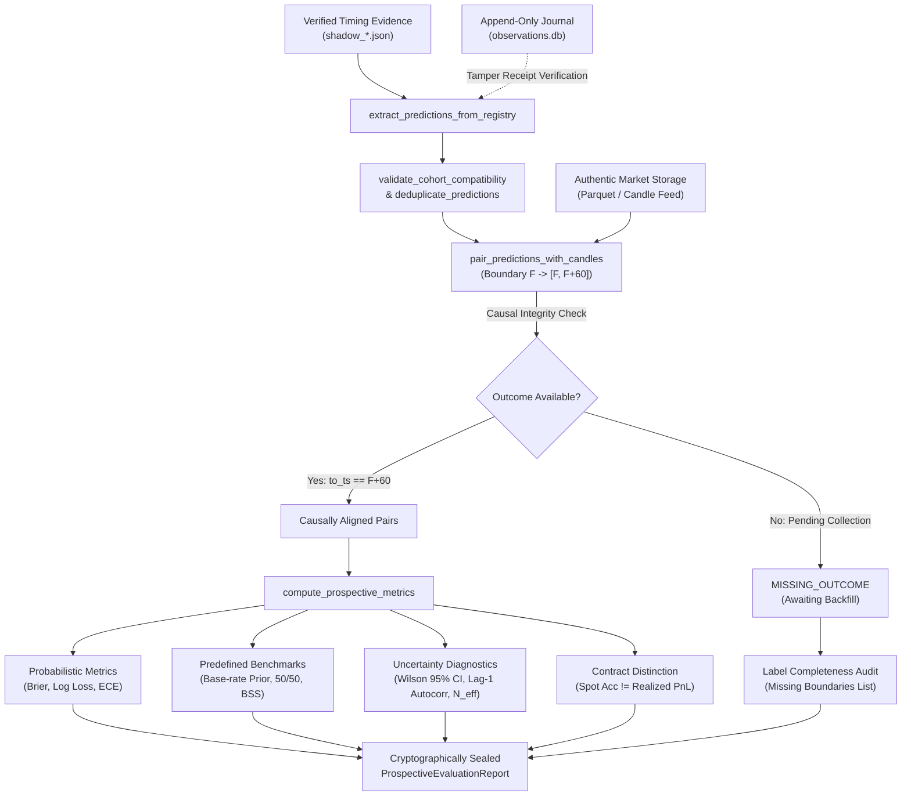

# Phase 36: Authentic Prospective Model Evaluation

## 1. Executive Summary & Objective

Phase 36 implements a strictly offline, causally aligned evaluation architecture to determine whether the existing frozen Random Forest model provides genuine predictive information using authentic prospective observations from Phase 35.

> [!IMPORTANT]
> **STRICT ZERO-ORDERS POSTURE & RESEARCH DISPOSITION**:
> This phase is entirely order-free. No REAL or PRACTICE broker orders are authorized, implemented, or emitted. The execution authority remains strictly:
> $$\mathbf{NONE}$$
> The scientific disposition remains:
> $$\mathbf{NO\_DEMONSTRATED\_EDGE}$$
> The five authentic shadow observations collected in Phase 35 had a mean calibrated probability of UP of approximately $0.475$ and directional confidence between $0.513$ and $0.541$, all below the frozen analytical decision threshold of $0.60$, resulting in five legitimate analytical SKIP decisions.
>
> We do NOT tune thresholds or retrain the model based on these five observations.

---

## 2. Model Audit: Target, Horizon, Calibration, and Training Cutoff

We conducted a forensic audit of the frozen candidate model (`data/phase13/candidate_models/candidate_h1_rf`):

### Model Artifact Specifications

| Dimension | Specification | Verification |
|---|---|---|
| **Model Family** | Random Forest (`RandomForestModel`) | 100 trees, max depth 6, min leaf 50, sqrt features |
| **Artifact Path** | `data/phase13/candidate_models/candidate_h1_rf` | Manifest SHA-256 verified |
| **Manifest SHA-256** | `8dc27f329148af54a5c44234268c4b4e31233b6b3b4e7ed79bd13e5cd98de872` | Pinned in `shadow.py` and evaluation pipeline |
| **Target Formulation** | Forward 1-bar binary direction: $Y \in \{0, 1\}$ | $Y = 1$ if $C_{t+1} > O_{t+1}$, else $0$ |
| **Neutral Handling** | Flat candle ($C_{t+1} = O_{t+1}$) is labeled $0$ in binary classification | Neutral spot movement is separately diagnosed |
| **Feature Horizon** | $h = 1$ bar (60 seconds) | Forward close of subsequent minute |
| **Feature Set** | 13 strictly stationary causal features | `return_1`, `log_return_1`, `intrabar_return`, `sma_ratio_5`, `sma_ratio_20`, `volatility_10`, `volatility_20`, `candle_range`, `body_to_range`, `upper_shadow_ratio`, `lower_shadow_ratio`, `log_volume`, `volume_ratio_10` |
| **Feature Pipeline** | `CausalFeaturePipeline(drop_warmup=True)` | Requires minimum 22 contiguous 60-second candles |
| **Calibration Method** | Platt sigmoid scaling | Fitted on chronological validation partition: $P(Y=1\|s) = \frac{1}{1 + \exp(-(3.9556 \cdot s - 2.1187))}$ |
| **Training Cutoff** | 2026-11-14T14:41:11 UTC | 62,871 authentic IQ Option candles (37,609 train, 6,268 val) |
| **Inference Contract** | 15-second deadline post-boundary $F$ | Committed to append-only SQLite journal before hypothetical entry |
| **Policy Threshold** | $p_{\text{cal}} \ge 0.60$ for CALL, $p_{\text{cal}} \le 0.40$ for PUT | Assumed payout 0.85; margin: $0.60 - \frac{1}{1 + 0.85}$ |

---

## 3. Prospective Evaluation Pipeline Architecture

The evaluation pipeline is implemented in `src/iqoption_research/research/prospective_eval.py` and exposed via the CLI command `iqresearch timing evaluate-predictions` (and alias `iqresearch prospective evaluate-predictions`).



### Core Pipeline Guarantees

1. **Strict Causal Separation**:
   - Each prediction committed at boundary $F$ is paired exclusively with the subsequent candle starting at $F$ and closing at $F + 60$.
   - Any candle with $\text{to\_ts} \le F$ or duration $\neq 60$ seconds is rejected with a `CausalAlignmentError`.
   - Predictions whose decision timestamp occurs at or after the outcome candle close ($\text{decision\_time\_utc\_ns} \ge (F + 60) \times 10^9$) are rejected as causality violations.
2. **Preservation of Skipped Decisions**:
   - Probabilistic forecasting metrics are evaluated unconditionally across all valid inference samples, preserving $(p_{\text{raw}}, p_{\text{cal}})$ even when the analytical policy decision was `SKIP` due to `BELOW_FROZEN_THRESHOLD`.
3. **Missing-Outcome Handling**:
   - If subsequent authentic candles are not yet in the catalog, predictions are preserved and marked `MISSING_OUTCOME`. The report returns status `AWAITING_LABEL_COLLECTION` and enumerates exact missing boundaries without fabricating labels.
4. **Neutral Candle Handling**:
   - Flat candles where open equals close ($C_{t+1} = O_{t+1}$) are explicitly flagged as `is_neutral = True` with spot direction `NEUTRAL`.
   - The pipeline computes both overall directional accuracy (neutral is not a win) and non-neutral directional accuracy.
5. **Cohort Incompatibility Rejection**:
   - Rejects silent merging of sessions with different model manifest digests, different symbols, or different candle sizes via `IncompatibleCohortError`.
6. **Tamper Evidence & Cryptographic Sealing**:
   - The evaluation report calculates a canonical SHA-256 digest (`evidence_sha256`) covering all metadata, distributions, metrics, and uncertainty diagnostics. Any mutation invalidates `verify_evaluation_report_integrity`.

---

## 4. Probabilistic Metrics & Benchmark Formulations

### 1. Brier Score & Brier Skill Score (BSS)
$$BS = \frac{1}{N} \sum_{i=1}^N (p_i - y_i)^2$$
$$BSS = 1.0 - \frac{BS_{\text{model}}}{BS_{\text{base}}}$$
Where $BS_{\text{base}} = \bar{y}(1 - \bar{y})$ is the Brier score of a constant base-rate predictor forecasting the empirical sample mean $\bar{y}$. A positive $BSS > 0$ indicates forecasting skill superior to climatological base rate; $BSS \le 0$ indicates zero or negative skill.

### 2. Log Loss (Binary Cross-Entropy)
$$LL = -\frac{1}{N} \sum_{i=1}^N \left[ y_i \ln(p_i) + (1 - y_i) \ln(1 - p_i) \right]$$
Probabilities are bounded to $[\epsilon, 1 - \epsilon]$ with $\epsilon = 10^{-15}$ to ensure numerical stability.

### 3. Expected Calibration Error (ECE) & Mean Calibration Bias
$$\text{Bias} = \frac{1}{N} \sum_{i=1}^N p_i - \frac{1}{N} \sum_{i=1}^N y_i$$
$$ECE = \sum_{m=1}^M \frac{|B_m|}{N} \left| \text{acc}(B_m) - \text{conf}(B_m) \right|$$

### 4. Directional Accuracy
- **Overall Spot Directional Accuracy**:
  $$\text{Acc}_{\text{overall}} = \frac{1}{N} \sum_{i=1}^N \mathbf{1}(\text{pred\_dir}_i = \text{spot\_dir}_i)$$
  Where $\text{pred\_dir}_i = \text{UP}$ if $p_i > 0.5$ else $\text{DOWN}$, and $\text{spot\_dir}_i \in \{\text{UP}, \text{DOWN}, \text{NEUTRAL}\}$.
- **Non-Neutral Directional Accuracy**:
  $$\text{Acc}_{\text{non-neutral}} = \frac{1}{N_{\text{active\_moves}}} \sum_{i: C_i \neq O_i} \mathbf{1}(\text{pred\_dir}_i = \text{spot\_dir}_i)$$
- **Binary Target Accuracy**: Evaluated against the exact model training formulation: $\mathbf{1}(C_i > O_i)$.

---

## 5. Sample-Size-Aware Uncertainty & Time-Series Dependence

### Epistemic Status & Small Sample Threshold
Following research standards, sample sizes $N < 30$ are automatically classified as:
$$\mathbf{EXPLORATORY\_DESCRIPTIVE\_ONLY}$$
With $N = 5$, statistical power is virtually zero, and asymptotic normality assumptions fail.

### Exact Wilson Score 95% Confidence Intervals
For $N$ trials with $k$ directional successes ($p = k / N$):
$$\text{center} = \frac{p + \frac{z^2}{2N}}{1 + \frac{z^2}{N}}, \quad \text{margin} = \frac{z \sqrt{\frac{p(1 - p)}{N} + \frac{z^2}{4N^2}}}{1 + \frac{z^2}{N}}$$
$$\text{CI}_{95\%} = \left[ \max(0, \text{center} - \text{margin}), \min(1, \text{center} + \text{margin}) \right]$$
For $N = 5$ with e.g. 3/5 successes (60%), the 95% Wilson confidence interval spans:
$$[0.231, 0.882]$$
Demonstrating that no statistically significant conclusion can be drawn from 5 samples.

### Lag-1 Autocorrelation & Effective Sample Size ($N_{\text{eff}}$)
To account for potential adjacent-candle dependence:
$$\rho_1 = \frac{\sum_{t=2}^N (y_t - \bar{y})(y_{t-1} - \bar{y})}{\sum_{t=1}^N (y_t - \bar{y})^2}$$
$$N_{\text{eff}} = N \cdot \frac{1 - \rho_1}{1 + \rho_1} \quad \text{(bounded in } [1.0, N]\text{)}$$
Positive outcome autocorrelation reduces degrees of freedom and effective independent observations.

---

## 6. Strict Separation: Spot Direction vs Contract Profitability

> [!CAUTION]
> **SPOT DIRECTION IS NOT REALIZED CONTRACT PROFITABILITY**:
> Binary-option contracts have asymmetric payoff structures determined by broker payouts:
>
> 1. **Break-Even Hurdle**: With an assumed payout of $85\%$ ($b = 0.85$):
>    $$\text{Win Rate}_{\text{break-even}} = \frac{1}{1 + b} = \frac{1}{1 + 0.85} \approx 54.054\%$$
>    A spot directional accuracy of $50\%$ to $53\%$ yields **negative financial expectancy**.
> 2. **Execution Realism**: Spot price feeds do not guarantee contract execution. Broker spreads, order rejection, slippage, and latency can negate hypothetical edges.
> 3. **Settlement Rules**: Spot neutral candles ($C = O$) are non-directional in spot analysis, whereas in binary options, broker tie rules vary (refund vs loss).
> 4. **No Financial Claims**: The system reports probabilistic forecasting quality only. Zero broker orders were transmitted.

---

## 7. Audit of Phase 35 Authentic Shadow Evidence

We evaluated the authentic Phase 35 shadow session (`shadow_1758c4a42993483fa41c48e3cb4ab386.json`):

```text
Session ID:                 shadow_1758c4a42993483fa41c48e3cb4ab386
Instrument:                 EURUSD 60s
Model Manifest SHA-256:     8dc27f329148af54a5c44234268c4b4e31233b6b3b4e7ed79bd13e5cd98de872
Total Observations:         5
Validated Candles (<=15s):  5/5 (100.0%)
Timing Gates Compliant:     5/5 (100.0%)
Decisions:                  5 SKIP (100.0%)
Analytical Skip Reasons:    5 BELOW_FROZEN_THRESHOLD
Mean Calibrated Prob UP:    0.474999 (0.4589 - 0.4872)
Directional Confidence:     0.5128 - 0.5411 (max(p, 1-p))
Decision Threshold:         0.60
Actual Payout Verified:     False (None)
Broker Orders Sent:         0
Execution Authority:        NONE
Research Disposition:       NO_DEMONSTRATED_EDGE
Status:                     AWAITING_LABEL_COLLECTION (5 missing outcome boundaries)
```

### Observation-by-Observation Breakdown

| Index | Boundary F | Wall Clock UTC | Calibrated P(UP) | Leaning | Confidence | Decision | Reason | Subsequent Outcome |
|---|---|---|---|---|---|---|---|---|
| **0** | `1795106520` | 2026-11-19 16:42:00 | `0.480537` | DOWN | `0.519463` | SKIP | BELOW_FROZEN_THRESHOLD | Pending collection $[1795106520, 1795106580]$ |
| **1** | `1795106580` | 2026-11-19 16:43:00 | `0.478394` | DOWN | `0.521606` | SKIP | BELOW_FROZEN_THRESHOLD | Pending collection $[1795106580, 1795106640]$ |
| **2** | `1795106640` | 2026-11-19 16:44:00 | `0.487160` | DOWN | `0.512840` | SKIP | BELOW_FROZEN_THRESHOLD | Pending collection $[1795106640, 1795106700]$ |
| **3** | `1795106700` | 2026-11-19 16:45:00 | `0.470031` | DOWN | `0.529969` | SKIP | BELOW_FROZEN_THRESHOLD | Pending collection $[1795106700, 1795106760]$ |
| **4** | `1795106760` | 2026-11-19 16:46:00 | `0.458875` | DOWN | `0.541125` | SKIP | BELOW_FROZEN_THRESHOLD | Pending collection $[1795106760, 1795106820]$ |

---

## 8. Exact Offline CLI Commands

### 1. Evaluate Historical Shadow Predictions (Human-Readable)
```powershell
python -m iqoption_research.cli.main timing evaluate-predictions `
  --evidence data/phase34/operator_supervised_live/shadow_1758c4a42993483fa41c48e3cb4ab386.json `
  --storage data/datasets
```

### 2. Export Immutable JSON Evidence Report
```powershell
python -m iqoption_research.cli.main timing evaluate-predictions `
  --evidence data/phase34/operator_supervised_live/shadow_1758c4a42993483fa41c48e3cb4ab386.json `
  --storage data/datasets `
  --output data/phase36/prospective_evaluation_report.json `
  --json
```

### 3. Filter Specific Session ID
```powershell
python -m iqoption_research.cli.main timing evaluate-predictions `
  --evidence data/phase34/operator_supervised_live `
  --session-id shadow_1758c4a42993483fa41c48e3cb4ab386 `
  --json
```

### 4. Verify Evidence Registry Integrity
```powershell
python -m iqoption_research.cli.main timing verify-evidence `
  --path data/phase34/operator_supervised_live/shadow_1758c4a42993483fa41c48e3cb4ab386.json `
  --json
```

---

## 9. Future Operator Collection Protocol

To evaluate probabilistic forecasting accuracy on subsequent authentic market data:

1. **Passive Historical Backfill**:
   Using the operator backfill pipeline, acquire the completed EURUSD 1-minute candles spanning `1795106520` through `1795106820` (5 minutes of authentic broker data).
2. **Execute Offline Evaluation Pipeline**:
   Run `iqresearch timing evaluate-predictions --evidence data/phase34/operator_supervised_live/shadow_1758c4a42993483fa41c48e3cb4ab386.json --storage data/datasets`.
3. **Inspect Forecasting Metrics**:
   Review Brier score, log loss, directional accuracy, and Brier skill score relative to the constant base-rate benchmark.
4. **Target Sample Size**:
   Maintain the minimum threshold ($N \ge 30$, target $N \ge 100$) before considering any hypothesis testing.
