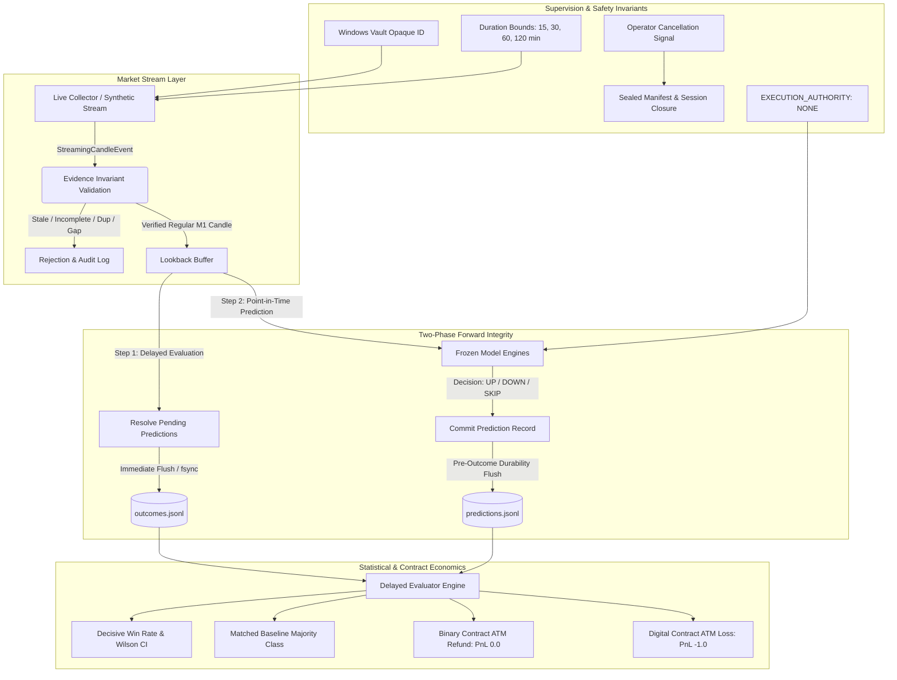

# Phase 40B: Prospective AI Shadow Observation Architecture & Operational Manual

## 1. Executive Summary & Core Invariants

Phase 40B integrates the verified Market Collector V2 streaming pipeline, frozen candidate model registry, immutable two-phase prediction journal, and Phase 41 decision/evaluation rules into a unified, operator-supervised prospective shadow observation workflow for EURUSD M1 models.



### Mandatory Research Safety Invariants

1. **`execution_authority = NONE`**: Models produce predictions solely for prospective scientific evaluation. The software contains no trade placement, buy/sell, order routing, balance mutation, or demo execution capabilities.
2. **`NO_DEMONSTRATED_EDGE`**: Candle-close comparisons are hypothetical research benchmarks and never observed broker order settlements. No statistical trading edge has been established.
3. **Point-in-Time Commitment**: A prediction record must be durably committed with cryptographic fingerprints (`feature_fingerprint`, `prediction_fingerprint`) to `predictions.jsonl` strictly prior to the observation or arrival of the candle that resolves its outcome.
4. **Delayed Independent Outcome Resolution**: Predictions are resolved only when subsequent completed market candles arrive at $t_{\text{maturity}} \ge t_{\text{cutoff}} + 60\text{s}$.
5. **Multi-Model Isolation**: Candidate models evaluate concurrently without cross-model data contamination; predictions are indexed uniquely by `(session_id, model_id, feature_cutoff_ts)`.
6. **No Unattended Execution**: Sessions are operator-supervised foreground tasks with strict duration bounds ($15, 30, 60, 120$ minutes) and clean fail-closed teardown.

---

## 2. Mathematical Formulations & Contract Economics

Generic directional accuracy on close-to-close returns fails to represent binary and digital financial option payoff structures. Phase 40B strictly distinguishes generic research metrics from contract-specific economics.

### 2.1 Populations & Rates

Given $N$ total observation opportunities:
- $N_{\text{trades}}$: Trades where the model issued an active directional decision (`UP` or `DOWN`), satisfying confidence threshold $\tau$ (i.e. $p \ge \tau$ or $p \le 1 - \tau$).
- $N_{\text{skip}}$: Trades abstained (`SKIP`) due to insufficient confidence or policy exclusion.
- Coverage: $C = \frac{N_{\text{trades}}}{N}$.
- Abstention Rate: $A = \frac{N_{\text{skip}}}{N} = 1 - C$.

For active trades:
- $W$: Count of winning trades (direction matched outcome).
- $L$: Count of losing trades (direction opposed outcome).
- $T$: Count of exact ATM ties ($\text{Close}_{t} == \text{Open}_{t}$).
- $N_{\text{decisive}} = W + L$ (decisive trade population).

$$\text{Win Rate}_{\text{all}} = \frac{W}{N_{\text{trades}}}$$

$$\text{Win Rate}_{\text{decisive}} = \frac{W}{W + L}$$

$$\text{Tie Rate} = \frac{T}{N_{\text{trades}}}$$

### 2.2 Contract Economics: Binary vs. Digital Options

Let $P$ denote the broker payout percentage (e.g., $P = 0.85$ for 85% payout), and $1.0$ unit be risked per trade:

#### 1. Binary Option (With At-The-Money Refund)
Under Binary option specifications, an exact tie (ATM) returns the invested principal without profit or loss ($\text{PnL} = 0.0$).

- Payoff on Win: $+P$
- Payoff on Loss: $-1.0$
- Payoff on Tie: $0.0$

$$\text{Expectancy}_{\text{binary}} = \frac{W \cdot P - L \cdot 1.0 + T \cdot 0.0}{N_{\text{trades}}} \times 100\%$$

To achieve expected return $\ge 0$, the break-even win rate across decisive trades is:

$$W_{\text{be, decisive}} = \frac{1}{1 + P}$$

For all trades taking into account tie rate $T_{\text{rate}}$:

$$W_{\text{be, all}} = \frac{1 - T_{\text{rate}}}{1 + P}$$

#### 2. Digital Option (At-The-Money Loss)
Under Digital option specifications, an exact tie (ATM) is treated as a loss of principal ($\text{PnL} = -1.0$).

- Payoff on Win: $+P$
- Payoff on Loss: $-1.0$
- Payoff on Tie: $-1.0$

$$\text{Expectancy}_{\text{digital}} = \frac{W \cdot P - (L + T) \cdot 1.0}{N_{\text{trades}}} \times 100\%$$

The break-even win rate for Digital options is:

$$W_{\text{be, digital}} = \frac{1}{1 + P}$$

### 2.3 Statistical Uncertainty: Wilson Score 95% Confidence Interval

Because prospective observations are bounded in sample size, point estimates of win rates are accompanied by the Wilson score confidence interval at confidence level $1 - \alpha = 0.95$ ($z = 1.95996$):

$$\hat{p} = \frac{W}{n}, \quad \text{where } n = W + L \text{ (decisive population)}$$

$$\text{CI}_{95\%} = \frac{\hat{p} + \frac{z^2}{2n} \pm z \sqrt{\frac{\hat{p}(1 - \hat{p})}{n} + \frac{z^2}{4n^2}}}{1 + \frac{z^2}{n}}$$

---

## 3. Streaming & Two-Phase Invariant Architecture

### 3.1 Streaming Candle Event Specification

Every candle observed from either the `LiveCollectorStream` or `SyntheticMarketStream` is normalized into a `StreamingCandleEvent`:

```python
@dataclass(frozen=True, slots=True)
class StreamingCandleEvent:
    candle: Candle
    received_at_utc_ts: float
    received_at_utc: str
    latency_ms: float
    clock_status: str
    clock_uncertainty_ms: float
    source_provenance: str
    request_id: str
    is_synthetic: bool = False
```

### 3.2 Evidence Rejection Rules

Incoming evidence is rejected prior to feature generation or buffer ingestion if any of the following conditions occur:
1. **Instrument/Timeframe Mismatch**: Symbol must be `"EURUSD"` and size must be `60` seconds.
2. **Incomplete Forming Candle**: `candle.is_complete` must be `True`.
3. **Prohibited OTC Data**: Any weekend or OTC-flagged candle is immediately rejected.
4. **Stale Evidence**: Observed wall clock receipt age exceeding `max_data_age_seconds` (default $300\text{s}$) is dropped.
5. **Duplicate Boundary**: `candle.to_ts` already present in `_seen_boundaries`.
6. **Temporal Continuity Gap**: `candle.from_ts != _candle_buffer[-1].to_ts` triggers a continuity gap event, rejects the discontinuous candle, and resets model alignment.

### 3.3 Two-Phase Invariant Loop Order

At each verified completed minute boundary:
1. **Delayed Evaluation**: Resolve pending predictions whose expected maturity timestamp is $\le$ current boundary. Outcome records are written and flushed with `os.fsync`.
2. **Feature Generation & Point-in-Time Inference**: Using past data $\le t_{\text{cutoff}}$ only, execute frozen model inference.
3. **Pre-Outcome Durability Commitment**: Write prediction record to `predictions.jsonl` with `os.fsync` before any future candle can be processed.
4. **State Publication**: Update atomic `state.json` and operator dashboard.

---

## 4. Operator Manual & Supervised Live-Acceptance Checklist

### Pre-Requisites & Pre-Flight Verification

- [ ] Repository is at verified Phase 40B commit.
- [ ] Active broker market hours: Verify current time is regular EURUSD market hours (Sunday 22:05 UTC through Friday 21:55 UTC).
- [ ] Target account is stored in Windows Credential Vault:
  ```powershell
  python -m iqoption_research.cli.main auth list
  ```
- [ ] Verify candidate model registration in frozen registry:
  ```powershell
  python -m iqoption_research.cli.main shadow list-candidates
  ```

### Acceptance Procedure

1. **Offline Simulator Dry Run (Zero Network)**:
   Verify the full prospective pipeline offline using the synthetic streaming harness:
   ```powershell
   python -m iqoption_research.cli.main shadow observe -m <MODEL_ID> --minutes 15 --synthetic
   ```
   Verify:
   - All processed candles are accepted.
   - Predictions and outcomes are recorded in `data/shadow_eval/sessions/<SESSION_ID>/`.
   - `manifest.json` is generated with `STREAM_COMPLETED_EOF`.

2. **Supervised Live Session Initiation**:
   Launch a bounded 15-minute live observation session:
   ```powershell
   python -m iqoption_research.cli.main shadow observe `
       -m <MODEL_ID> `
       --minutes 15 `
       --account-id <ACCOUNT_ID> `
       --live `
       --yes-i-understand
   ```
   Verify console output:
   - Connected strictly with read-only authority (`execution_authority = NONE`).
   - Server clock synchronization verified within $\pm 5000\text{ms}$.
   - Progress bar updates minute-by-minute.

3. **Desktop Workstation Supervised Panel**:
   Launch the Research Workstation GUI:
   ```powershell
   python -m iqoption_research.cli.main desktop
   ```
   Navigate to `Shadow Evaluation` -> `Prospective Observation` subtab:
   - Select frozen candidate model from dropdown.
   - Choose `Offline Simulator` or `Supervised Live`.
   - Monitor real-time streaming evidence treeview: Total Preds, Pending, Trades, Decisive Win%, Matched Maj%, Wilson CI, Exp Binary, Exp Digital, BE Gap.
   - Verify safety banner: `EXECUTION_AUTHORITY: NONE · NO DEMONSTRATED EDGE · STRICTLY READ-ONLY`.

4. **Session Teardown & Manifest Verification**:
   Upon session completion or cancellation:
   - Verify `session.json` records `ended_at_utc`, `actual_duration_seconds`, and `manifest_sha256`.
   - Inspect immutable `manifest.json` digest:
     ```powershell
     python -m iqoption_research.cli.main shadow inspect-session <SESSION_ID>
     ```
