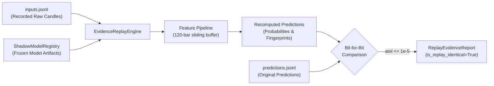

# Phase 40C Architecture: Verifiable Prospective Research Infrastructure

## 1. Executive Summary

Phase 40C transitions the IQ Option quantitative research platform from exploratory single-session prospective shadow observation to a **cryptographically verifiable, deterministic, and confirmatory multi-session research infrastructure**.

The system addresses the fundamental challenges of empirical market research on financial time series:
1. **Timing and Clock Vulnerability:** Replaces unmonitored wall clocks with monotonic clock step-detection, chronometric discipline, and broker synchronization tracking.
2. **Replayability Deficit:** Records complete, bit-for-bit normalized raw market candle inputs (`inputs.jsonl`) with canonical SHA-256 digests, enabling 100% deterministic offline replay and verification without live broker connections.
3. **Data-Peeking and Selection Bias:** Implements formal preregistered campaign protocols with cryptographic sealing (`protocol_sha256`) and confirmatory outcome blinding during active observation.
4. **Temporal Autocorrelation:** Evaluates candidate model performance against the economic break-even hurdle ($54.05\%$) using a dependence-aware Day-Block Bootstrap (20,000 replicates, fixed seed 20261123, and 2-day block sensitivity).
5. **Strict Security Boundaries:** Maintains an immutable zero-trading posture (`execution_authority = NONE`), read-only market data observation, and offline testability.

---

## 2. Evidence Schema 3 Specification

Prospective observation sessions executed under Phase 40C conform to **Evidence Schema 3**, which extends Schema 2 with timing diagnostics and complete input candle journals.

```
data/shadow_eval/sessions/<session_id>/
├── manifest.json          # Root cryptographic seal and journal digests
├── session.json           # Session configuration and metadata
├── diagnostics.jsonl      # Chronological diagnostic & clock events
├── inputs.jsonl           # Normalized input candles consumed by feature pipeline
├── predictions.jsonl      # Point-in-time model probability distributions
├── outcomes.jsonl         # Delayed candle-close resolution outcomes
└── commitments.jsonl      # Pre-expiry cryptographic commitment attestations
```

### 2.1 Manifest (`manifest.json`)
The manifest acts as the root attestation artifact. It binds all session components using SHA-256 digests:
- `session_id`: Unique identifier (e.g., `pobs_20261201_0800_eurusd_123456`).
- `schema_version`: `3`.
- `campaign_id`: Associated research campaign identifier (or `null` if ad-hoc).
- `slot_id`: Scheduled observation window identifier (or `null` if ad-hoc).
- `protocol_sha256`: Cryptographic digest of the preregistered campaign protocol.
- `predictions_sha256` & `predictions_count`: Digest and line count of `predictions.jsonl`.
- `outcomes_sha256` & `outcomes_count`: Digest and line count of `outcomes.jsonl`.
- `commitments_sha256` & `commitments_count`: Digest and line count of `commitments.jsonl`.
- `diagnostics_sha256` & `diagnostics_count`: Digest and line count of `diagnostics.jsonl`.
- `inputs_sha256` & `inputs_count`: Digest and line count of `inputs.jsonl`.
- `total_candles_processed`: Total count of market candles received and processed.
- `manifest_sha256`: Self-digest computed over all manifest fields excluding `manifest_sha256`.

### 2.2 Diagnostics Journal (`diagnostics.jsonl`)
An append-only, fsynced journal recording every timing event, clock synchronization state, socket transition, and operational milestone:
- **Event Types:** `SESSION_INITIALIZED`, `STREAM_CONNECTING`, `STREAM_CONNECTED`, `BROKER_TIME_SYNC`, `BROKER_CLOCK_STALE`, `LOCAL_CLOCK_STEP`, `CLOCK_DISAGREEMENT`, `WARMUP_PROGRESS`, `WARMUP_COMPLETED`, `PREDICTION_COMMITTED`, `COMMITMENT_QUARANTINED`, `STREAM_COMPLETED_EOF`, `SESSION_SEALED`.
- **Integrity Guarantee:** Strictly monotonic sequence numbering (`1, 2, ...`) and credential sanitization removing tokens, keys, and passwords.
- **Performance:** Direct flush and disk `fsync` on every event with median write latency under 1.0 ms.

### 2.3 Inputs Journal (`inputs.jsonl`)
An append-only log capturing the exact sequence of historical warmup candles and real-time streaming candles supplied to the feature extraction pipeline:
- **Candle Fields:** `sequence_number`, `receipt_wall_utc`, `symbol`, `timeframe`, `from_ts`, `to_ts`, `open`, `high`, `low`, `close`, `volume`, `candle_source`, `candle_sha256`.
- **Canonical Candle Hash:** 
  $$\text{SHA256}(\text{symbol} \parallel \text{timeframe} \parallel \text{from\_ts} \parallel \text{to\_ts} \parallel \text{open} \parallel \text{high} \parallel \text{low} \parallel \text{close} \parallel \text{volume})$$
  Ensures that any alteration, gap, or interpolation in market data breaks the journal verification.

### 2.4 Backward Compatibility
The verification engine (`verify_session_integrity`) maintains complete backward compatibility:
- **Schema 1:** Legacy offline sessions without commitments or inputs.
- **Schema 2:** Phase 40B prospective sessions (such as genuine pilot sessions `pobs_d2d1a79b15d8` and `pobs_7843aa5dbb1c`) possessing `commitments.jsonl` but lacking `inputs.jsonl`.
- **Schema 3:** Complete Phase 40C sessions requiring valid `diagnostics.jsonl` and `inputs.jsonl` logs.

---

## 3. Timing Diagnostics and Clock Discipline

Market prediction evaluation requires strict temporal causality. A prediction is fraudulent if it incorporates information after its feature cutoff timestamp $T_{\text{cutoff}}$, or if it is committed after maturity $T_{\text{maturity}}$.

Phase 40C deploys `ShadowTimingDiagnosticsCoordinator` to maintain dual-clock vigilance:

```
+-------------------------------------------------------------------+
|               Dual Clock Verification Framework                   |
+-------------------------------------------------------------------+
|  1. Local Monotonic vs. Wall Clock Check:                         |
|     delta_mono = now_perf_counter() - last_mono                   |
|     delta_wall = now_wall_clock() - last_wall                     |
|     drift_step = |delta_mono - delta_wall|                        |
|     IF drift_step > 50ms -> EMIT LOCAL_CLOCK_STEP EVENT           |
|                                                                   |
|  2. Remote Broker Chronometry Check:                              |
|     broker_offset = server_timestamp - client_wall_clock          |
|     round_trip_latency = t_rx - t_tx                             |
|     clock_uncertainty = round_trip_latency / 2 + jitter           |
|     IF last_sync > 15s -> EMIT BROKER_CLOCK_STALE EVENT           |
|                                                                   |
|  3. Pre-Expiry Commitment Deadline:                              |
|     post_fsync_ts < feature_cutoff_ts + 55.0s                     |
|     IF late -> QUARANTINE_LATE_COMMITMENT                         |
+-------------------------------------------------------------------+
```

1. **Local Monotonic Stepping:** Compares high-resolution monotonic hardware ticks (`time.perf_counter_ns`) against system wall clock (`time.time_ns`). If an NTP synchronization adjustment, sleep event, or manual clock change causes a divergence exceeding $50\text{ ms}$, an alert is logged to `diagnostics.jsonl`.
2. **Broker Chronometry Synchronization:** Actively tracks broker WebSocket `timeSync` packets. If time synchronization becomes stale ($> 15\text{ s}$ without a sync packet) or clock uncertainty exceeds configured thresholds, the state is recorded.
3. **Durable Fsync Commitment:** Model predictions must be written to disk and `fsync`ed before the pre-expiry deadline ($T_{\text{cutoff}} + 55.0\text{ s}$ for 60s candles). Late writes are automatically quarantined and disqualified from win-rate evaluation.

---

## 4. Deterministic Offline Evidence Replay Engine

The `EvidenceReplayEngine` enables complete offline algorithmic auditing of any recorded Schema 3 session without requiring network or broker connectivity.



### 4.1 Replay Workflow
1. **Inputs Verification:** Verifies `inputs.jsonl` SHA-256 against `manifest.json`. Verifies canonical hash and sequential continuity of every candle record.
2. **Buffer Reconstruction:** Feeds recorded candles chronologically through the identical sliding buffer structure used during live observation (120-bar warmup + incremental 1-bar steps).
3. **Identical Re-Inference:** At each historical `feature_cutoff_ts`, executes the frozen candidate model loaded from `ShadowModelRegistry`.
4. **Mathematical Verification:**
   - **Feature Fingerprints:** Recomputed feature vector SHA-256 must match `orig_pred.feature_fingerprint` identically.
   - **Prediction Probabilities:** Recomputed class probabilities must match `orig_pred.probabilities` within absolute numerical tolerance (`atol=1e-5`).
   - **Decisions:** Recomputed trading decision (`UP`, `DOWN`, `SKIP`) must match `orig_pred.decision`.
   - **Outcomes:** Recomputed candle close comparison at maturity must match `outcomes.jsonl`.

Any alteration of historical candles or model weights causes immediate replay failure with exact discrepancy reporting.

---

## 5. Preregistered Research Campaign Protocol

To eliminate confirmation bias, data-mining snooping, and arbitrary stopping rules, Phase 40C enforces preregistered research campaigns:

```
Campaign State Progression:
+-------+      register()      +------------+   first session   +--------+   40 days / 80 windows   +-----------+
| DRAFT | -------------------> | REGISTERED | ----------------> | ACTIVE | -----------------------> | COMPLETED |
+-------+                      +------------+                   +--------+                          +-----------+
                                     |
                                     v
                       protocol_sha256 locked
```

### 5.1 Protocol Specification (`CampaignProtocolSpec`)
- `campaign_id`: Unique campaign identifier.
- `protocol_version`: `40C_CONFIRMATORY_V1`.
- `symbol` & `timeframe`: e.g., `EURUSD`, 60-second candles.
- `candidate_model_id` & `candidate_threshold`: e.g., `cand_lr_eurusd_m1`, $0.55$.
- `baseline_model_id` & `baseline_threshold`: `baseline_majority_class`, $0.55$.
- `assumed_payout`: Hypothetical broker payout (0.85).
- `break_even_hurdle`: Minimum accuracy hurdle required to break even:
  $$\text{Hurdle} = \frac{1}{1 + \text{Payout}} = \frac{1}{1 + 0.85} \approx 0.540541 \quad (54.05\%)$$
- `min_total_market_days`: 40 calendar market days (Mondays through Fridays).
- `windows_per_day`: 2 sessions per day (08:00 UTC European Open and 14:00 UTC US/European Overlap).
- `min_completed_days`: 30 minimum completed days.
- `min_completed_sessions`: 60 minimum completed sessions.
- `min_decisive_outcomes`: 2,400 minimum decisive (UP/DOWN) observations.
- `bootstrap_replicates`: 20,000 resamples.
- `bootstrap_seed`: Fixed deterministic seed `20261123`.

### 5.2 Protocol Sealing
Upon invoking `register()`, a canonical JSON representation of the protocol is hashed to produce `protocol_sha256`. Subsequent observation sessions linked to the campaign must cryptographically record this hash in their `manifest.json`.

---

## 6. Confirmatory Outcome Blinding Architecture

To prevent operator bias, selective reporting, or premature stopping during active data collection, the `CampaignEvaluator` enforces **confirmatory observation blinding**:

1. **Blinded State:** While a campaign is in `REGISTERED` or `ACTIVE` state and evaluation is requested without the explicit `--unblind` override:
   - Cumulative win rate, Brier score, and bootstrap confidence intervals are masked (`0.0` or `None`).
   - The report displays operational progress only: completed days, sessions linked, verified slots, and integrity status.
   - An explicit blinding banner notifies the operator that confirmatory blinding is in effect.
2. **Unblinded State:** Upon study completion (or upon explicit supervised request via `--unblind` for interim diagnostic audits), complete statistical evaluations are unblinded and reported.

---

## 7. Dependence-Aware Day-Block Bootstrap Methodology

Financial market return observations within the same trading session exhibit strong intraday serial correlation and volatility clustering. Standard i.i.d. Bernoulli binomial confidence intervals (such as Wilson score intervals) underestimate uncertainty by failing to account for intraday dependence.

Phase 40C implements a **Day-Block Bootstrap**:

```
Given observations partitioned into D distinct calendar trading days:
Day 1: [O_1,1, O_1,2, ..., O_1,N1]  -> (Wins_1, Losses_1)
Day 2: [O_2,1, O_2,2, ..., O_2,N2]  -> (Wins_2, Losses_2)
...
Day D: [O_D,1, O_D,2, ..., O_D,ND]  -> (Wins_D, Losses_D)

For replicate b = 1 .. 20,000:
  Sample D days with replacement: (d*_1, d*_2, ..., d*_D)
  Aggregate total resampled wins and losses:
    W*_b = sum(Wins_d*)
    L*_b = sum(Losses_d*)
  Compute resampled accuracy:
    Acc*_b = W*_b / (W*_b + L*_b)

95% Confidence Interval: [Percentile(Acc*, 2.5%), Percentile(Acc*, 97.5%)]
```

### 7.1 Two-Day Block Sensitivity Analysis
To assess longer-memory multi-day macroeconomic autocorrelation, the engine also computes a two-consecutive-day block bootstrap over non-overlapping pairs $([D_1, D_2], [D_3, D_4], \dots)$.

### 7.2 Paired Majority Baseline Comparison
Every candidate prediction is evaluated on the exact same timestamp against the frozen pre-observation majority benchmark (`DOWN`). The paired accuracy difference $\Delta = \text{Acc}_{\text{cand}} - \text{Acc}_{\text{majority}}$ is bootstrapped across daily blocks to determine whether the candidate outperforms the baseline with 95% statistical confidence ($\text{CI}_{\text{lower}} > 0$).

---

## 8. Conservative Scientific Disposition Verdicts

The `CampaignEvaluator` issues one of four mutually exclusive, strictly defined scientific disposition verdicts:

| Verdict | Trigger Criteria | Meaning |
| :--- | :--- | :--- |
| **`INTEGRITY_FAILURE`** | Any linked session fails cryptographic manifest or journal integrity checks. | Evidence corrupted or tampered; all findings invalid. |
| **`INSUFFICIENT_EVIDENCE`** | Target sample sizes unmet ($< 2,400$ decisive outcomes, $< 30$ days, or $< 60$ sessions). | Campaign incomplete; insufficient data to evaluate hypotheses. |
| **`NO_DEMONSTRATED_EDGE`** | Sample targets met, but 95% bootstrap lower bound does not exceed hurdle ($54.05\%$) OR candidate does not outperform paired majority baseline. | Null hypothesis cannot be rejected; model exhibits no tradable edge. |
| **`FURTHER_RESEARCH_JUSTIFIED`** | Sample targets met, 95% Day-Block Bootstrap lower bound $> 54.05\%$, AND paired baseline difference lower bound $> 0.0\%$. | Candidate clears economic and statistical hurdles under confirmatory protocol. |

---

## 9. Security and Operational Invariants

1. **`execution_authority = NONE`**: The repository contains zero order-execution pathways, broker balance modification functions, or autonomous trading logic.
2. **Read-Only Connection Enforcement**: The WebSocket client enforces `assert_read_only()` immediately following authentication.
3. **Offline Testability**: 100% of unit and regression tests run completely offline using synthetic data generators and recorded mocks.
4. **Immutability of Historical Evidence**: Historical pilot sessions (`pobs_d2d1a79b15d8` and `pobs_7843aa5dbb1c`) and frozen model bundles remain bit-for-bit unchanged.
5. **No Demonstrated Edge**: All platform outputs, CLI summaries, and GUI panels display prominent scientific disclaimers confirming that no predictive edge has been demonstrated.
