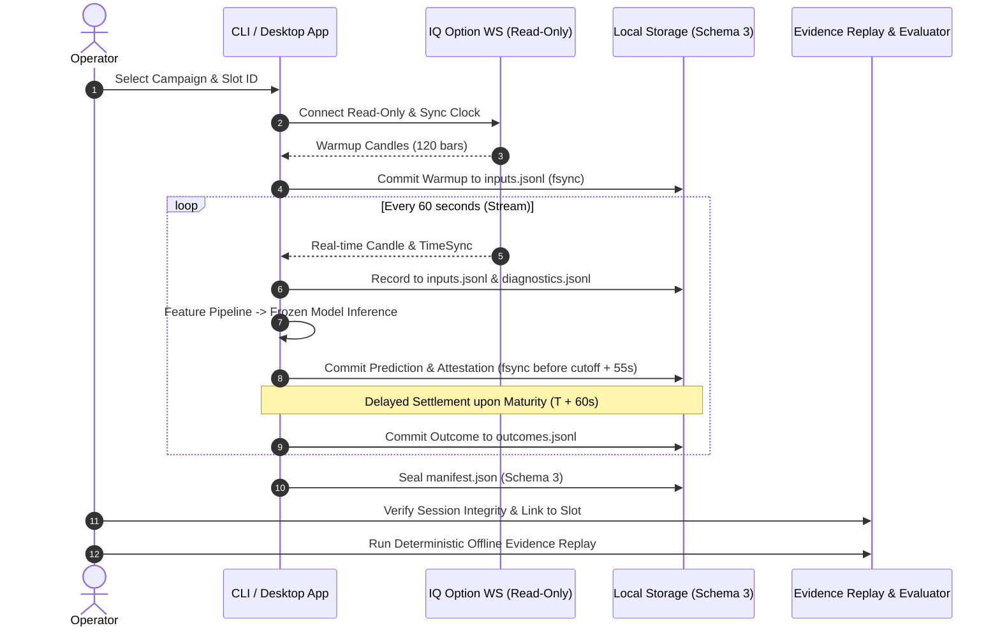

# Phase 40C: Preregistered Confirmatory Research Campaign Protocol

## Protocol Identifier: `40C_CONFIRMATORY_V1`

> **MANDATORY RESEARCH DISCLAIMER**  
> THIS PROTOCOL GOVERNS STRICTLY NON-EXECUTING, READ-ONLY MARKET OBSERVATION RESEARCH.  
> IT DOES NOT AUTHORIZE, ENABLE, OR CONDUCT LIVE BROKER ORDERS, WALLET MUTATIONS, OR FINANCIAL TRADING.  
> ALL SETTLEMENT CALCULATIONS ARE HYPOTHETICAL CANDLE-CLOSE SIMULATIONS BASED ON AN ASSUMED 85% BROKER PAYOUT.  
> NO PREDICTIVE EDGE HAS BEEN DEMONSTRATED (`NO_DEMONSTRATED_EDGE`).

---

## 1. Research Objectives and Target Population

The purpose of this protocol is to conduct a rigorous, operator-supervised prospective evaluation of machine learning candidate models on 1-minute financial candles (`EURUSD`, 60-second timeframe), eliminating data-peeking bias, survivorship bias, and temporal autocorrelation distortion.

### 1.1 Study Population and Schedule
- **Target Instrument:** `EURUSD` binary option market data feed.
- **Timeframe:** 60 seconds (1-minute candles).
- **Target Population Duration:** 40 consecutive eligible market days (excluding Saturdays and Sundays).
- **Scheduled Observation Windows:** Exactly 2 sessions per market day:
  1. **Window 1 (European Morning Open):** 08:00 UTC (09:00 local time in Casablanca during UTC+1 standard time).
  2. **Window 2 (US / European Session Overlap):** 14:00 UTC (15:00 local time in Casablanca during UTC+1 standard time).
- **Window Duration:** 60 minutes per session (120-candle warmup + up to 60 streaming observation bars).
- **Total Planned Windows:** 80 observation slots ($40 \text{ days} \times 2 \text{ windows/day}$).

### 1.2 Minimum Required Sample Targets
To achieve adequate statistical power to evaluate a $54.05\%$ break-even hurdle at $\alpha = 0.05$:
- **Minimum Completed Market Days:** 30 days.
- **Minimum Completed Verified Sessions:** 60 sessions.
- **Minimum Decisive (UP/DOWN) Outcomes:** 2,400 observations.

---

## 2. Preregistration and Cryptographic Protocol Sealing

To adhere to open-science confirmatory standards, campaign parameters are formalized before prospective data collection begins.

### 2.1 Campaign Lifecycle States
1. **`DRAFT`**: Protocol parameters and the 80-window calendar are initialized.
2. **`REGISTERED`**: The protocol is formalized and locked. A canonical SHA-256 digest (`protocol_sha256`) is computed and stored. No protocol parameters may be modified after registration.
3. **`ACTIVE`**: Supervised observation sessions are executed and linked to scheduled slots.
4. **`COMPLETED`**: All 40 market days / 80 windows have been observed and verified.

### 2.2 Protocol Canonical Hash Calculation
The `protocol_sha256` digest is generated over a canonical JSON dictionary containing:
- `campaign_id`
- `protocol_version` (`40C_CONFIRMATORY_V1`)
- `symbol` (`EURUSD`)
- `timeframe` (`60`)
- `candidate_model_id` & `candidate_threshold`
- `baseline_model_id` & `baseline_threshold`
- `assumed_payout` (`0.85`)
- `break_even_hurdle` (`0.5405405405405405`)
- `min_total_market_days` (`40`)
- `min_completed_days` (`30`)
- `min_completed_sessions` (`60`)
- `min_decisive_outcomes` (`2400`)
- `bootstrap_replicates` (`20000`)
- `bootstrap_seed` (`20261123`)
- `registered_at_utc`

---

## 3. Confirmatory Observation Blinding Protocol

### 3.1 Rationale for Blinding
Interim inspection of empirical win rates induces operator bias, cherry-picking, and arbitrary early-stopping of research campaigns when results happen to peak. Confirmatory study designs require outcome blinding until data collection is complete.

### 3.2 Blinding Rules
1. While a campaign is in `REGISTERED` or `ACTIVE` status, standard status queries and reports (`agy campaign status`, `agy campaign analyze`, and GUI panels) mask all win-rate and statistical performance figures.
2. The report surfaces operational progress: completed days, linked sessions, verified integrity count, and socket connectivity.
3. If an operator requires an interim diagnostic check for technical audit purposes, they must pass the explicit `--unblind` flag. Interim unblinded queries are recorded in audit logs.

---

## 4. Operator Execution Guide

The supervised operator follows these standardized steps for each observation window:



### 4.1 Initializing and Registering a Campaign (One-Time Setup)
```bash
# 1. Create a campaign draft for EURUSD starting on a specified date
python -m iqoption_research.cli.main campaign create \
    --campaign-id camp_eurusd_confirmatory_01 \
    --candidate-model cand_lr_eurusd_m1 \
    --candidate-threshold 0.55 \
    --start-date 2026-12-01

# 2. Review generated calendar slots and lock preregistration
python -m iqoption_research.cli.main campaign register camp_eurusd_confirmatory_01
```

### 4.2 Executing an Observation Window via CLI
```bash
# Inspect upcoming scheduled slots
python -m iqoption_research.cli.main campaign status camp_eurusd_confirmatory_01

# Run supervised observation for a designated slot (e.g. slot_001)
python -m iqoption_research.cli.main shadow prospective-observe \
    --model cand_lr_eurusd_m1 \
    --duration 60 \
    --campaign-id camp_eurusd_confirmatory_01 \
    --slot-id slot_001
```

### 4.3 Executing an Observation Window via Desktop GUI
1. Launch the Desktop application:
   ```bash
   python -m iqoption_research.cli.main desktop
   ```
2. Navigate to **Tab 4 (Prospective Observation)** on the `ShadowEvaluationPanel`.
3. In the **Research Campaign Linkage** group, select the registered campaign from the **Campaign** dropdown.
4. Select the current scheduled slot from the **Slot** dropdown.
5. Verify the **Blinding Notice** indicates `Campaign: ACTIVE (Blinded)`.
6. Click **Start Prospective Observation**. The background supervisor executes read-only market data collection, durable fsynced prediction commitments, and delayed outcome resolution.

### 4.4 Auditing Session Evidence Offline
After each session completes:
```bash
# Verify session cryptographic sealing and Schema 3 compliance
python -m iqoption_research.cli.main shadow verify-session pobs_20261201_0800_eurusd_123456

# Verify input candles against manifest
python -m iqoption_research.cli.main shadow verify-inputs pobs_20261201_0800_eurusd_123456

# Execute bit-for-bit deterministic offline evidence replay
python -m iqoption_research.cli.main shadow replay-evidence pobs_20261201_0800_eurusd_123456 --tolerance 1e-5
```

---

## 5. Statistical Evaluation Methodology

### 5.1 Economic Break-Even Hurdle
For binary options settled at close with assumed payout ratio $R = 0.85$ (win yields $+0.85$, loss yields $-1.00$, ties yield $0.00$):
$$\text{Expected PnL} = p \cdot R - (1 - p) \cdot 1.0 = 0 \implies p^* = \frac{1}{1 + R} = \frac{1}{1.85} \approx 54.054\%$$

A candidate model is economically viable only if its decisive accuracy statistically exceeds $54.05\%$.

### 5.2 Dependence-Aware Day-Block Bootstrap
To account for intraday serial correlation:
1. Observations are clustered by calendar trading day $d \in \{1, \dots, D\}$.
2. $B = 20,000$ bootstrap replicates are drawn by resampling entire calendar days with replacement using fixed PRNG seed `20261123`.
3. For each replicate $b$, the aggregate decisive accuracy is computed:
   $$\text{Acc}_b^* = \frac{\sum_{i=1}^D W_{d_i^*}}{\sum_{i=1}^D (W_{d_i^*} + L_{d_i^*})}$$
4. The 95% confidence interval is the 2.5th and 97.5th percentiles of $\{\text{Acc}_b^*\}_{b=1}^{20,000}$.
5. A two-day block sensitivity bootstrap is computed over consecutive 2-day pairs to test for multi-day dependency.

### 5.3 Paired Benchmark Comparison
The pre-observation majority benchmark (`baseline_majority_class`, predicting `DOWN`) is evaluated on the exact same timestamps where the candidate model selected a trade. The paired difference $\Delta = \text{Acc}_{\text{cand}} - \text{Acc}_{\text{baseline}}$ is bootstrapped across daily blocks.

---

## 6. Scientific Decision Rules & Verdict Criteria

Upon unblinded evaluation (`agy campaign analyze <campaign_id> --unblind`), the system issues a definitive verdict:

```
                                  [Check Session Integrity]
                                             |
                         +-------------------+-------------------+
                         | Any check failed?                     | No
                        YES                                      v
                         |                              [Check Sample Size]
                         v                                       |
                INTEGRITY_FAILURE                        +-------+-------+
                                                         | < 2,400 decis?| No
                                                        YES              v
                                                         |       [Check Hurdle & Baseline]
                                                         v               |
                                                INSUFFICIENT_EVIDENCE    +-------+-------+
                                                                         | Clears both?  | No
                                                                        YES              v
                                                                         |      NO_DEMONSTRATED_EDGE
                                                                         v
                                                            FURTHER_RESEARCH_JUSTIFIED
```

1. **`INTEGRITY_FAILURE`**: Any session failed manifest or journal checksum verification. All empirical results are invalid.
2. **`INSUFFICIENT_EVIDENCE`**: Fewer than 2,400 decisive observations, fewer than 30 completed days, or fewer than 60 completed sessions.
3. **`NO_DEMONSTRATED_EDGE`**: Sample size requirements met, but either:
   - 95% Day-Block Bootstrap lower bound $\le 54.05\%$, OR
   - 95% Paired Baseline Difference lower bound $\le 0.0\%$.
4. **`FURTHER_RESEARCH_JUSTIFIED`**: Sample size requirements met, 95% Day-Block Bootstrap lower bound $> 54.05\%$, AND 95% Paired Baseline Difference lower bound $> 0.0\%$.

---

## 7. Compliance and Security Declarations

- **Broker Execution:** Strictly prohibited. `execution_authority = NONE`.
- **Wallet Invariants:** Read-only observation; zero balance modifications.
- **Reproducibility:** 100% reproducible via `agy shadow replay-evidence` without active internet access.
- **Reporting Disclaimer:** Every export and summary must prominently display the standard `NO_DEMONSTRATED_EDGE` scientific disclaimer.
