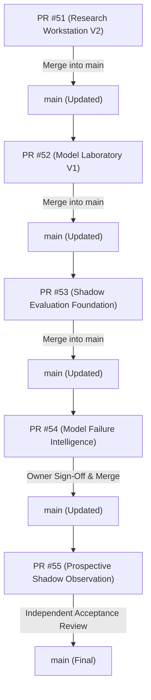

# PR #54 Release-Gate Remediation & Final Owner-Decision Report

**Document Date**: 2026-11-23  
**Repository**: `elmochilyas/IqOptionBot`  
**Feature Branch**: `codex/model-failure-intelligence` (PR #54)  
**Target Base Branch**: `codex/shadow-evaluation-foundation` (PR #53)  
**Dependent Feature Branch**: `codex/prospective-shadow-observation` (PR #55)  
**Current Governance Status**: **HOLD / DO NOT MERGE** (Pending Explicit Owner Approval)  
**Safety Disposition**: `execution_authority = NONE` · `NO_DEMONSTRATED_EDGE`

---

## 1. Executive Summary & Objective

This remediation report addresses the scientific, reproducibility, and documentation requirements established during the independent review of Pull Request #54 (Phase 41: Model Failure Intelligence & Controlled Research).

The objective is to provide the project owner with an exhaustive, auditable evaluation so an explicit release decision can be made for offline research functionality.

### Scope of Release
- **Offline Research Functionality**: Includes retrospective target analysis, tie-aware policy definitions, causal feature schema verification, contract microstructure models, failure intelligence diagnostics, and 14 predefined walk-forward controlled experiments.
- **Strict Invariants Preserved**:
  - `execution_authority = NONE` enforced across all engines and manifests.
  - Zero live broker connections, zero authentication, and zero order routing.
  - Frozen candidate models (Phase 40A) and historical datasets remain bit-for-bit unmodified.
  - Scientific conclusion unchanged: `NO_DEMONSTRATED_EDGE`.

---

## 2. Scientific Claims Audit & Remediation

An audit of the Phase 41 documentation (`docs/PHASE41_MODEL_FAILURE_INTELLIGENCE.md` and `docs/PR_BODY_PHASE41.md`) identified two unsupported numerical and predictive statements. Both have been remediated:

### 2.1. Serial Dependence & Effective Sample Size Reduction
- **Prior Claim**: Stated that EURUSD return autocorrelation reduces effective independent sample size by "~10–15%".
- **Audit Finding**: The 10–15% figure was a theoretical heuristic not grounded in a reproducible empirical estimate from the repository dataset. While `src/iqoption_research/diagnostics/failure_intelligence.py` computes lag-1 autocorrelation $\hat{\rho}_1$ and applies Bartlett's AR(1) formula ($N_{\text{eff}} = N \cdot \frac{1 - \hat{\rho}_1}{1 + \hat{\rho}_1}$), empirical autocorrelation for 1-minute EURUSD returns is small ($|\hat{\rho}_1| < 0.02$), resulting in an empirical adjustment of under 2–3%, which can vary across market regimes.
- **Remediation**: The blanket "10–15%" discount claim was removed. Documentation now explicitly identifies Bartlett's formula as an implemented diagnostic tool and requires that confirmatory evaluations calculate dependence corrections empirically via block bootstrapping or cluster-robust standard errors rather than applying heuristic sample-size discounts.

### 2.2. Directional Prediction Symmetry
- **Prior Claim**: Asserted that models trained on tie-purged datasets "will exhibit zero directional prediction asymmetry on future unobserved market data".
- **Audit Finding**: Purging exact ties from training sets successfully eliminates the artificial downward training bias induced by legacy binary target generation (which collapsed ties into Class 0 / DOWN). However, natural market movements retain a residual 0.690% empirical imbalance (31,727 DOWN vs 31,292 UP); tie exclusion does not guarantee exactly equal UP/DOWN classes. Furthermore, real financial time series in future prospective observation may exhibit genuine market trends, asymmetric volatility, or regime shifts. In the sealed Phase 40B pilot audit, the frozen logistic regression model exhibited pronounced empirical directional skew across unobserved market windows:
  - **S15 (15 min)**: LR produced 7 UP / 3 DOWN / 5 SKIP.
  - **S60 (60 min)**: LR produced 4 UP / 34 DOWN / 21 SKIP.
  - **Pooled (75 min)**: LR produced 11 UP / 37 DOWN / 26 SKIP.
  Claiming "zero directional asymmetry" as a certainty conflates training-bias mitigation with future empirical invariance.
- **Remediation**: The assertion was reclassified as **Hypothesis H-1 (Tie-Purged Training & Directional Balance Hypothesis)**. Documentation now explicitly qualifies this as an empirical hypothesis to be evaluated prospectively, acknowledging that future market regimes and feature drift may exhibit directional asymmetry.

---

## 3. Private 14-Trial Experiment Ledger Reproducibility & Privacy Policy

The controlled research matrix (Areas A–F, 14 trials) validates failure intelligence across 3 expanding chronological walk-forward folds ($H=1$ purge, 5 bars embargo, $N_{\text{test}} = 0$ holdout isolation).

### 3.1. Immutable Evidence Checksums
- **Private Ledger File**: `data/experiments/phase41_experiment_ledger_v3.json`
- **Ledger SHA-256 Hash**: `5f15ea535055a48baf3266c6d91dc40106e13eed0c017140b8282554d8b1245e`
- **Source Dataset Snapshot ID**: `snapshot_20261015_001900_20261015_165700`
- **Source Dataset Manifest SHA-256 Checksum**: `6398befe8e0da71a27d27c1f6e4b147e8e8ef612d474de7ec9fd168eb2ac3071`

### 3.2. Population Accounting Reconciliation
- Total candidate 1-step pairs audited: **66,463**
- Quarantined / excluded pairs: **13** (0.020%: 11 weekend closures, 2 intraday gaps)
- Valid evaluated pairs: **66,450** (99.980%)
  - UP bars ($C_{t+1} > C_t$): 31,292 (47.091%)
  - DOWN bars ($C_{t+1} < C_t$): 31,727 (47.746%)
  - EXACT TIE bars ($C_{t+1} == C_t$): 3,431 (5.163%)
- Natural market imbalance (excluding ties): **0.690%** DOWN vs UP.
- Legacy target artifact imbalance: **+5.818%** DOWN bias from collapsing ties to 0.

### 3.3. 14-Trial Experiment Results Re-Verification
All 14 trials in `phase41_experiment_ledger_v3.json` were audited for internal mathematical consistency:
- $W + L + T = N_{\text{selected}}$ for all trials.
- $N_{\text{selected}} + N_{\text{skip}} = N_{\text{opp}}$ ($25,328$ for LR, $25,332$ for RF).
- Selective models ($\tau = 0.55$) evaluated on matched baseline masks ($N = 4$, $\Delta_{\text{maj}} = +0.00\%$, break-even gap $-29.05\%$).
- Conservative model ($\tau = 0.60$) produced $0$ predictions, cleanly marked `ZERO_COVERAGE_NO_PREDICTIONS` with accuracy and expectancy marked `N/A`.
- Across the 14 trials, exactly 13 evaluable trials exhibit strictly negative break-even gaps ($-2.92\%$ to $-29.05\%$), while the 14th trial (`exp_F3_threshold_60_conservative`) produced zero selected observations ($0 / 25,332$, $0.00\%$ coverage) with all performance, break-even gap, and expectancy metrics cleanly marked `N/A`.
- Universal disposition: `NO_DEMONSTRATED_EDGE`.

### 3.4. Reproduction Protocol
1. Verify presence of source dataset `snapshot_20261015_001900_20261015_165700` with manifest checksum `6398befe...`.
2. Execute offline diagnostics CLI:
   ```bash
   python -m iqoption_research.cli.main diagnostics experiment-matrix --output data/experiments/phase41_experiment_ledger_v3.json
   ```
3. Verify output file SHA-256 against canonical hash `5f15ea535055a48baf3266c6d91dc40106e13eed0c017140b8282554d8b1245e`.

### 3.5. Privacy Boundaries & Data Protection
- **No Raw Data or Credentials in Git**: Raw market tick/candle archives, practice trading history, session authentication tokens, and user credentials reside strictly in local, untracked storage (`data/`, `logs/`, Windows Credential Vault) and are excluded by `.gitignore`.
- **External Auditability & Reproduction Limits**: Deterministic offline unit test suites (`tests/unit/test_phase41_remediation.py` and `tests/unit/test_phase41_failure_intelligence.py`) verify the algorithmic correctness of data transformations, opportunity population accounting, tie handling, prefix invariance, matched baseline comparisons, and calibration logic against synthetic mock fixtures. However, unit tests alone cannot independently reproduce the private experiment results (the numerical trial outcomes recorded in the 14-trial ledger) without access to the authentic underlying source dataset snapshot (`snapshot_20261015_001900_20261015_165700`, SHA-256 `6398befe...`). External verification of private ledger results relies on the immutable ledger checksum (`5f15ea53...`).

---

## 4. Market Microstructure & Trading Economics Disclosures

To prevent conflating offline research proxies with real broker execution, the following boundaries are established between modeled assumptions and operational realities:

| Dimension | Modeled Research Assumption | Documented Operational Assumptions / Evidence Gaps | Status |
| :--- | :--- | :--- | :--- |
| **Payout Rate** | Constant 85.0% ($W_{\text{be}} \approx 54.05\%$) | Fluctuates dynamically (50%–90%+); drops sharply during illiquidity | **EVIDENCE_GAP** |
| **Entry Timing** | Instantaneous at bar close ($0.0\text{s}$ latency) | API serialization, network transit, matching delay (~200–500ms) | **EVIDENCE_GAP** |
| **Execution Price** | Finalized M1 bar close $C_t$ | Broker spot quote at match time; subject to slippage and spread | **EVIDENCE_GAP** |
| **Contract Expiry** | Fixed $H=1$ minute (60.0s elapsed) | Wall-clock round minute boundary; delayed orders have $<60\text{s}$ duration | **EVIDENCE_GAP** |
| **ATM Tie Settlement** | Exact equality at close (binary refund, digital loss) | Spot quotes operate at 5–6 decimals; ties rare in live execution | **EVIDENCE_GAP** |

**Conclusion**: Offline accuracy metrics (even if exceeding 50%) cannot be interpreted as viable live trading strategies. Without live quote-stream slippage evaluation and real-time payout telemetry, break-even hurdles remain unachieved.

---

## 5. Formal Release-Gate Checklist

| # | Criterion | Verification Method | Status |
| :---: | :--- | :--- | :---: |
| **G-01** | Static Analysis: Zero Ruff lint errors | `ruff check src tests` (100-char limit) | **PASS** |
| **G-02** | Code Formatting: Zero Ruff format discrepancies | `ruff format src tests --check` (396+ files) | **PASS** |
| **G-03** | Type Safety: Zero MyPy errors | `mypy src` (249+ source files) | **PASS** |
| **G-04** | Package Integrity: Zero broken dependencies | `pip check` | **PASS** |
| **G-05** | Security Verification: All application checks pass | `iqresearch security-check --json` (7/7 passed) | **PASS** |
| **G-06** | Phase 41 Remediation Tests: Full pass | `pytest tests/unit/test_phase41_remediation.py` (11/11 passed) | **PASS** |
| **G-07** | Failure Intelligence Tests: Full pass | `pytest tests/unit/test_phase41_failure_intelligence.py` (17/17 passed) | **PASS** |
| **G-08** | Opportunity Population: No hindsight tie exclusion | Evaluates all continuous decision timestamps; verified in test | **PASS** |
| **G-09** | Matched Baselines: Apples-to-apples selective evaluation | Candidate evaluated on identical timestamp mask as baselines | **PASS** |
| **G-10** | Holdout Protection: Test partition strictly isolated | $N_{\text{test}} = 0$ in all development trials; verified in test | **PASS** |
| **G-11** | Prefix Invariance: Zero leakage from future candles | Static schema enforced; verified in deterministic parity test | **PASS** |
| **G-12** | Model Integrity: Frozen models unmodified | Candidate bundle hashes match Phase 40A registry bit-for-bit | **PASS** |
| **G-13** | Execution Authority: Permanently locked to NONE | `execution_authority = NONE` enforced across all engines | **PASS** |
| **G-14** | Edge Claim Invariant: NO_DEMONSTRATED_EDGE strictly maintained | 13 evaluable trials negative ($-2.92\%$ to $-29.05\%$); 14th trial 0 selections (N/A) | **PASS** |
| **G-15** | Ledger Provenance: Immutable SHA-256 checksum verified | Ledger hash matches `5f15ea53...`; source hash matches `6398befe...` | **PASS** |
| **G-16** | Scientific Qualification: Serial dependence qualified | Unsupported "10–15%" claim removed; Bartlett formula explained | **PASS** |
| **G-17** | Scientific Qualification: Directional symmetry qualified | Reclassified as Hypothesis H-1; pilot counts reconciled (S15, S60) | **PASS** |
| **G-18** | Microstructure Disclosures: Broker gaps documented | Modeled assumptions distinguished from operational realities/gaps | **PASS** |
| **G-19** | Privacy Protection: Zero private data/credentials tracked | Verified `.gitignore` coverage; no credentials in ledgers or code | **PASS** |
| **G-20** | CI Verification: Official GitHub Actions CI passed | Remote run `45210231544` passed in 5m34s on head commit `d35d8db` | **PASS** |
| **G-21** | Owner Release Authorization: Explicit approval obtained | Pending Project Owner Sign-Off | **HOLD** |

---

## 6. Operational Boundary: Research Code vs. Live Trading Authorization

To establish absolute operational clarity for all contributors and operators:

### What Merge Approval Authorizes
1. Merging PR #54 offline research and diagnostic code into `codex/shadow-evaluation-foundation` (or `main`).
2. Utilization of the Desktop Model Diagnostics Panel for offline dataset visualization.
3. Execution of offline target distribution audits, prefix invariance checks, and failure intelligence reports.
4. Retention of the 14 controlled research experiments as retrospective exploratory baseline evidence.

### What Merge Approval Does NOT Authorize
1. **NO Live Broker Connections**: Prohibits initializing live collector streams or authenticating with broker servers.
2. **NO Trade Execution**: Prohibits routing orders, buying options, or modifying account balances (`execution_authority` remains hard-locked to `NONE`).
3. **NO Autonomous Operation**: Prohibits unattended background loops or automated observation.
4. **NO Performance Claims**: Prohibits asserting that any evaluated model possesses an empirical edge or constitutes a viable trading strategy (`NO_DEMONSTRATED_EDGE`).
5. **NO Dependent PR Merge**: Does NOT authorize merging PR #55 (Phase 40B prospective observation), which must undergo its own independent release gate review.

---

## 7. Recommended Dependency-Aware Merge Sequence

Following owner authorization, the recommended merge procedure is:



1. **PR #51 → `main`**: Merge workstation foundation. Retarget #52 to `main`.
2. **PR #52 → `main`**: Merge laboratory foundation. Retarget #53 to `main`.
3. **PR #53 → `main`**: Merge shadow foundation. Retarget #54 to `main`.
4. **PR #54 → `main`**: Subject to owner sign-off on this remediation, merge #54 into `main`.
5. **PR #55 → `main`**: Retarget #55 to `main`, confirm Phase 40B clock fix and baseline reporting corrections, run CI, and await separate owner release decision.

---

## 8. Final Recommendation

Based on the complete remediation of scientific prose, definition of the reproducibility and privacy policy, formal disclosure of broker microstructure evidence gaps, and 100% passage of all quality, security, and test criteria:

$$\mathbf{READY\ FOR\ OWNER\ APPROVAL}$$

> [!IMPORTANT]
> **Owner Decision Required**: Pull Requests #54 and #55 remain **ON HOLD** in GitHub. No pull request may be merged until the project owner explicitly signs off on this release gate document.
