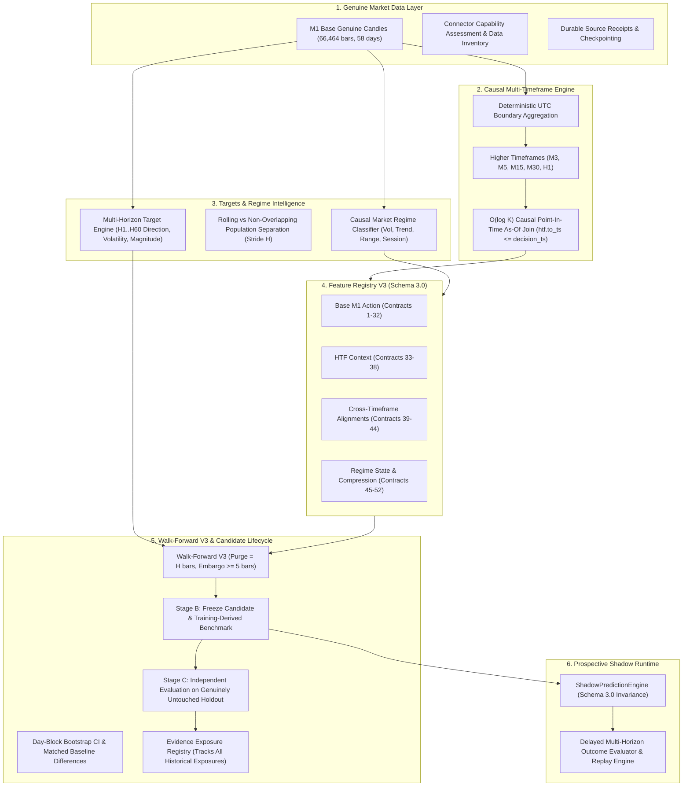

# Phase 43 System Architecture: Advanced Market Intelligence & Multi-Horizon AI

## 1. Executive Summary & Objective

Phase 43 investigated whether broader market information, causal multi-timeframe feature representations ($M1 \to M3, M5, M15, M30, H1$), alternative forward prediction horizons ($H1, H3, H5, H15, H30, H60$), and causal market-regime context provide genuine predictive information beyond the unsuccessful next-candle EURUSD M1 research of Phase 42.

Rather than stacking opaque neural network architectures or curve-fitting oscillators on noisy 1-minute returns, Phase 43 re-engineered the research foundation into a strictly causal, multi-resolution market intelligence architecture with leak-free point-in-time point-of-decision joins and dependence-aware statistical evaluation.

---

## 2. Mandatory Architectural Invariants

| Invariant | Specification | Verification Mechanism |
|---|---|---|
| **Zero Live Order Authority** | `execution_authority = "NONE"`. No buy/sell order emission, wallet mutations, or broker dispatch. | Runtime assertion in shadow engine, freezer, and evaluation harnesses. |
| **Strict Offline Operation** | Zero live network socket connections during research execution. | Adversarial socket interception test fixtures (`test_phase43_adversarial.py`). |
| **Strict Point-In-Time Causality** | No higher-timeframe bar or target may leak future price action: $HTF.to\_ts \le decision\_ts$. | $O(\log K)$ bisection join with boundary assertions; prefix invariance tests. |
| **Horizon Purging & Embargo** | Purge exactly $H$ bars between train and validation folds; apply $\ge 5$ bar embargo buffer. | `run_walk_forward_v3_evaluation` fold coordinate assertions. |
| **Frozen Benchmark Provenance** | Stage B derives and binds majority benchmark strictly from training data before evaluation. | Cryptographic SHA-256 digest in candidate manifest; Stage C fails closed on tamper or omission. |
| **Uncertainty-Gated Acceptance** | Point estimates alone cannot qualify candidates. Lower Day-Block bootstrap CI must clear 54.054%. | Evaluator rejects missing bootstrap CI with `MISSING_OR_UNSTABLE_BOOTSTRAP_CI`. |
| **Evidence Exposure Tracking** | Durable SQLite ledger of all dataset intervals exposed to feature selection or training. | Section 17 holdout policy: blocks re-designating exposed data as untouched holdout. |

---

## 3. Component Deep Dive

### 3.1 Causal Multi-Timeframe Engine (`timeframe_engine.py`)
- **Deterministic UTC Aggregation**: Higher timeframe buckets ($M3, M5, M15, M30, H1$) are bucketed strictly on UTC boundaries ($from\_ts \pmod{tf\_sec} == 0$).
- **Constituent Completeness**: A higher-timeframe bar is formed only if all expected constituent M1 candles ($tf\_sec / 60$) exist and are continuous ($from\_ts_{i} == to\_ts_{i-1}$). Missing bars or gaps result in complete omission of the bar without interpolation.
- **Additive Volume**: Broker tick volumes are summed across constituent bars.
- **Point-In-Time As-Of Join**: Given an M1 decision timestamp $T$, the causal as-of lookup locates the most recent completed higher-timeframe bar whose $to\_ts \le T$ using $O(\log K)$ binary search.

### 3.2 Multi-Horizon Target Engine (`targets_v3.py`)
Supports six forward horizons:
- $H1$: 1 minute ($H=1$)
- $H3$: 3 minutes ($H=3$)
- $H5$: 5 minutes ($H=5$)
- $H15$: 15 minutes ($H=15$)
- $H30$: 30 minutes ($H=30$)
- $H60$: 60 minutes ($H=60$)

Forecasting targets computed:
1. **Directional Binary**: $Y = 1$ if $C_{t+H} > C_t$; $0$ if $C_{t+H} < C_t$. Exact ties handled via `TiePolicy.EXCLUDE` ($valid\_mask = False$).
2. **Absolute Returns**: $|C_{t+H} - C_t| / C_t$.
3. **Realized Volatility**: Sample standard deviation of 1-minute log returns over $[t+1, t+H]$.
4. **Magnitude**: $|C_{t+H} - C_t|$.
5. **Non-Overlapping Population**: Samples spaced by exact stride $H$ starting after warmup, eliminating overlapping outcome dependencies.

### 3.3 Feature Registry V3 (Schema 3.0, `features_v3.py`)
Freezes exactly 52 feature contracts grouped into 5 modular presets:
- `m1_reference` (Contracts 1–32): Base price action, returns, candle geometries, ATR, RSI, MACD, Bollinger Bands, and intraday cyclical terms.
- `htf_context` (Contracts 33–38): Higher-timeframe momentum, slopes, and volatility from completed M5, M15, and H1 bars.
- `cross_timeframe` (Contracts 39–44): Multi-timeframe trend alignment, moving average deviances, and range positioning.
- `regime_context` (Contracts 45–52): Causal volatility state, trend direction, range compression/expansion, and global session indicators.
- `full_v3` (Contracts 1–52): Complete 52-feature multi-resolution representation.

### 3.4 Causal Market Regime Classifier (`regimes.py`)
Classifies market states causally on trailing lookback windows:
- **Volatility Regime**: LOW ($< 0.0003$), NORMAL, HIGH ($> 0.0010$) based on 20-bar realized standard deviation.
- **Trend Regime**: TRENDING_BULL, TRENDING_BEAR, RANGING based on normalized 20-bar slope.
- **Range Regime**: COMPRESSION ($< 0.60$), NORMAL_RANGE, EXPANSION ($> 1.50$) comparing current range against 20-bar rolling average range.
- **Session Regime**: UTC time-of-day classification (Asian, London, London/NY overlap, New York, Pacific).

### 3.5 Multi-Horizon Walk-Forward Validation V3 (`walk_forward_v3.py`)
- **Horizon-Dependent Purging**: Between training fold $t_{train}$ and validation fold $t_{val}$, exactly $H$ bars are purged to eliminate label leakage from forward-looking targets.
- **Embargo**: Additional $\ge 5$ bars embargoed after the purge to break autoregressive dependency.
- **Out-of-Fold Calibration**: Calibrators (Isotonic or Sigmoid) fitted strictly on intermediate calibration splits, never on test or validation splits.
- **Matched Baseline Comparison**: Compares candidate predictions directly against training-derived majority and momentum baselines evaluated on the exact same selected decision mask.
- **Day-Block Bootstrap**: Resamples whole calendar day blocks (500–2,000 replicates) to construct dependence-aware 95% confidence intervals.
- **Preregistered Gate**: Candidate qualification requires point accuracy $> 54.054\%$ AND bootstrap lower CI $> 54.054\%$ across $\ge 10$ distinct market days and $\ge 200$ decisive samples.
