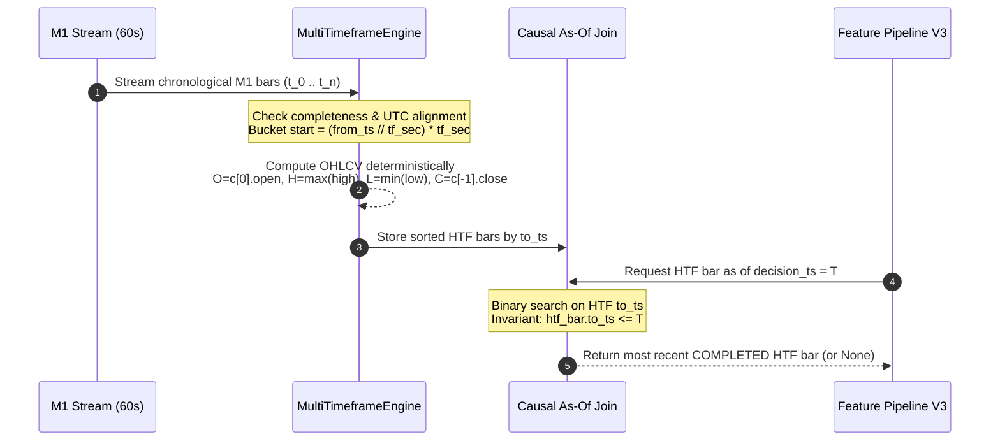

# Causal Multi-Timeframe Dataset Engine (Phase 43)

## 1. Overview & Causality Principles

In financial machine learning, multi-timeframe analysis is prone to subtle, catastrophic lookahead leakage:
- Referencing an hourly bar at 10:15 that only closes at 11:00 leaks 45 minutes of future prices.
- Misaligned bucket boundaries across timezones create timestamp jitter.
- Filling missing data across market closures with interpolated synthetic prices creates phantom technical patterns.

Phase 43 addresses these failure modes with an immutable, deterministic **Causal Multi-Timeframe Engine** (`timeframe_engine.py`) designed to aggregate base genuine $M1$ candles into higher timeframe bars ($M3, M5, M15, M30, H1$) and perform point-in-time as-of joins with zero lookahead.

---

## 2. Deterministic UTC Boundary Alignment

Higher-timeframe buckets align strictly to integer multiples of the timeframe duration measured from Unix epoch:

$$\text{bucket\_start} = \left\lfloor \frac{t_{\text{from}}}{T_{\text{sec}}} \right\rfloor \times T_{\text{sec}}$$

$$\text{bucket\_end} = \text{bucket\_start} + T_{\text{sec}}$$

Supported timeframe configurations:
- **M1**: 60 seconds (Identity)
- **M3**: 180 seconds ($3 \times 60$)
- **M5**: 300 seconds ($5 \times 60$)
- **M15**: 900 seconds ($15 \times 60$)
- **M30**: 1,800 seconds ($30 \times 60$)
- **H1**: 3,600 seconds ($60 \times 60$)

### Boundary Exactness
Because timestamps are aligned to UTC hours and minutes, an $H1$ bar begins exactly at `HH:00:00` and concludes at `HH:59:59` (with $to\_ts = \text{HH+1}:00:00$). Buckets never straddle arbitrary minute offsets.

---

## 3. Constituent Completeness & Gap Isolation

Higher timeframe bars require strict constituent completeness:

$$N_{\text{expected}} = \frac{T_{\text{sec}}}{60}$$

### Verification Invariants
1. **Count Equality**: A bucket must contain exactly $N_{\text{expected}}$ M1 bars.
2. **Temporal Continuity**: For every constituent bar $i \in [1, N-1]$:
   $$t_{\text{from}, i} = t_{\text{to}, i-1} = t_{\text{from}, 0} + i \times 60$$
3. **Completion Flag**: All constituent candles must have `is_complete == True`.
4. **No Synthetic Interpolation**: If any constituent minute is missing (due to an unscheduled data gap or scheduled closure), the entire higher-timeframe bucket is dropped. The engine never invents or interpolates prices.

### Aggregation Formulas

$$\text{Open} = c_0.\text{open}$$

$$\text{High} = \max_{i=0}^{N-1} (c_i.\text{high})$$

$$\text{Low} = \min_{i=0}^{N-1} (c_i.\text{low})$$

$$\text{Close} = c_{N-1}.\text{close}$$

$$\text{Volume} = \sum_{i=0}^{N-1} c_i.\text{volume}$$

---

## 4. $O(\log K)$ Point-in-Time As-Of Join

During feature extraction at decision timestamp $T$ (where $T = c_t.to\_ts$ of the decision M1 candle), the model requires higher-timeframe context (e.g. M15 trend, H1 slope).

To prevent lookahead leakage, the engine implements strict as-of bisection:

### Causal Invariant

$$\text{HTF\_Bar.to\_ts} \le T_{\text{decision}}$$

### Algorithm
1. The list of completed higher-timeframe bars is ordered monotonically by $to\_ts$.
2. Perform bisection lookup:
   $$\text{idx} = \text{bisect\_right}([b.to\_ts], T_{\text{decision}}) - 1$$
3. If $\text{idx} < 0$, no completed higher-timeframe bar exists yet; return `None`.
4. Return candidate bar $\text{HTF}[idx]$.
5. Time complexity: $O(\log K)$ where $K$ is the number of higher-timeframe bars. Vectorized batch join processes all $N$ decision timestamps in $O(N \log K)$.

---

## 5. Prefix Invariance Proof

A feature extraction pipeline is prefix invariant if:

$$f(X_{1..t})_t = f(X_{1..T})_t \quad \forall t \le T$$

The multi-timeframe engine guarantees prefix invariance:
1. Aggregated bars depend only on constituent candles within $[t_{\text{start}}, t_{\text{end}}]$. Future candles cannot alter past closed bars.
2. The as-of join selection at time $t$ depends only on bars with $to\_ts \le t$. Future bars have $to\_ts > t$ and are disregarded by `bisect_right`.
3. Verified by adversarial test `test_08_prefix_invariance_multi_timeframe` and `test_18_schema_3_prefix_invariance`.
