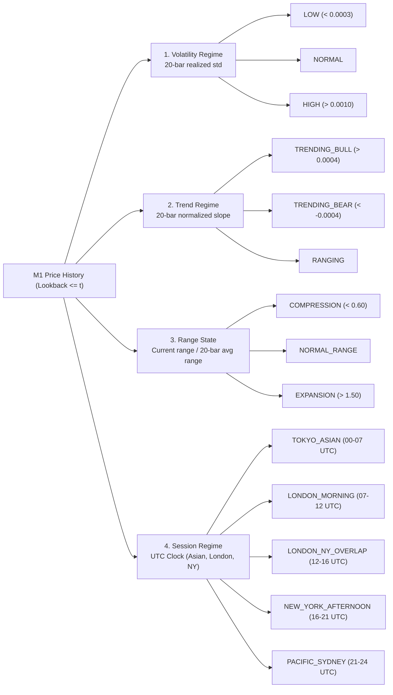

# Multi-Horizon Targets & Causal Market Regimes (Phase 43)

## 1. Multi-Horizon Prediction Targets (`targets_v3.py`)

Single-candle ($H=1$) directional prediction on 1-minute EURUSD charts was proven in Phase 42 to offer no edge beyond random noise (accuracy 50.83% across 66,464 candles). Phase 43 introduces alternative forecasting horizons to investigate whether persistent macro trends emerge over multi-minute windows:

- **H1**: 1 minute ($1 \times M1$ bar) — Baseline next-candle reference.
- **H3**: 3 minutes ($3 \times M1$ bars) — Short scalping horizon.
- **H5**: 5 minutes ($5 \times M1$ bars) — Standard binary option expiry.
- **H15**: 15 minutes ($15 \times M1$ bars) — Intraday momentum cycle.
- **H30**: 30 minutes ($30 \times M1$ bars) — Half-hour structural horizon.
- **H60**: 60 minutes ($60 \times M1$ bars) — Hourly trend persistence.

### Mathematical Formulations

1. **Directional Binary Target**:
   $$Y_t = \begin{cases} 1 (\text{UP}) & \text{if } C_{t+H} > C_t \\ 0 (\text{DOWN}) & \text{if } C_{t+H} < C_t \end{cases}$$
   Exact ties ($|C_{t+H} - C_t| < 10^{-8}$) are invalidated under `TiePolicy.EXCLUDE` ($\text{valid\_mask}_t = \text{False}$).

2. **Absolute Forward Return**:
   $$R_t = \frac{|C_{t+H} - C_t|}{C_t}$$

3. **Directional Movement Magnitude**:
   $$M_t = |C_{t+H} - C_t|$$

4. **Future Realized Volatility**:
   The sample standard deviation of 1-minute log returns over the forward window $[t+1, t+H]$:
   $$\sigma_{\text{realized}, t} = \sqrt{\frac{1}{H-1} \sum_{i=1}^H \left( r_{t+i} - \bar{r} \right)^2}$$
   where $r_{t+i} = \ln(C_{t+i} / C_{t+i-1})$.

---

## 2. Gap Invalidation & Lookahead Boundary Policies

Target labels that span unobserved intervals are scientifically invalid and must not enter the training or evaluation populations:
- **Intraday Missing Bars**: If any intervening candle between decision $t$ and maturity $t+H$ is missing, $\text{valid\_mask}_t = \text{False}$.
- **Weekend Closures**: Any window crossing Friday close into Sunday reopen is marked invalid.
- **Dataset Horizon Boundary**: The final $H$ candles of the dataset have no observable forward maturity, so $\text{valid\_mask} = \text{False}$.

---

## 3. Rolling vs Non-Overlapping Opportunity Populations

A critical source of spurious statistical significance in multi-horizon research is **outcome auto-correlation**:
When $H = 15$ and predictions are made at every 1-minute bar (Stride = 1), adjacent predictions overlap by 14 bars. A single market price shock influences 15 consecutive samples, artificially inflating sample size and deflating standard errors.

Phase 43 enforces strict population separation:
1. **Rolling Opportunities (Stride = 1)**: Evaluates the continuous decision stream for operational execution ($N \approx 66,000$).
2. **Non-Overlapping Opportunities (Stride = $H$)**: Selects strictly disjoint time intervals ($N \approx 66,000 / H$) where:
   $$t_{k+1} \ge t_k + H$$
   Non-overlapping evaluation guarantees zero target overlap between consecutive observations, satisfying classical independent sampling assumptions.

---

## 4. Causal Market Regime Classification (`regimes.py`)

Markets alternate between stationary ranging, trend expansion, and volatility shocks. Phase 43 implements a causal regime classifier operating strictly on trailing lookback data:

### Regime Stratified Evaluation
`evaluate_regimes_stratified()` segments candidate win rates, sample counts, and baseline superiorities across each regime slice to diagnose whether edges are localized to specific market conditions (e.g. London/NY overlap during volatility compression).
