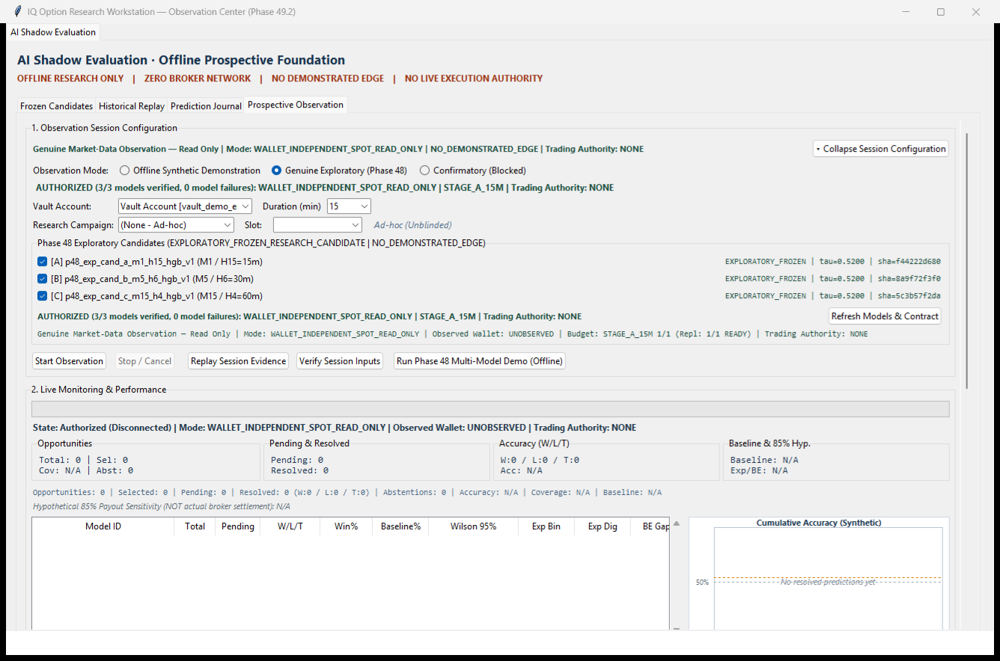
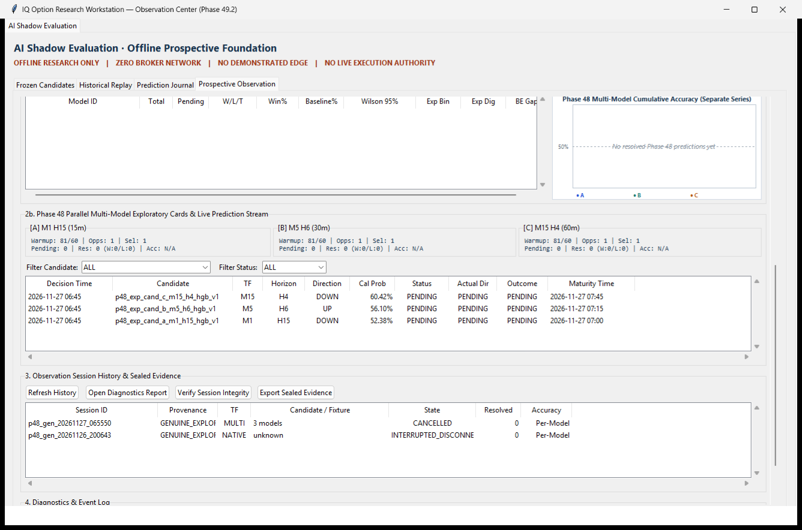

# Phase 49.2 — Wallet-Independent Genuine Market-Data Observation

- **Capability**: `WALLET_INDEPENDENT_SPOT_READ_ONLY`
- **Contract Protocol Revision**: `49.2.0` (proposed inactive contract at `reports/phase48/proposed_wallet_independent_contract.json`)
- **Research Disposition**: `NO_DEMONSTRATED_EDGE`
- **Evidence Classification**: `EXPLORATORY_PROSPECTIVE_ONLY`
- **Execution Authority**: `NONE` (zero trading authority; zero order capability; zero wallet mutation)

---

## 1. Root Cause: Why Practice-Wallet Verification Blocks Genuine Market-Data Observation

In `src/iqoption_research/models/account.py`, `wallet_decision()` determines active wallet scope strictly from observed protocol indicators (`WalletIndicator`). Over a live IQ Option WebSocket connection:

- `authenticate`, `get-profile`, `get-balances`, and `balance-changed` return user balance inventory (`PRACTICE` / `REAL`), `profile.raw`, and legacy `balance_id` fields, **none** of which prove connection-scoped active wallet authority on the wire (`WalletSource.SIMULATED_SESSION` is emitted only by `SimulatedReadOnlyConnector`).
- Consequently, `AsyncIQOption.get_account_status().practice_verification()` on a genuine WebSocket connection returns `PracticeVerification(status=PracticeStatus.ACCOUNT_SELECTION_UNVERIFIED, is_verified=False)`.
- Requiring `VERIFIED_ACTIVE_PRACTICE` (`require_practice_account=True`, `PRACTICE_VERIFIED_REQUIRED`) correctly fails closed at startup—preventing genuine market-data collection for our three frozen EURUSD exploratory candidates.

Because our frozen candidates evaluate **EURUSD spot candle streams** (and never execute orders or touch wallets), requiring active-wallet proof for read-only market-data observation conflates trading-account proof with passive price-feed ingestion.

---

## 2. Separately Governed Capability: `WALLET_INDEPENDENT_SPOT_READ_ONLY`

Rather than disabling `require_practice_account` globally or weakening `wallet_decision()`, Phase 49.2 introduces `ObservationAuthorizationMode` (`src/iqoption_research/phase48/governance.py`):

| Authorization Mode | Contract `protocol_version` | Practice Proof Required | Usage Scope | Default |
| :--- | :--- | :--- | :--- | :--- |
| `PRACTICE_VERIFIED_REQUIRED` | `48.1.0` | **Yes** (`is_verified=True`) | Legacy & practice-verified workflows | Active default |
| `WALLET_INDEPENDENT_SPOT_READ_ONLY` | `49.2.0` | **No** (honest `observed_wallet_classification` recorded) | EURUSD M1/M5/M15 read-only candle observation only | **Inactive** unless explicitly signed via CLI |

### Preserved Safeguards & Bindings

1. **Practice verification preserved elsewhere**: Legacy contracts (`48.1.0`), `PracticeBinaryTransportAdapter`, and any caller with `authorization_mode=PRACTICE_VERIFIED_REQUIRED` continue to require `VERIFIED_ACTIVE_PRACTICE` and raise `ValueError` if `require_practice_account=False` is passed.
2. **No silent UI bypass**: UI configuration cannot alter `authorization_mode` or `require_practice_account`; `ParallelObservationRuntime` enforces exact mode equality between contract and transport before connecting.
3. **Immutable binding**: `contract_sha256` and `authorization_signature_sha256` bind `protocol_version="49.2.0"`, `authorization_mode`, `allowed_account_ref`, exact frozen candidate IDs and artifact SHA-256 digests, `asset="EURUSD"`, `allow_otc=False`, `native_timeframes=(60, 300, 900)`, stage duration/budget, expiration, and `execution_authority="NONE"`.
4. **Honest wallet reporting**: Under `WALLET_INDEPENDENT_SPOT_READ_ONLY`, `IQOptionReadOnlyMultiTransport.connect()` still fetches real `AccountStatus` and evaluates `practice_verification()`, recording the observed classification (`account_selection_unverified`, `real_balance_active`, etc.) in `session.json`, `diagnostics.jsonl`, and the Observation Center UI without ever converting `is_verified` to `True`.

---

## 3. Preserved Frozen Model Candidates

All three frozen Phase 48 candidates remain unmodified with identical artifact SHA-256 digests:

1. **Candidate A — M1 H15 (`p48_exp_cand_a_m1_h15_hgb_v1`)**: `60s`, horizon `15` bars (`15m`), threshold `0.515474`, bundle SHA-256 `a9d538c80f1a77f258892bb074f6b6a7a026196061938d935acffa1542d97e61`
2. **Candidate B — M5 H6 (`p48_exp_cand_b_m5_h6_hgb_v1`)**: `300s`, horizon `6` bars (`30m`), threshold `0.549763`, bundle SHA-256 `fa908c9f8d07ff9cb647f124c5a94c8de25634bcf2b92e414f8d62d0bee02762`
3. **Candidate C — M15 H4 (`p48_exp_cand_c_m15_h4_hgb_v1`)**: `900s`, horizon `4` bars (`60m`), threshold `0.564935`, bundle SHA-256 `1efedf7b67e4bb74bbfb5b2da9841e83e278254b3f2d2d7e9a5c1ede0af19f24`

---

## 4. Strict Market-Data-Only Outbound Wire Protocol (`spot_market_data_only=True`)

When `ConnectionConfig.spot_market_data_only=True` (mutually exclusive with `timing_market_data_only=True`), `IQOptionWebSocketClient._send_raw()` (`src/iqoption_research/connectors/iqoption/ws_client.py`) calls `validate_spot_market_data_frame()` (`src/iqoption_research/connectors/iqoption/protocol.py`):

- **Allowed pre-authentication**: `authenticate` (`ssid`, `protocol`), `heartbeat`.
- **Allowed post-authentication only**:
  - `sendMessage` -> `get-profile` (`version="1.0"`, `body={}`)
  - `sendMessage` -> `get-balances` (`version="1.0"`, `body={}`)
  - `sendMessage` -> `get-candles` (`version="2.0"`, exact keys `{"active_id", "size", "count", "to"}`, `active_id in (1,)` i.e. EURUSD regular market only, `size in (60, 300, 900)`, `1 <= count <= 1000`, `to > 0`)
  - `subscribeMessage` / `unsubscribeMessage` -> `candle-generated` (`params.routingFilters`: exact keys `{"active_id", "size"}`, `active_id in (1,)`, `size in (60, 300, 900)`)
- **Explicitly rejected (`TradingNotAllowedError`)**:
  - Any unauthenticated `sendMessage`, `subscribeMessage`, or `unsubscribeMessage`
  - Any order / option / placement frame (`buy`, `buyV2`, `binary-options`, `digital-options`)
  - Any wallet mutation / balance switch frame (`changebalance`, `change_balance`, `switch_balance`, `api_profile_changebalance`)
  - EURUSD OTC (`active_id=76`) or any non-EURUSD asset
  - Any non-native timeframe (`1`, `120`, `600`, `1800`, etc.)

---

## 5. Preserved Failed First Pilot & Replacement Authorization Procedure

The first genuine Stage A pilot remains preserved and unmodified:
- **Session ID**: `p48_gen_20261126_200643` (`data/phase48/sessions/p48_gen_20261126_200643/`)
- **Status / Usage**: `INTERRUPTED_DISCONNECT` after `2.437s` with `0` opportunities, `0` predictions, `0` model failures; usage record retained as `RESERVED` (`1/1` Stage A consumed in `data/phase48/campaigns/phase48_exploratory_eurusd_parallel_v1.usage.json`).

### Exact CLI Command for Owner Authorization of ONE Replacement Attempt (Not Executed Automatically)

After reviewing this PR and choosing the bound Windows Credential Vault account ID (`<ACCOUNT_ID>`), the owner can explicitly authorize **one** bounded 15-minute replacement Stage A attempt (no outcome drain) under `WALLET_INDEPENDENT_SPOT_READ_ONLY`:

```powershell
.\.venv\Scripts\python.exe -m iqoption_research.cli.main phase48 authorize-replacement `
  --failed-session-id p48_gen_20261126_200643 `
  --account-id <YOUR_VAULT_ACCOUNT_ID> `
  --owner "<YOUR_OWNER_ID>" `
  --mode WALLET_INDEPENDENT_SPOT_READ_ONLY `
  --review-note "Reviewed p48_gen_20261126_200643; authorizing single 15m WALLET_INDEPENDENT_SPOT_READ_ONLY Stage A market-data pilot"
```

To inspect contract status afterward (without connecting to the broker):

```powershell
.\.venv\Scripts\python.exe -m iqoption_research.cli.main phase48 status
```

To revoke an active contract at any time:

```powershell
.\.venv\Scripts\python.exe -m iqoption_research.cli.main phase48 revoke --owner "<YOUR_OWNER_ID>" --reason "Manual revocation"
```

---

## 6. Operator Step-by-Step Guide (12 Steps)

1. Verify frozen model bundles & current contract state: `python -m iqoption_research.cli.main phase48 status`.
2. Confirm your saved Windows Credential Vault `account_id` matches the intended IQ Option account.
3. Run the explicit `phase48 authorize-replacement` CLI command shown above with `--mode WALLET_INDEPENDENT_SPOT_READ_ONLY` (or `phase48 authorize` if starting fresh in an unconsumed stage).
4. Re-run `phase48 status` and verify `protocol_version: "49.2.0"`, `authorization_mode: "WALLET_INDEPENDENT_SPOT_READ_ONLY"`, `require_practice_account: false`, and valid `replacement_authorization`.
5. Launch the Research Workstation V2 desktop UI and open the **Observation Center** tab.
6. Select **Genuine Exploratory (Phase 48)**, pick the bound **Vault Account**, keep duration aligned with the authorized stage (`15` min for Stage A replacement), and ensure all 3 frozen candidates are checked.
7. Click **Refresh Models & Contract** and verify the banner reads `AUTHORIZED (3/3 models verified, 0 model failures): WALLET_INDEPENDENT_SPOT_READ_ONLY | STAGE_A_15M | Trading Authority: NONE` and `Budget: STAGE_A_15M 1/1 (Repl: 1/1 READY)`.
8. Confirm **State: `Authorized (Disconnected)`** and **`Trading Authority: NONE`** before starting.
9. Click **Start Observation**, verify the confirmation popup details (`WALLET_INDEPENDENT_SPOT_READ_ONLY`, `Trading Authority: NONE`), and confirm.
10. Observe startup transitions (`Connecting` -> `Loading warmup candles` -> `Observing (RUNNING)`) and verify `Observed Wallet: account_selection_unverified` (honest status, never falsified as practice-verified).
11. Wait for the bounded 15-minute window to seal cleanly (`COMPLETED`) or press **Stop / Cancel** if manual early termination is needed.
12. Independently verify the sealed evidence ledger on disk:
    `python -m iqoption_research.cli.main phase48 verify-session data\phase48\sessions\<SESSION_ID>`.

---

## 7. Offline Verification Results & Dashboard Screenshots

- **Production interface audit**: Verified `AsyncIQOption`, `IQOptionWebSocketClient`, `AccountStatus`, `PracticeVerification.is_verified`, `BrokerClockDiagnostics.status`, `CandleFetchResult`, and `IQOptionReadOnlyMultiTransport` (`ReadOnlyBrokerClientProtocol` replacing `Any`-typed `client_override`).
- **Offline mocked-socket acceptance**: Verified full Stage A lifecycle (failed legacy `PRACTICE_VERIFIED_REQUIRED` startup -> owner replacement CLI with `--mode WALLET_INDEPENDENT_SPOT_READ_ONLY` -> multi-timeframe `M1`/`M5`/`M15` warmup + streaming + pre-maturity commitments + sealed ledger `verify_phase48_session_integrity() == (True, [])`), plus rejection of OTC (`active_id=76`), unsupported timeframes, orders, wallet mutations, unauthenticated frames, and tampered contracts.





---

## 8. Remaining Compatibility Limitations Before Live Execution

- No genuine network connection to live IQ Option servers was executed during Phase 49.2 (strict offline development restriction).
- If live IQ Option WebSocket servers emit unexpected envelope changes on `get-profile`, `get-balances`, `timeSync`, `get-candles`, or `candle-generated` (such as missing profile/balance messages or >120s server clock unavailability), `IQOptionReadOnlyMultiTransport` will fail closed to `FAILED_STARTUP` or `FAILED_PROVENANCE`.
- `WALLET_INDEPENDENT_SPOT_READ_ONLY` remains read-only price observation only (`execution_authority = NONE`, `NO_DEMONSTRATED_EDGE`); candle direction does not settle real broker payouts.
