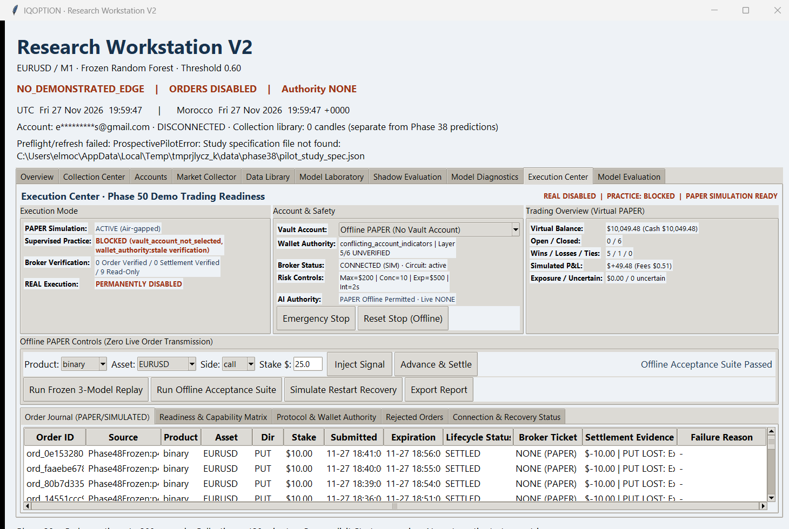
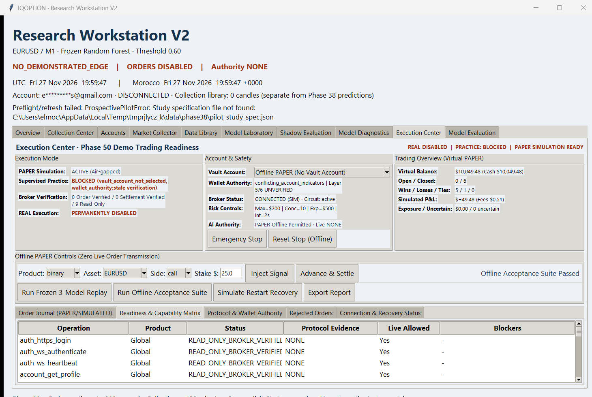
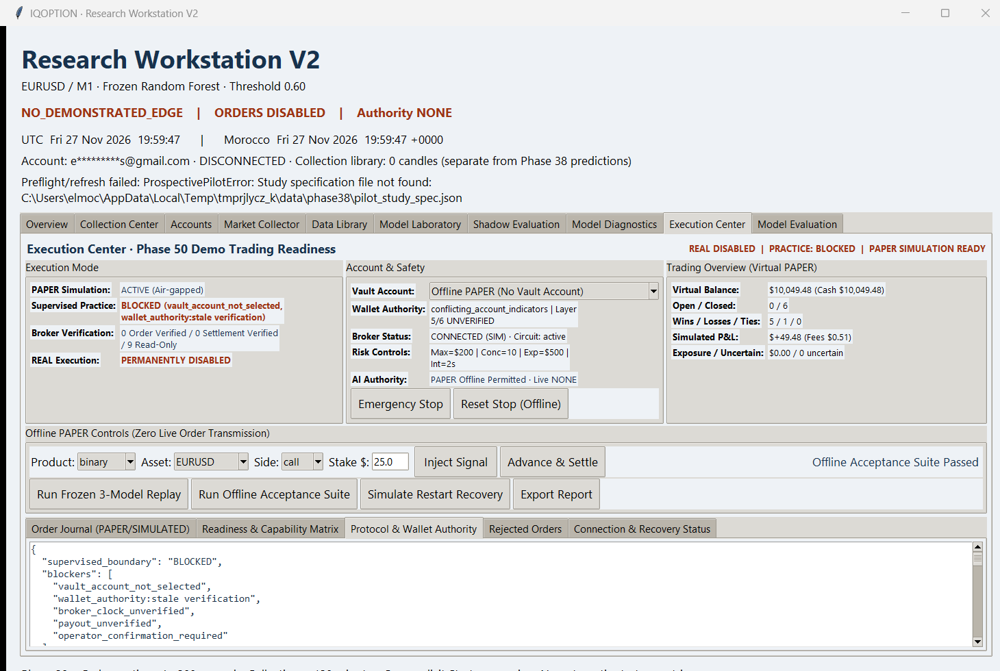

# Phase 50 — End-to-End Demo Trading Execution Readiness

## Executive Summary & Verdict

| Domain | Status | Evidence Level | Live Broker Orders Permitted? |
| :--- | :--- | :--- | :---: |
| **Offline `PAPER` Execution Engine (`ModularExecutionEngine`)** | `OFFLINE_TESTED` | `MOCKED_OFFLINE` | **No** (Air-gapped simulation) |
| **Phase 48 Frozen AI -> `PAPER` Bridge (`PaperBridgePortfolioCoordinator`)** | `OFFLINE_TESTED` | `MOCKED_OFFLINE` | **No** (`execution_authority=NONE`) |
| **Research Workstation V2 Execution Center UI (`ExecutionCenterPanel`)** | `OFFLINE_TESTED` | `MOCKED_OFFLINE` | **No** (Zero live order buttons) |
| **Binary Options `PRACTICE` Automated Submission** | `IMPLEMENTED` / `BLOCKED` | `UNVERIFIED_COMMUNITY` + `MOCKED_OFFLINE` | **Blocked** (`conflicting_account_indicators` & unverified order routing) |
| **Binary Options Manual History Recovery (`get-history`)** | `READ_ONLY_BROKER_VERIFIED` | `SANITIZED_BROKER_READ_ONLY` | Read-only audit only (never counts as automated submission) |
| **Digital Options Broker Execution & Early Close** | `NOT_IMPLEMENTED` (`PAPER` simulated) | `NONE_SIMULATED_STRIKE_MODEL` | **Not implemented** |
| **Forex / CFD Broker Execution & SL/TP Modification** | `NOT_IMPLEMENTED` (`PAPER` simulated) | `NONE_SIMULATED_MARGIN_MODEL` | **Not implemented** |
| **`REAL` Account Execution (`ExecutionMode.REAL`)** | `UNSUPPORTED` | `NONE` | **Permanently disabled** |

**Key finding:** The local multi-product execution lifecycle, SQLite crash/restart recovery, 14 operational risk controls, strictly isolated Phase 48 `PAPER` bridge, and desktop Execution Center are end-to-end functional offline. Live automated Practice trading remains **explicitly `BLOCKED`** (`0` `BROKER_ORDER_VERIFIED`, `0` `SETTLEMENT_VERIFIED`) until an operator resolves `conflicting_account_indicators` and conducts an explicitly authorized single-order Binary Practice compatibility test proving end-to-end Practice-only routing.

---

## 1. Parallel Research Track Preservation (Phase 48)

Phase 50 makes **zero mutations** to Phase 48 models, confidence thresholds, session logs, or campaign authorization:

- **Frozen candidates preserved verbatim:**
  - `p48_exp_cand_a_m1_h15_hgb_v1` (M1, Horizon 15, frozen threshold `0.515474`)
  - `p48_exp_cand_b_m5_h6_hgb_v1` (M5, Horizon 6, frozen threshold `0.549763`)
  - `p48_exp_cand_c_m15_h4_hgb_v1` (M15, Horizon 4, frozen threshold `0.564935`)
- **Disposition & authority:** `NO_DEMONSTRATED_EDGE`, `execution_authority="NONE"`.
- **Stage C authorization:** Completely untouched and unconsumed.
- **Stage B read-only replay verification:** Reading `data/phase48/sessions/p48_gen_20261127_145740/predictions.jsonl` strictly read-only produces **152 commitments** (`Cand A: 120 total, 94 abstained, 26 UP/DOWN; Cand B: 24/24/0; Cand C: 8/8/0`) with unchanged SHA-256 checksums.

---

## 2. Execution Architecture Audit

Auditing `execution/` (`engine.py`, `execution_engine.py`, `live_practice_transport.py`, `practice_transport.py`, `account_diagnostics.py`, `safety.py`, `broker_readiness.py`, `capability_matrix.py`, `state_machine.py`, `risk.py`, and `adapters/`) identified five structural issues that were remediated during Phase 50:

| Component | Audit Finding | Remediation Applied |
| :--- | :--- | :--- |
| `execution/engine.py` (`PaperTradingEngine`) vs `execution/execution_engine.py` (`ModularExecutionEngine`) | `DUPLICATED` — Legacy `PaperTradingEngine` uses binary-only `SIMULATED_*` paths while `ModularExecutionEngine` is the multi-product engine. | Consolidated all Phase 50 AI bridging, risk controls, persistence, and UI onto `ModularExecutionEngine` while preserving `PaperTradingEngine` for legacy CLI compatibility. |
| Wallet evaluators (`models/account.py`, `safety.py`, `account_diagnostics.py`, `live_practice_transport.py`) | `DUPLICATED / DIVERGENT` — Profile `balance_id` handling vs `balances[]` conflict checks previously diverged (`get_routing_audit()` hardcoded `has_authoritative_active_indicator=False`). | Added shared `evaluate_wallet_conflicts()` across `safety.py` & `account_diagnostics.py`, added `SixLayerWalletAuthority`, and computed real authoritative flags in `live_practice_transport.py`. |
| `execution/broker_readiness.py` (`PracticeExecutionReadinessGate`) & `ModularExecutionConfig` | `DISCONNECTED` — `PracticeExecutionReadinessGate` was not wired cleanly, and `ModularExecutionConfig(mode=PRACTICE)` left `mode_config.mode=PAPER` out of sync. | Wired `PracticeExecutionReadinessGate`, added `AccountSelectionUnverifiedError` raise on conflicting/unverified wallets, and synchronized `mode_config` in `ModularExecutionConfig.__post_init__`. |
| `adapters/binary.py` & `practice_transport.py` | `INCOMPLETE / UNSAFE_FALLBACK` — Unknown symbols silently fell back to `active_id=1`, and invalid Practice balance IDs fell back to `user_balance_id=1`. | Created strict `execution/instruments.py` (`UnsupportedExecutionInstrumentError`, zero `active_id=1` fallback) and blocked missing/non-numeric Practice `user_balance_id` on live socket transports. |
| `ModularExecutionEngine`, `ExecutionJournal`, `OperationalRiskManager` | `INCOMPLETE` — Startup recovery did not reconstruct `PaperPortfolio` balance, reserved cash, risk counters, kill-switch latch, clock freshness, or uncertain/timeout order state. | Implemented full SQLite recovery (`recover_on_startup`, `engine_kv_state`), all 14 risk limits, timeout/unknown/connection-loss state transitions, and SHA-256 evidence exports. |

---

## 3. Broker Capability Matrix (34 Operations)

| Status Summary (`BrokerCapabilityMatrix.summary_counts()`) | Count |
| :--- | :---: |
| `read_only_broker_verified` | **9** |
| `offline_tested` | **6** |
| `implemented` (offline schema / mock only; unverified live) | **4** |
| `not_implemented` (Digital & Forex live broker ops) | **5** |
| `blocked` (automated live Practice routing/submission/settlement) | **4** |
| `unsupported` (prohibited by safety policy) | **6** |
| `broker_order_verified` | **0** |
| `settlement_verified` | **0** |

| Operation ID | Product | Category | Name | Status | Evidence Level | Live Allowed | Protocol Frame |
| :--- | :--- | :--- | :--- | :--- | :--- | :---: | :--- |
| `auth_https_login` | Global | authentication | HTTPS Login & 2FA | `read_only_broker_verified` | `NONE` | Yes | `POST auth/v2/login` |
| `auth_ws_authenticate` | Global | authentication | WebSocket SSID Authentication | `read_only_broker_verified` | `NONE` | Yes | `authenticate` |
| `auth_ws_heartbeat` | Global | authentication | WebSocket Heartbeat | `read_only_broker_verified` | `NONE` | Yes | `heartbeat` |
| `account_get_profile` | Global | account_data | Get User Profile | `read_only_broker_verified` | `NONE` | Yes | `get-profile` |
| `account_get_balances` | Global | account_data | Get Account Balances | `read_only_broker_verified` | `NONE` | Yes | `get-balances` |
| `account_practice_verification` | Global | account_data | Authoritative Practice Verification | `read_only_broker_verified` | `SANITIZED_BROKER_READ_ONLY` | Yes | `get-profile + get-balances` |
| `account_order_routing_authority` | Global | account_data | Order-Specific Practice Routing Authority | `blocked` | `SANITIZED_BROKER_READ_ONLY` | **No** | `get-profile + get-balances + balance-changed + option-opened` |
| `market_get_candles` | Global | market_data | Get Historical Candles | `read_only_broker_verified` | `SANITIZED_BROKER_READ_ONLY` | Yes | `get-candles` |
| `market_subscribe_candles` | Global | market_data | Subscribe Streaming Candles | `read_only_broker_verified` | `SANITIZED_BROKER_READ_ONLY` | Yes | `subscribeMessage(candle-generated)` |
| `binary_history_recovery_manual` | binary | position_monitoring | Manual Practice Trade History Recovery | `read_only_broker_verified` | `SANITIZED_BROKER_READ_ONLY` | Yes | `get-history (options)` |
| `binary_simulated_trade` | binary | order_submission | Binary Simulated Paper Order | `offline_tested` | `MOCKED_OFFLINE` | **No** | `N/A (Internal)` |
| `binary_order_submission_practice` | binary | order_submission | Binary Option Practice Submission Schema | `implemented` | `UNVERIFIED_COMMUNITY` | **No** | `binary-options.open-option / buyV2` |
| `binary_order_status_practice` | binary | order_status | Binary Option Order Acknowledgement Parser | `implemented` | `MOCKED_OFFLINE` | **No** | `option-opened / socket-option-opened` |
| `binary_settlement_reconciliation` | binary | settlement | Binary Settlement Reconciliation | `implemented` | `MOCKED_OFFLINE` | **No** | `option-closed / socket-option-closed` |
| `binary_blitz_position_live` | binary | position_monitoring | Blitz Option Live Position Tracking | `implemented` | `UNVERIFIED_COMMUNITY` | **No** | `portfolio.position-changed` |
| `binary_practice_transport_live` | binary | order_submission | Binary Practice Live Transport | `blocked` | `MOCKED_OFFLINE` | **No** | `binary-options.open-option` |
| `supervised_single_practice_order` | binary | order_submission | Supervised Single-Order Demo Compatibility Test | `blocked` | `MOCKED_OFFLINE` | **No** | `binary-options.open-option` |
| `binary_live_settlement_correlation` | binary | settlement | Automated Live Binary Settlement Correlation | `blocked` | `NONE` | **No** | `option-closed + get-balances` |
| `digital_simulated_trade` | digital | order_submission | Digital Option Simulated Paper Order | `offline_tested` | `MOCKED_OFFLINE` | **No** | `N/A (Internal)` |
| `digital_order_submission_broker` | digital | order_submission | Digital Option Broker Order Submission | `not_implemented` | `NONE` | **No** | `digital-options.place-digital-option` |
| `digital_early_closure_broker` | digital | position_closure | Digital Option Early Broker Closure | `not_implemented` | `NONE` | **No** | `digital-options.close-position` |
| `forex_simulated_trade` | forex | order_submission | Forex/CFD Simulated Paper Order | `offline_tested` | `MOCKED_OFFLINE` | **No** | `N/A (Internal)` |
| `forex_order_submission_broker` | forex | order_submission | Forex/CFD Broker Order Submission | `not_implemented` | `NONE` | **No** | `order.open-order` |
| `forex_position_close_broker` | forex | position_closure | Forex/CFD Broker Position Closure | `not_implemented` | `NONE` | **No** | `order.close-position` |
| `forex_modify_sl_tp_broker` | forex | position_monitoring | Forex/CFD SL/TP Modification | `not_implemented` | `NONE` | **No** | `order.change-tpsl` |
| `ai_paper_commitment_bridge` | binary | order_submission | Phase 48 Frozen Model -> PAPER Bridge | `offline_tested` | `MOCKED_OFFLINE` | **No** | `N/A (Internal)` |
| `offline_lifecycle_and_recovery` | Global | settlement | End-to-End Offline Execution Lifecycle & Recovery | `offline_tested` | `MOCKED_OFFLINE` | **No** | `N/A (Internal)` |
| `practice_balance_select_manual` | Global | balance_management | Explicit Operator Practice Session Selection | `offline_tested` | `MOCKED_OFFLINE` | **No** | `change_balance` |
| `balance_switch_auto` | Global | balance_management | Automatic Balance Switching | `unsupported` | `NONE` | **No** | `change_balance / switch_balance` |
| `order_submission_real` | Global | order_submission | Real Account Order Submission | `unsupported` | `NONE` | **No** | `N/A (Internal)` |
| `otc_silent_substitution` | Global | market_data | Silent Regular-to-OTC Instrument Substitution | `unsupported` | `NONE` | **No** | `N/A (Internal)` |
| `blind_order_resubmission` | Global | order_submission | Blind Retry on Acknowledgement Timeout | `unsupported` | `NONE` | **No** | `N/A (Internal)` |
| `ai_confidence_live_gate` | Global | order_submission | AI-Authorized Live Broker Execution | `unsupported` | `NONE` | **No** | `N/A (Internal)` |
| `unreconciled_live_recovery` | Global | settlement | Heuristic Closure of Unknown Restarted Live Orders | `unsupported` | `NONE` | **No** | `N/A (Internal)` |

> **Evidence boundary:** `binary_history_recovery_manual` confirms only that manually submitted official-UI Binary orders can be queried via `get-history`. It is never counted as `BROKER_ORDER_VERIFIED` or `SETTLEMENT_VERIFIED`.

---

## 4. Product-Specific Execution & Instrument Isolation

Separate adapters and payoff models govern each product (`src/iqoption_research/execution/adapters/`):

- **Binary Options (`adapters/binary.py`):** Fixed expiry (`expiry_horizon_bars`, M1+ via `compute_binary_expiry`), fixed binary payout schedule, Practice live frame serialization in `PracticeBinaryTransportAdapter`.
- **Digital Options (`adapters/digital.py`):** Non-linear strike payoff (`DigitalPayoffModel`) and early-close valuation (`close_early` / `engine.early_close_digital_order`). Missing live broker frame evidence is explicitly stamped as `broker_evidence="NONE_SIMULATED_STRIKE_MODEL"`. Live broker submission remains `NOT_IMPLEMENTED`.
- **Forex / CFD (`adapters/forex.py`):** Margin requirement check (`calculate_sizing`: refuses stake exceeding `available_cash`), pip-value PnL, spread friction, and Stop-Loss / Take-Profit triggers (`settle_or_close`). Stamped with `broker_evidence="NONE_SIMULATED_MARGIN_MODEL"`. Live broker submission remains `NOT_IMPLEMENTED`.

### Canonical Execution Instruments (`execution/instruments.py`)

| Canonical Symbol | `active_id` | Market Kind | Permitted Products | Notes |
| :--- | :---: | :--- | :--- | :--- |
| `EURUSD` | `1` | `REGULAR` | Binary, Digital, Forex | Standard market hours only |
| `EURUSD_OTC` | `76` | `OTC` | Binary, Digital | Synthetic OTC market; **Forex refused** |
| `EURUSD_OP` | `1861` | `BLITZ_OP` | Binary (`min_expiry=5s`) | Short-duration Blitz option; **Digital/Forex refused** |
| `GBPUSD` | `2` | `REGULAR` | Binary, Digital, Forex | Strictly mapped |
| `USDJPY` | `3` | `REGULAR` | Binary, Digital, Forex | `pip_size=0.01` |

Unrecognized symbols or ID/product mismatches raise `UnsupportedExecutionInstrumentError` with **zero silent fallback to `active_id=1`**.

---

## 5. Practice-Account Authority Investigation (`conflicting_account_indicators`)

Genuine Phase 48 sessions (e.g., `p48_gen_20261127_145740`) recorded `conflicting_account_indicators`. Our investigation across `execution/account_diagnostics.py`, `execution/safety.py`, `execution/broker_readiness.py`, and `execution/live_practice_transport.py` established:

1. **Root cause of `conflicting_account_indicators`:**
   - IQ Option WebSocket sessions can simultaneously present a Practice wallet in `balances[]` (`id="101"`, `type=4`, `is_default=True`) while `get-profile` reports `balance_id=200` (`type=1`, `REAL`) or `balances[]` marks `REAL` (`id="200"`) with `raw_is_active=True`.
   - Web UI selection (Edge/Chrome) is **browser-local** and does not confer authority onto an independent headless Python WebSocket session.
   - `change_balance` frames emit a `balance-changed` server push that lacks a direct `request_id` echo (`balance_id_found=False`), requiring bounded read-only re-polling of `get-profile` + `get-balances`.
   - Market-data subscription (`get-candles`, `candle-generated`) is wallet-independent and grants **zero execution authority**.

2. **Six-Layer Authority Model (`SixLayerWalletAuthority`):**
   - **Layer 1 — `wallet_inventory`:** Raw `get-balances` accounts (`REAL` type `1` vs `PRACTICE` type `4`). Mere presence of a `$10,000` Practice wallet confers zero routing safety.
   - **Layer 2 — `profile_reported_identity`:** `get-profile.balance_id`. Previously assumed authoritative when `balances` was ambiguous; now strictly non-authoritative on its own.
   - **Layer 3 — `locally_selected_wallet`:** Vault/CLI local operator preference.
   - **Layer 4 — `official_ui_selection`:** Browser session state (unshared with Python API WebSocket).
   - **Layer 5 — `connection_scoped_authority`:** Corroborated `raw_is_active=True` + matching `get-profile.balance_id == practice_id` + zero `wallet_type_conflict` + optional `balance-changed` event within freshness window.
   - **Layer 6 — `order_specific_routing_authority`:** Requires `user_balance_id` echoed cleanly on broker acknowledgement (`option-opened`) AND post-settlement verification that **only** the virtual Practice wallet balance delta changed while the `REAL` wallet balance remained identical.

Any conflict (`wallet_type_conflict`), missing active indicator, stale check, or session reconnect triggers an immediate fail-closed block (`CONFLICTING_ACCOUNT_INDICATORS` / `BLOCKED_CONFLICTING_ACCOUNT_INDICATORS` / `AccountSelectionUnverifiedError`). Automatic balance switching remains `UNSUPPORTED`.

### Exact Operator Verification Procedure (Supervised Read-Only -> Pre-Flight)

Before any operator ever considers enabling a single supervised Practice test in a future session:

```powershell
# 1. Inspect wallet inventory, 6-layer authority, and check for conflicting indicators (read-only)
.\.venv\Scripts\python.exe -m iqoption_research.cli.main execution practice-diagnostics --live

# 2. If uncorroborated or REAL-selected, run explicit operator-authorized balance selection
.\.venv\Scripts\python.exe -m iqoption_research.cli.main execution practice-select --live

# 3. Verify supervised pre-flight boundary WITHOUT transmitting any order frame
.\.venv\Scripts\python.exe -m iqoption_research.cli.main execution practice-test --live-socket --preflight-only --symbol EURUSD
```

All order transmission MUST remain aborted if `practice-diagnostics` or `--preflight-only` exits with `CONFLICTING_ACCOUNT_INDICATORS`, stale clock, missing payout, or `REAL` wallet indicators.

---

## 6. Offline Lifecycle, Recovery & 14 Operational Risk Controls

`ModularExecutionEngine` + `ExecutionJournal` (`state_machine.py`) + `OperationalRiskManager` (`risk.py`) validate and enforce end-to-end offline execution in `PAPER` mode:

- **23 Verified Lifecycle & Failure Cases (`tests/e2e/test_execution_lifecycle_and_paper_bridge_e2e.py`):** Signal generation/validation, proposal creation, risk approval/rejection, canonical product & instrument resolution (`EURUSD`/`EURUSD_OTC`/`EURUSD_OP`), Practice routing pre-flight block/allow, expiration calculation, binary frame serialization, broker ack/ticket correlation, open exposure tracking (`reserved_open_stake`), expiry settlement (`WIN`/`LOSS`/`TIE`), virtual balance reconciliation, SQLite persistence, SHA-256 evidence bundle export, duplicate signal prevention, oversize rejection journaling, acknowledgement timeout (`TIMEOUT` -> `is_uncertain=True` without blind retry), unknown submission (`UNKNOWN` blocking new entries until `reconcile_uncertain_order`), connection loss during settlement (`HALTED_CONNECTION_LOSS`, moving open orders to `RECONCILING`), emergency stop kill switch, and full SQLite restart recovery rebuilding balance, counts, risk state, and kill-switch latch.
- **14 Risk Controls Enforced Strictly Independently of AI Scores:**
  `max_stake_per_trade`, `max_stake_pct_balance`, `max_concurrent_positions`, `max_simultaneous_exposure`, `max_trades_per_session`, `max_daily_loss`, `max_consecutive_losses`, `min_order_interval_seconds`, duplicate signal prevention (`idempotency_key` + `signal_id`), `stale_market_data_threshold_seconds` (live path), clock freshness (`require_fresh_clock`, `max_clock_age_seconds`), account-verification freshness (`max_account_verification_age_seconds`), `emergency_stop` kill switch (persistent), `handle_connection_loss` interruption halt, and `block_on_uncertain_orders`. No martingale, loss-recovery sizing, or stake escalation exists anywhere.

---

## 7. AI-to-Execution Integration in Strictly `PAPER` Mode (`execution/paper_bridge.py`)

- `PaperBridgePortfolioCoordinator` raises `PaperAirGapViolationError` on any `ExecutionMode` other than `PAPER`.
- **13-field input contract:** Validates `candidate_id`, `candidate_artifact_digest` (`bundle_sha256`), `native_timeframe_seconds`, `horizon_bars`, `decision_timestamp`, `raw_prob_up`, `calibrated_probability`, `confidence_threshold`, `confidence_margin`, `decision` (`UP`/`DOWN`/`ABSTAIN`), `maturity_timestamp`, provenance (`feature_digest`, `reference_candle_digest`, `commitment_digest`), and deterministic `order_intent_id`.
- **Fail-closed filters:** `ABSTAIN` never creates an order (`AISignalRejectionReason.ABSTAIN_SIGNAL`); rejects stale, duplicate, invalid-probability, expired, digest-tampered, threshold-tampered, or cross-candidate simultaneous opposing directional signals (`CONFLICTING_CANDIDATE_SIGNAL`).
- **Simulation honesty:** Every order is stamped `"PAPER/SIMULATED"` alongside `SIMULATED_PAYOUT_ASSUMPTION` explicitly warning that candle-close direction is **not** live broker settlement. Each candidate (`A`, `B`, `C`) runs an independent `PAPER` book alongside the cross-candidate conflict-guarded book.

---

## 8. Supervised Single-Order Practice Compatibility Test Readiness (`execution/supervised_practice.py`)

The Binary-only Practice compatibility gate (`SupervisedPracticeSpec`, `SupervisedPracticeReadinessEvaluator`) remains **`BLOCKED`** during Phase 50 and **was not executed live**.

- **Bound:** Regular `EURUSD` (`active_id=1`) · `ProductType.BINARY` only · `max_orders_permitted=1` · Stake `$1.00–$5.00` · `ai_authorized=False` (enforced in `__post_init__`) · `cancel_if_unacknowledged_seconds=10.0`.
- **Live mock rehearsal only (`MOCKED_OFFLINE_ONLY`, `live_broker_verified=False`):** Verified in `run_supervised_practice_mock_rehearsal()` using an offline in-memory socket confirming initial REAL/conflict block (`blocked_before_operator_selection=True`), post-`change_balance` Layer-5 corroboration (`post_select_routing_verified=True`), ticket `9100042` acknowledgement (`ack_balance_id=101`), simulated settlement (`+0.85`), and exact balance reconciliation.
- **Future operator execution command (only after all diagnostics pass):**
  ```powershell
  .\.venv\Scripts\python.exe -m iqoption_research.cli.main execution practice-test --live-socket --symbol EURUSD --side call --stake 1.00 --select-practice
  ```

---

## 9. Offline Demo & Research Workstation V2 Execution Center

### CLI Offline Acceptance Demo

Run the complete deterministic offline demonstration without touching live networks or Phase 48 artifacts:

```powershell
.\.venv\Scripts\python.exe -m iqoption_research.cli.main execution offline-demo --output-dir C:\Temp\phase50_demo --json
```

### Desktop Execution Center Screenshots

Launch Research Workstation V2 (`desktop` CLI or module) and select the **Execution Center** tab (`src/iqoption_research/desktop/execution_center_panel.py`):






