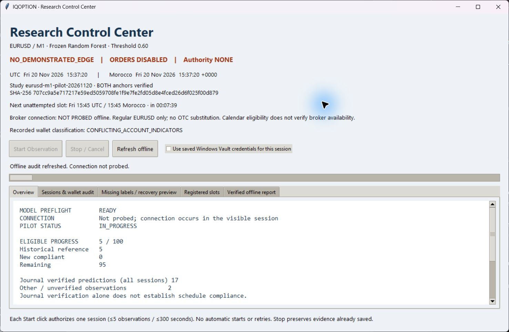

# Windows research dashboard

Double-click `Start-ResearchDashboard.cmd` in the repository. It uses the existing
`.venv\Scripts\pythonw.exe`; no server, browser, frontend build or broker connection
starts with the dashboard. Python 3.12 with Tkinter and the repository dependencies
is required. If dependencies need refreshing, use `.venv\Scripts\python.exe -m pip
install -e .[dev]`. `tzdata` supplies IANA timezone rules on Windows.

The default study is `data/phase38/pilot_study_spec.json`. Both existing registration
anchors must be present and valid. The dashboard never registers or edits a study.
It reads the frozen model at `data/phase13/candidate_models/candidate_h1_rf` and
evidence in `data/phase34/operator_supervised_live`, including each local journal.

## Observe one session

1. Open the dashboard and inspect the model preflight, study identity, upcoming
   registered slots, session audit, and actual wallet classification.
2. During an unattempted eligible slot, click **Start Observation** once. This is
   authorization for exactly one foreground, read-only session. A visible console
   opens. Keep supervising it; provide credentials there if prompted.
3. Wait for completion or click **Stop / Cancel**. The dashboard refreshes local
   evidence and authentic labels automatically, including actual observed, eligible,
   rejected and uncommitted counts. A nonzero exit remains visible above the report.

The session keeps the existing five-observation/300-second caps and interactive
terminal requirement. It uses regular EURUSD only. A conservative guard requires
300 seconds remaining in the original slot both before dispatch and after login;
a slow login can therefore cause refusal. Calendar eligibility is not a broker
availability probe. There is no automatic launch, session retry, OTC substitution,
wallet switch, order capability, model retraining or threshold change.

## Optional saved credentials

Interactive entry remains the default. To opt in, **the operator** first runs this
existing command in their own interactive terminal:

```powershell
.venv\Scripts\python.exe -m iqoption_research.cli.main auth save-credentials
```

Then select **Use saved Windows Vault credentials for this session** before Start.
The choice is not persisted across dashboard restarts. Only the launched foreground
session loads the credentials. The GUI never prompts for or handles a password.
No credential is put in child arguments, a file, logs, IPC, or environment variables.
Known broker credential environment variables are removed from the child environment.
If no saved entry exists, the console falls back to interactive entry. An insecure
backend is refused rather than used. Storage and deletion stay with the existing
`auth save-credentials` and `auth forget-credentials` commands.

## Audit and offline work

Overview shows eligible progress toward 100, historical versus new compliant
predictions, journal-verified versus other observations, label coverage, signal
coverage, SKIP rate and Brier score. Journal receipt verification alone does not
establish schedule compliance. Metrics cover the eligible cohort reported by the
existing Phase 38 reconciler; a score based only on historical reference labels is
not new prospective evidence.

The November 20 observations before the registered schedule remain in the audit,
with their window deviation and zero eligible contribution. A recorded
`CONFLICTING_ACCOUNT_INDICATORS` classification is displayed as such; the dashboard
does not claim the practice wallet is verified.

The recovery tab is a local preview. It never executes commands found in reports.
Historical backfill requires separate operator authorization through the existing
CLI. Checkpoint publication and verification remain the unchanged, create-only
`prospective pilot-checkpoint` and `prospective pilot-verify` commands; the dashboard
does not publish or overwrite checkpoints.

Slots use the registered schedule and `Africa/Casablanca` from installed IANA
timezone data, including its date-specific UTC offset. No fixed Morocco offset is
assumed. Friday's remaining slots and subsequent weekdays appear in Registered slots.

## Process lifetime and limitations

- A named Windows mutex prevents two dashboards for the same checkout. Rapid clicks
  cannot dispatch twice. Create-only markers under `data/desktop/claims` record an
  attempted slot even when startup/login fails. Do not remove markers to retry a slot.
  Existing evidence in the slot also prevents a dashboard launch.
- This mutex does not prevent a separate operator from manually starting an unrelated
  CLI session. Do not operate another CLI shadow session alongside the dashboard.
- The child waits for a local startup marker until it has been assigned to a Windows
  kill-on-close job. If job assignment fails, it cannot authenticate. Closing or
  crashing the dashboard cannot leave the assigned broker process running.
- Stop requests cooperative asyncio cancellation through a secret-free local marker.
  After five seconds, a hung process is killed through the job. Ctrl+C in the console
  also uses the runner's existing cancellation path. Abrupt termination may prevent
  a final registry from being written; existing immutable evidence/journal commits
  remain preserved. No completion or missing observations are synthesized.
- The 300-second cap is the existing observation-loop cap; interactive login can
  take additional time. Closing the app cancels login too, with the same kill fallback.
- Connection/login errors are summarized by exception class and exit code, without
  copying potentially sensitive exception payloads into dashboard files. The session
  audit and verified offline report are inspectable within the app.
- No live broker session was run during implementation or testing. Native console
  lifecycle and UI checks are offline; an operator-supervised live acceptance check
  during a future eligible slot remains necessary.

## Narrow authentication review

`supervised_client` gains an explicit default-false vault option. `ShadowTrial`
passes it only when requested, while retaining the existing market-data-only client,
zero reconnect attempts, read-only assertion and unchanged wallet behavior. The CLI
checks terminal interactivity and authorization before constructing the trial.
Windows vault backend validation now requires both the exact native class name and
module, rejecting lookalike names, chainer/plaintext backends and substring matches.
Tests separately cover default prompts, explicit loading, missing-entry fallback,
insecure-backend refusal and terminal refusal before vault access, alongside the
existing Phase 8 secure-authentication suite.



## Validation recorded on Windows

- Full offline suite: **2,302 passed**, three existing getpass warnings, 167.74 seconds.
- Final focused desktop suite after additional lifecycle tests: **33 passed**.
- Desktop plus existing Phase 8 secure-auth tests: **65 passed**.
- Ruff lint and formatting: passed; MyPy: 222 source files passed.
- Application security check: all seven checks passed; `pip check`: passed.
- Manual native smoke check: duplicate-dashboard mutex rejected; a visible console
  successfully ran the existing **offline** shadow preflight; closing a Windows job
  terminated its owned sleeping process within five seconds. No live flag was used.
- Actual Tkinter overview and registered-slots tabs inspected on Windows; screenshot
  included above. Preview closed after inspection.

The PR's Safe Offline CI run validates the final commit, including the five tests
added after the initial full-suite run. No IQ Option connection was made.
