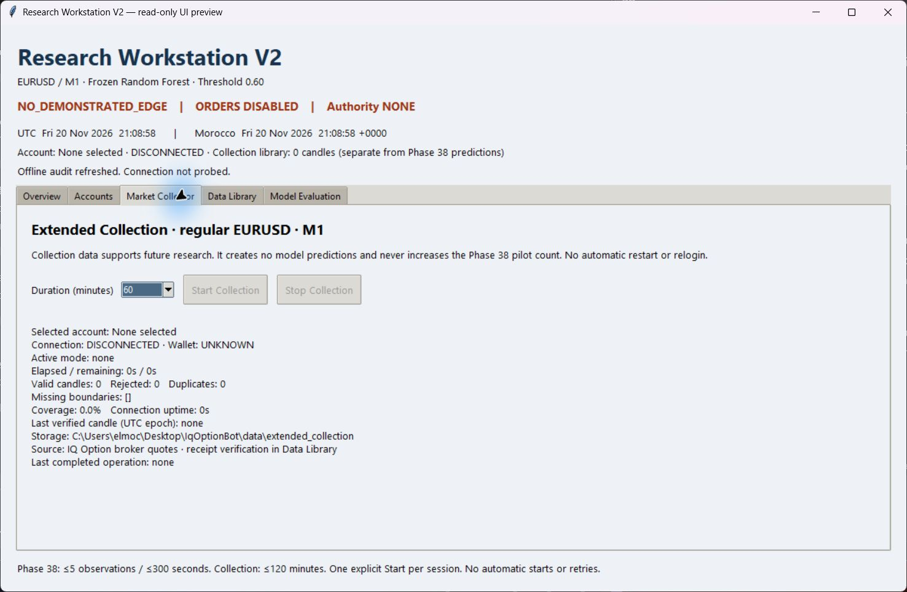

# Research Workstation V2

Double-click **Start-ResearchDashboard.cmd** from the repository, using the existing
Python 3.12 virtual environment. Close an older dashboard normally before launching
the upgraded one; one dashboard owns the live-process guard for this checkout.
No new dependencies, HTTP service, cloud service or frontend build are required.

The workstation has Overview, Accounts, Market Collector, Data Library and Model
Evaluation tabs. It starts disconnected. The existing Phase 38 Start Observation,
study identity, audit, recovery preview and schedule are now in **Model Evaluation**.
Phase 38 remains frozen at candidate_h1_rf, threshold 0.60, regular EURUSD M1,
five observations/300 seconds and its original dual-anchored registered windows.
The collector never contributes predictions or labels to the Phase 38 population.

## Accounts and migration

1. Open **Accounts**. Only masked labels and opaque account IDs leave the vault.
2. Choose **Add account**. A foreground local terminal asks for explicit storage
   consent and then hidden email/password entry. The dashboard never receives these
   values. This operation does not authenticate with IQ Option.
3. Select an account in the list. **Update credentials** uses the same operator-owned
   terminal. **Forget selected** asks for confirmation and removes the saved secret.
4. Enable **Remember selected account** to persist just the chosen identity for
   future explicit sessions. With it disabled, selection is cleared after each
   operation and must be made again; saved passwords remain securely in the vault.
5. Selecting an account does not select or switch the broker wallet. The actual
   wallet classification is shown when a connection reports it. In particular,
   CONFLICTING_ACCOUNT_INDICATORS is never presented as practice-verified.

The existing `WindowsCredentialVault` verifies the native Windows backend before
returning its account store. Its version-2 account index is itself a Windows Vault
entry (`__accounts_v2__` under the existing service), not a disk JSON file. Each
entry has a stable random UUID, an identity and a credential key; a separate index
field remembers an ID only. Malformed/unknown index versions fail closed.

On first index access, an existing legacy active-account identity is imported into
the index without reading or moving its password. The original credential entry
and legacy active pointer remain usable. Migration does not enable Remember Me.
New accounts use opaque credential keys. Updating a migrated identity keeps its ID;
changing the email removes the old secret/pointer after the replacement is committed.
Legacy CLI authentication remains supported, but use Accounts for multi-account
management after migration. An unavailable selected identity never falls back to
another saved account or to an interactive broker login.

Account and Remember Me mutations are disabled while a foreground operation or
observation launch is pending. The vault is scoped to the Windows user; it does not
protect against another malicious process already running as that same user.

## One extended collection

1. Select a saved account in Accounts.
2. Open **Market Collector**, select 15, 30, 60 or 120 minutes, and click
   **Start Collection** once. This authorizes exactly one bounded read-only connection.
3. Supervise its foreground terminal. The panel reports actual connection state,
   elapsed/remaining time, connection uptime, wallet classification, valid/rejected
   candles, duplicate boundaries, missing boundaries, coverage and storage destination.
4. **Stop Collection**, closing the dashboard, reaching the duration limit or a safety
   failure ends the session. Saved data is inspected in **Data Library** after exit.

The duration bounds the collector lifecycle, including authentication. The parent
has an independent deadline watchdog. Cancellation requests cooperative teardown;
after five seconds the existing Windows Job Object hard-termination fallback applies.
The child cannot authenticate until the parent has assigned it to that job. Crashing
the parent closes the job and terminates its children. No session, credential-based
relogin, subscription or reconnect loop is automatically started after completion.

Collection and Phase 38 use the same process controller, so they cannot overlap
within the dashboard. A separately launched CLI process remains outside the
dashboard's ownership; do not run one alongside it. After a session, account
selection is cleared unless Remember Me is enabled.

## Candle and provenance contract

The collector uses the existing market-data-only `AsyncIQOption` client with zero
reconnect attempts and unchanged read-only outgoing-frame restrictions. It makes
at most one bounded request per new completed-minute boundary, requesting three
candles to cover a small overlap. It uses the earlier local/broker clock with a
two-second plus uncertainty reserve. No OTC fallback is allowed.

The existing forward-sync validator is shared, not reimplemented. It checks regular
EURUSD identity/active ID 1, timeframe, timestamps, completeness, OHLC/volume/spread,
request-derived identity provenance and conflicts. Duplicate boundaries are counted
within each session; conflicting data cannot overwrite committed candles. An empty
or invalid page is rejected, and three consecutive quality failures stop collection.
Disconnects, auth failures, stale/invalid/stepped clocks and unverified provenance
fail closed. Clock uncertainty over five seconds is refused. Calendar checks do not
prove the broker instrument is currently available; real responses must verify it.

Each accepted request records its request ID, invocation time, actual observed
availability time, correlated receipt/parse/completion timing, broker clock freshness,
skew and uncertainty. The nominal candle close is **never** used as observed
availability. There are no invented candles, forecasts, scores or live-status values.
Raw broker payloads and exception bodies are not copied into collection reports.

## Storage and offline verification

Each unique session uses `data/extended_collection/collection_<uuid>/`:

- `session.json`: immutable hashed specification with start time, authorized end,
  selected duration, opaque account ID, instrument, source and research-only purpose.
- `datasets/`: existing immutable Parquet files and checksummed metadata sidecars.
- `catalog.db`: the existing DatasetCatalog contract, scoped to this collection.
- `receipts/<boundary>.json`: create-only, hashed records binding catalog entries,
  file fingerprints, collected boundaries and observed availability provenance.
- `state.json`: atomically replaced operational progress, including missing boundaries
  and quality rejections. It is not a substitute for committed evidence.
- `manifest.json`: create-only final receipt inventory, specification fingerprint,
  actual end time, termination reason, wallet status and final counters.

Parquet and catalog publication precede a receipt commit. Files are flushed before
the receipt is published; JSON uses temporary files plus atomic replacement or a
create-only hard link on the same local filesystem. Use local NTFS storage, not a
network drive with different atomicity semantics.

If a process dies between file publication and receipt commit, the files remain
on disk as **uncommitted**, explicitly listed in Data Library. Existing receipts
remain verifiable. No availability timestamp is synthesized to promote orphan files.
A missing final manifest is shown as active/interrupted partial evidence, never as
successful completion. Offline reopening reads and verifies the same records without
duplicating them, altering them or contacting the broker. SQLite is opened read-only
for inspection, and both file hashes and catalog bindings are checked.

Deduplication and coverage are session-scoped. Different manually started sessions
can contain overlapping market boundaries; library candle totals are stored session
records, not a claim of globally independent samples. Any future training dataset
must reconcile overlaps/conflicts and apply chronological splits and leakage checks.
Model Laboratory, model training and cross-session dataset merging are outside this PR.
SHA-256 provides local tamper evidence, not independent broker attestation/signatures.

## Market lifecycle and scheduled closure

1. **Scheduled market closure vs unexpected errors**: Regular interbank EURUSD follows
   the standard schedule (Sunday 17:00 to Friday 17:00 America/New_York, accounting
   for US/European daylight-saving transitions). At Friday 22:00 UTC (NY 17:00 in standard
   time), the market closes for the weekend. The collector raises a typed
   `ScheduledMarketClosure` exception rather than a generic `ValueError`.
2. **Clean session termination**: When scheduled closure is encountered during an active
   collection, the session terminates cleanly with `SCHEDULED_MARKET_CLOSURE`. Committed
   Parquet pages, catalog entries, receipts and the final `manifest.json` are preserved.
   It is never classified as `FAILED_ValueError` or an unexpected exception.
3. **Pre-flight duration refusal and explicit operator authorization**: Prior to launching
   a collection, `assess_duration_market_fit()` evaluates whether the requested duration (15, 30,
   60 or 120 minutes) extends beyond the next scheduled market close. If the requested duration
   crosses a scheduled market closure, the session is refused with an actionable message identifying
   the shorter supported durations (e.g. 15m, 30m) that fit before closure. The workstation never
   silently shortens the requested duration. In the CLI, proceeding with a shortened session requires
   explicit operator authorization via `--allow-shortened-session`. In the desktop UI, the operator
   is prompted with a confirmation dialogue explicitly stating the available minutes before market
   close. If the market is closed, collection is refused unconditionally.
4. **Calendar vs broker availability**: Calendar checks establish theoretical regular
   hours. Broker-side availability remains distinct and verified only by authenticated
   read-only candle responses. OTC instruments remain strictly forbidden.

## Termination reason taxonomy

Sessions terminate with one of the following explicit, typed or explicitly mapped, non-overlapping reasons:

- `DURATION_LIMIT`: The requested collection duration elapsed normally.
- `SCHEDULED_MARKET_CLOSURE`: Regular market closed on schedule; committed data preserved.
- `OPERATOR_CANCELLED`: Operator requested cancellation or closed the dashboard; partial data preserved.
- `BROKER_DISCONNECTED`: Broker WebSocket transport disconnected unexpectedly.
- `BROKER_CLOCK_UNAVAILABLE`: Initial clock synchronization timed out or failed.
- `STALE_OR_INVALID_BROKER_CLOCK`: Clock freshness check failed or a clock step was detected.
- `UNVERIFIED_BROKER_CLOCK`: Server time or uncertainty values were missing.
- `REPEATED_DATA_QUALITY_FAILURE`: Three consecutive candle quality rejections occurred.
- `FAILED_<ExceptionType>`: Unexpected runtime exception, sanitized of credentials and raw payloads.

## Coverage semantics, publication ordering, and desktop display

1. **Publication ordering and state consistency**: In `ExtendedCollection.finalize()`, every
   final operational field (`coverage_note`, `remaining_seconds=0.0`, `actual_elapsed_seconds`,
   `requested_minutes`, `connection="DISCONNECTED"`) is computed *before* publishing to `state.json`
   and the live status file, followed by writing the immutable `manifest.json`. This guarantees
   that `state.json`, `status_path`, and `manifest.json` are completely consistent.
2. **Observed-boundary coverage vs requested-duration completion**: When a session ends
   early (due to scheduled close, cancellation or error), its `coverage` metric represents
   the ratio of valid observed candles to expected 1-minute boundaries within the
   *actual elapsed* window. A `coverage_note` is recorded in the manifest, state, and status to make
   explicit that early termination does not represent requested-duration completion.
3. **Active vs historical metrics**: The desktop dashboard distinguishes active live
   sessions from historical/post-session views. When idle or post-session, metrics are
   explicitly labelled as `historical (last saved)` or `post-session (final)`. Actual
   elapsed seconds and requested duration are displayed together to prevent ambiguity.
4. **Human-readable timestamps**: All candle boundaries, last-verified candle markers
   and library summary date ranges are formatted as human-readable UTC datetime strings
   (e.g., `YYYY-MM-DD HH:MM:SS UTC`) rather than raw Unix epoch integers.
5. **Actionable dashboard errors**: Market calendar refusals and operational errors display
   clean, human-readable explanations instead of raw exception class names, with zero raw
   exception traceback or credential exposure.

## Wallet classification and ambiguity resolution

The workstation preserves `CONFLICTING_ACCOUNT_INDICATORS` whenever broker-supplied
account signals disagree. The classification logic never infers Practice-wallet verification,
never automatically switches wallets, and never changes broker account state.

To resolve `CONFLICTING_ACCOUNT_INDICATORS` without ambiguity, the following additional
read-only evidence is required:

1. A `balance-changed` event from the broker confirming the active wallet transition.
2. A single-balance `get-balance` request confirming the suspected wallet's `active` flag.
3. A `profile` message with `current_balance.id` matching the suspected wallet and `type`
   verifying practice (type=4) or real (type=1).

Until all three independent signals agree, the workstation maintains the fail-closed posture
and displays the ambiguity directly to the operator.

## Validation and remaining live acceptance

All development tests mock broker/authentication/subprocess boundaries. New tests
cover account migration and selection, explicit storage consent, insecure backends,
Remember Me, secret-free errors/arguments, bounded dispatch, process overlap/closure,
quality failures, duplicate/conflicting candles, clocks, partial publication,
offline reopening and a UI-to-CLI-to-storage path for a virtual 60-minute session.
That end-to-end fixture verifies unchanged Phase 38 counts and study-file hashes.
The PR includes full local and final-head Windows CI results.

No live broker session is required or was performed for development. After review
and CI acceptance, the operator should separately validate real login, instrument
availability, broker pacing, live clocks and a supervised extended session.

The screenshot below is an actual rendering of the revised Tkinter application in
an isolated read-only preview. An existing dashboard was left untouched; the preview
disabled all vault access and live dispatch and displayed real local Phase 38 evidence.
Its empty collection library is genuine; it contains no simulated collection data.

